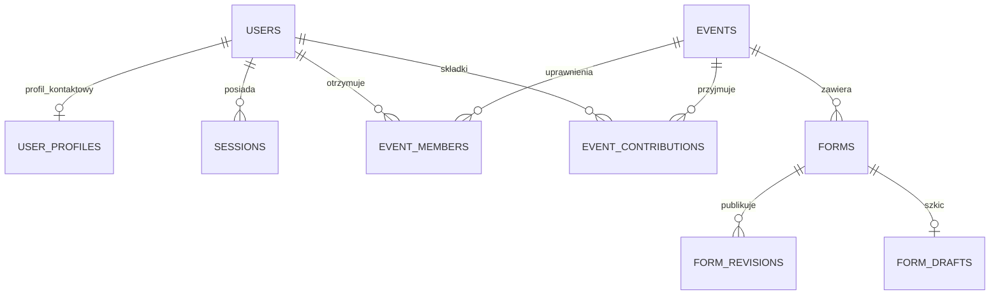
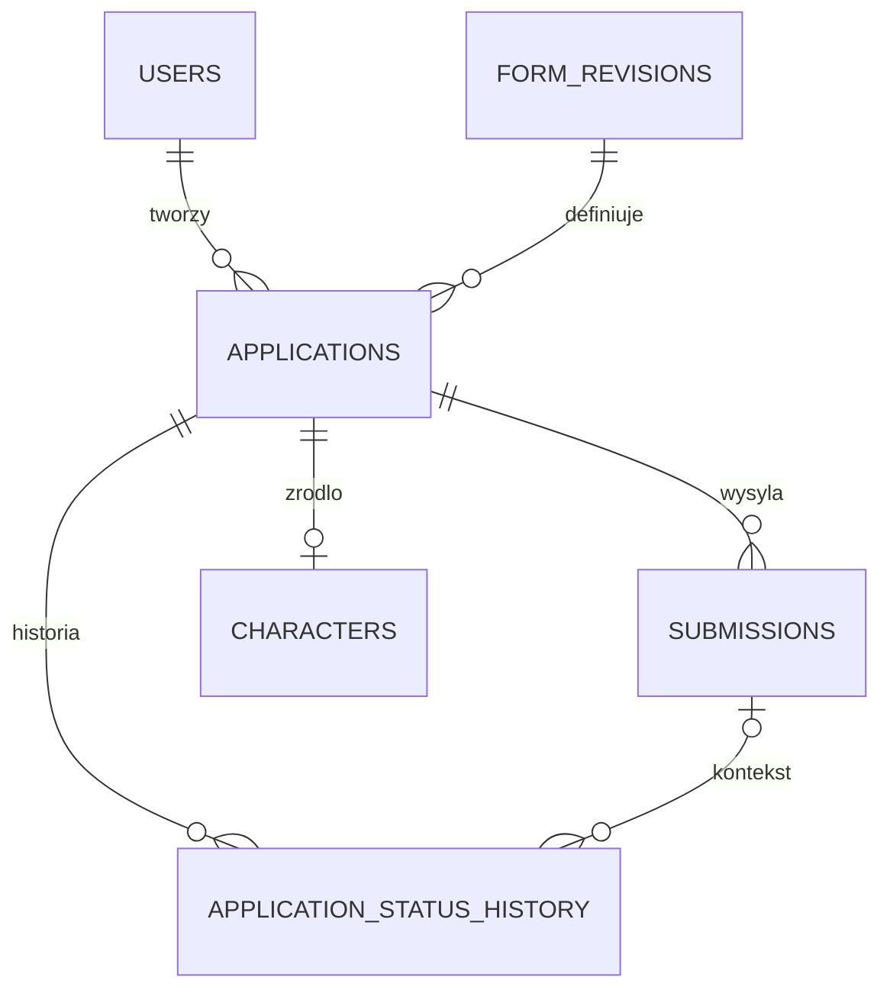
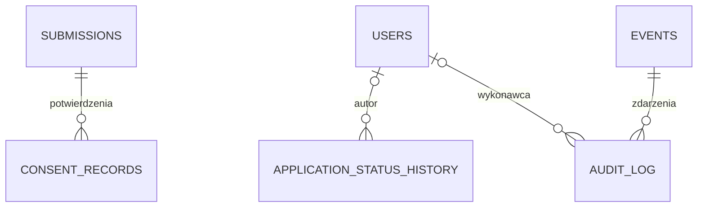
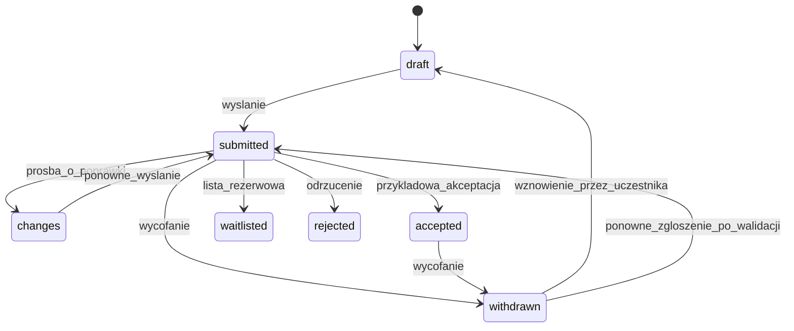

# Ursunalia — model danych, architektura i migracja

Audyt: 13.10.2026, HEAD `68737a8794e426d612fe54c03c88f6d431ba394e`. **Model docelowy jest rekomendacją do zatwierdzenia. SQL poniżej jest projektem, nie wykonaną migracją.** Uzupełnienie biznesowe 13.10.2026: przyjęcie przez akceptację ankiety postaci i ręcznie rejestrowana składka są zatwierdzone; siedem statusów i nieblokujące organizatora reguły zmian zostały zatwierdzone decyzjami C09/D18 i C10/D08. Dowody aktualnego stanu: [FUNCTIONAL_SPEC, mapa S1–S15](../product/FUNCTIONAL_SPEC.md#mapa-źródeł).

## 1. Stan obecny

SQLite ma cztery tabele, tworzone przy starcie przez `CREATE TABLE IF NOT EXISTS` w `server/server.mjs:35–47`:

| Tabela | Kolumny i ograniczenia | Znaczenie |
|---|---|---|
| users | id TEXT PK; name/email/password/role NOT NULL; email UNIQUE; role participant/organizer | Jedna globalna rola, hasło salt:hash; brak metadanych konta. |
| sessions | token_hash TEXT PK; user_id FK users ON DELETE CASCADE; expires INTEGER | Hash tokena; czas ważności jako epoch ms. |
| forms | (id TEXT, revision INTEGER) PK; definition TEXT NOT NULL | Każdy rekord jest wersją; Form i FormRevision nie są rozdzielone. |
| applications | id PK; user_id FK; form_id/form_revision FK forms; answers TEXT; status draft/submitted/accepted/changes; updated_at; submitted_at nullable; feedback; UNIQUE(user_id,form_id) | Szkic i wysłane zgłoszenie w tym samym rekordzie; JSON odpowiedzi, aktualna decyzja bez autora/historii. |

`PRAGMA foreign_keys=ON`, WAL. Brak jawnych dodatkowych indeksów, wersji schematu, CHECK json_valid i kontroli optimistic locking. PK/UNIQUE tworzą swoje indeksy. Event nie jest tabelą; pochodzi z JSON. `forms.eventId` jest tylko wewnątrz definicji, publikacja sprawdza równość z seed.event.id. Charakter postaci wynika z ID pól/formularza. Nie ma Review, Character, Consent, członków wydarzenia ani szkiców kreatora w SQLite.

TypeScript `Application` zawiera pełną definicję formularza, odpowiedzi, status i aktualny feedback. API rekonstruuje definicję z FK; nie ufa przesłanym polom definicji. To dobry fundament wersjonowania. `Answer = string | number | string[]`. Szkice kreatora: localStorage `ursunalia:builder:v27:<id>`, bez użytkownika/trybu. Szkice uczestnika demo mają osobny snapshot localStorage, stare postacie są importowane z sessionStorage (S2/S15).

Obecny model nie zapisuje:

- wcześniejszych decyzji, ich autorów/czasów ani poprzednich zestawów odpowiedzi;
- faktu osobnego potwierdzenia zgody na określony dokument;
- rzeczywistego uczestnictwa niezależnego od odpowiedzi na formularz;
- prywatności pola jako metadanej ani praw konkretnego organizatora;
- dat utworzenia historycznych kont i zgłoszeń.

Tych danych nie wolno wymyślić podczas migracji.

## 2. Rekomendowana architektura

**Modularny monolit:** Angular + jedno API Node 24 + SQLite na trwałym lokalnym dysku, jeden aktywny proces zapisujący, reverse proxy HTTPS. Jedna grupa organizatorska; bez `tenant_id`, tabel organizacji, brokera i orkiestracji.

| Moduł | Odpowiedzialność | Granica |
|---|---|---|
| Identity | Konto, hasła, sesje, odzyskanie dostępu oraz wspólny profil kontaktowy użytkownika | Kontakt wprowadzany podczas rejestracji konta, a nie powielany w ankietach wydarzenia; uprawnienia do odczytu zależą od wydarzenia. |
| Events/access | Metadane, terminy zapisów, EventMember i capabilities | Każde żądanie sprawdza wydarzenie i uprawnienia. Akceptacja wskazanego formularza daje udział. |
| Forms | Szkic, walidacja, publikacja niezmiennej rewizji | Nie przepisuje historycznych zgłoszeń. |
| Applications | Szkic, wersja zapisu, wysłanie i immutable snapshot | Nie pozwala organizatorowi zmieniać odpowiedzi uczestnika. |
| Status history / reviews | Historia wszystkich zmian statusu i decyzji organizatora; odnośnik do wysłanych odpowiedzi, jeśli istnieją | Nie udaje, że administracyjna zmiana statusu oznacza ocenę wysłanego formularza. |
| Characters | Opcjonalny profil fabularny i powiązanie z zaakceptowanym zgłoszeniem | Nie zawiera kontaktu, zgód ani granic uczestnika. |
| Privacy/operations | Ograniczone DTO, retencja, eksport, audyt, backup | Nie kopiuje treści poufnej do logów. |
| Contributions | Ręczne potwierdzenie otrzymania składki za przelew per wydarzenie i użytkownik | Bez operatora płatności, bez statusu płatności jako części decyzji fabularnej. |

Wdrożenie zacząć od wydzielenia funkcji serwisowych/polityk z obecnego `server.mjs`, bez zmiany frameworka. FE: oddzielić `AuthStore`, stan formularzy i roboczych zgłoszeń dopiero w zadaniach dotyczących tych obszarów; serwer nadal jest źródłem prawdy. Walidacja definicji/odpowiedzi pozostaje wspólna; autoryzacja wyłącznie serwerowa. Szablony kart mają korzystać z definicji, `kind` i jawnego mapowania semantyki, nie z porównania do `character-2027`.

Alternatywy:

| Wariant | Ocena |
|---|---|
| Zostać przy 4 tabelach i dopisać eventId w JSON | Krótszy patch, ale nie rozwiązuje integralności i historii; dopuszczalne tylko jako etap krótkiej stabilizacji. |
| Relacyjny rdzeń + wersjonowane JSON | **Rekomendowane**: proste zapytania o właściciela, wydarzenie, status; elastyczne pytania bez migracji dla każdej ankiety. |
| Każda odpowiedź jako osobny rekord EAV | Dodatkowe joiny, konwersje typów i migracje; brak obecnej potrzeby analitycznej uzasadniającej koszt. |
| PostgreSQL teraz | Możliwy później przy wielu procesach/większym obciążeniu; najpierw mierzyć SQLite. |
| Osobny backend Python | Kompetencje zespołu mogą uzasadnić kiedyś, ale teraz koszt przepisania działającej ścieżki i testów bez korzyści MVP. |

## 3. Encje i kardynalności

Zgłoszenie jest procesem odpowiedzi użytkownika na ankietę. Postać jest bytem fabularnym, który może powstać z zaakceptowanego zgłoszenia typu character. Ankieta organizacyjna nie tworzy postaci. **Dla Ursunaliów 2027 akceptacja ankiety postaci oznacza przyjęcie gracza do wydarzenia.** Uczestnictwo wyliczamy z aktywnego zaakceptowanego zgłoszenia ankiety oznaczonej `grants_admission=1`; dla Ursunaliów dotyczy to tylko ankiety postaci, nie logistyki. EventMember oznacza **uprawnienia zespołu**, nie obowiązkowy rekord każdego uczestnika. Składka jest niezależnym faktem rozliczeniowym per użytkownik i wydarzenie.

ERD podzielono na trzy czytelne fragmenty. Tabele techniczne prywatnych odpowiedzi pominięto na diagramach; SQL definiuje je jawnie.







Nie każda encja musi być wdrożona przed pilotażem: **Character oraz serwerowy FormDraft mogą wejść później** pod warunkami z roadmapy. Oddzielenie niezmiennego wysłania od szkicu i praw do danych poufnych jest potrzebne przed realnymi zapisami.

## 4. Projekt schematu SQLite

UUID/identyfikatory istniejące zachowujemy jako TEXT, nie zmieniamy ich na INTEGER. Daty techniczne: UTC ISO 8601 TEXT; sesje epoch ms dla kompatybilności. Dni wydarzenia `starts_on/ends_on` w formacie YYYY-MM-DD, bez wymyślania nieznanych godzin; okno zapisów używa timestampów UTC i wskazanej strefy do prezentacji. `created_at` danych historycznych nullable, z jawnym `imported_at`. JSON jako TEXT z walidacją runtime i CHECK; żadnego kodu wykonywalnego w definicji. SQLite musi wspierać JSON functions (zweryfikować w docelowym Node).

Poniższy DDL to **docelowy schemat świeżej bazy** służący przeglądowi. Nie uruchamiać go na bazie v27; plan migracji opisano osobno. Rozdzielone prywatne tabele utrudniają przypadkowy `SELECT *`/serializację, ale same nie stanowią kontroli dostępu.

```sql
PRAGMA foreign_keys = ON;

CREATE TABLE schema_migrations (
  version INTEGER PRIMARY KEY,
  applied_at TEXT NOT NULL,
  checksum TEXT NOT NULL
);

CREATE TABLE users (
  id TEXT PRIMARY KEY NOT NULL,
  name TEXT NOT NULL,
  email TEXT NOT NULL COLLATE NOCASE UNIQUE,
  password_hash TEXT NOT NULL,
  password_scheme TEXT NOT NULL,
  platform_role TEXT NOT NULL DEFAULT 'user'
    CHECK(platform_role IN ('user','admin')),
  created_at TEXT,
  imported_at TEXT,
  disabled_at TEXT
);

-- Globalny profil kontaktowy jest wspólny dla wszystkich wydarzeń.
-- Pola contact phone/fb/discord pozostają nullable w projekcie DDL;
-- o obowiązkowości telefonu decydujemy oddzielnie. Istniejące users.name
-- zachować bez automatycznego rozbijania go na first_name/last_name.
CREATE TABLE user_profiles (
  user_id TEXT PRIMARY KEY NOT NULL REFERENCES users(id) ON DELETE CASCADE,
  first_name TEXT,
  last_name TEXT,
  phone TEXT,
  facebook TEXT,
  discord TEXT,
  updated_at TEXT NOT NULL
);

CREATE TABLE sessions (
  token_hash TEXT PRIMARY KEY NOT NULL,
  user_id TEXT NOT NULL REFERENCES users(id) ON DELETE CASCADE,
  expires_at_ms INTEGER NOT NULL,
  created_at TEXT
);
CREATE INDEX sessions_user ON sessions(user_id);
CREATE INDEX sessions_expiry ON sessions(expires_at_ms);

CREATE TABLE events (
  id TEXT PRIMARY KEY NOT NULL,
  slug TEXT NOT NULL UNIQUE,
  name TEXT NOT NULL,
  starts_on TEXT NOT NULL,
  ends_on TEXT NOT NULL,
  timezone TEXT NOT NULL DEFAULT 'Europe/Warsaw',
  registration_status TEXT NOT NULL DEFAULT 'closed'
    CHECK(registration_status IN ('closed','open','paused')),
  opens_at TEXT,
  closes_at TEXT,
  description TEXT NOT NULL DEFAULT '',
  location_text TEXT NOT NULL DEFAULT '',
  archived_at TEXT,
  CHECK(ends_on >= starts_on),
  CHECK(opens_at IS NULL OR closes_at IS NULL OR closes_at >= opens_at)
);

CREATE TABLE event_members (
  event_id TEXT NOT NULL REFERENCES events(id),
  user_id TEXT NOT NULL REFERENCES users(id),
  role TEXT NOT NULL CHECK(role IN ('head_organizer','manager','storyteller','reviewer','safety')),
  can_read_story INTEGER NOT NULL DEFAULT 0 CHECK(can_read_story IN (0,1)),
  can_read_social_contacts INTEGER NOT NULL DEFAULT 0 CHECK(can_read_social_contacts IN (0,1)),
  can_read_private_contacts INTEGER NOT NULL DEFAULT 0 CHECK(can_read_private_contacts IN (0,1)),
  can_read_identity INTEGER NOT NULL DEFAULT 0 CHECK(can_read_identity IN (0,1)),
  can_read_sensitive INTEGER NOT NULL DEFAULT 0 CHECK(can_read_sensitive IN (0,1)),
  can_read_health INTEGER NOT NULL DEFAULT 0 CHECK(can_read_health IN (0,1)),
  can_review_applications INTEGER NOT NULL DEFAULT 0 CHECK(can_review_applications IN (0,1)),
  can_manage_members INTEGER NOT NULL DEFAULT 0 CHECK(can_manage_members IN (0,1)),
  can_export INTEGER NOT NULL DEFAULT 0 CHECK(can_export IN (0,1)),
  can_manage_contributions INTEGER NOT NULL DEFAULT 0 CHECK(can_manage_contributions IN (0,1)),
  PRIMARY KEY(event_id,user_id)
);

CREATE TABLE forms (
  id TEXT PRIMARY KEY NOT NULL,
  event_id TEXT NOT NULL REFERENCES events(id),
  kind TEXT NOT NULL CHECK(kind IN ('character','logistics','generic')),
  grants_admission INTEGER NOT NULL DEFAULT 0 CHECK(grants_admission IN (0,1)),
  status TEXT NOT NULL DEFAULT 'draft'
    CHECK(status IN ('draft','published','closed','archived')),
  current_revision INTEGER,
  max_per_user INTEGER DEFAULT 1 CHECK(max_per_user IS NULL OR max_per_user > 0),
  UNIQUE(id,event_id),
  FOREIGN KEY(id,current_revision) REFERENCES form_revisions(form_id,revision)
    DEFERRABLE INITIALLY DEFERRED
);

CREATE TABLE form_revisions (
  form_id TEXT NOT NULL REFERENCES forms(id),
  revision INTEGER NOT NULL CHECK(revision > 0),
  schema_version INTEGER NOT NULL CHECK(schema_version > 0),
  definition_json TEXT NOT NULL CHECK(json_valid(definition_json) AND json_type(definition_json)='object'),
  content_hash TEXT NOT NULL,
  published_by TEXT REFERENCES users(id),
  published_at TEXT,
  imported_at TEXT,
  PRIMARY KEY(form_id,revision)
);

CREATE TABLE form_drafts (
  form_id TEXT PRIMARY KEY NOT NULL REFERENCES forms(id),
  base_revision INTEGER,
  draft_json TEXT NOT NULL CHECK(json_valid(draft_json) AND json_type(draft_json)='object'),
  lock_version INTEGER NOT NULL DEFAULT 1 CHECK(lock_version > 0),
  updated_by TEXT NOT NULL REFERENCES users(id),
  updated_at TEXT NOT NULL,
  FOREIGN KEY(form_id,base_revision) REFERENCES form_revisions(form_id,revision)
);

CREATE TABLE applications (
  id TEXT PRIMARY KEY NOT NULL,
  event_id TEXT NOT NULL,
  user_id TEXT NOT NULL REFERENCES users(id),
  form_id TEXT NOT NULL,
  form_revision INTEGER NOT NULL,
  slot INTEGER NOT NULL DEFAULT 1 CHECK(slot > 0),
  status TEXT NOT NULL CHECK(status IN (
    'draft','submitted','accepted','changes',
    'waitlisted','rejected','withdrawn'
  )),
  answers_json TEXT NOT NULL CHECK(json_valid(answers_json) AND json_type(answers_json)='object'),
  lock_version INTEGER NOT NULL DEFAULT 1 CHECK(lock_version > 0),
  created_at TEXT,
  updated_at TEXT NOT NULL,
  imported_at TEXT,
  current_submission_id TEXT,
  legacy_feedback TEXT,
  UNIQUE(user_id,form_id,slot),
  UNIQUE(id,event_id,user_id),
  FOREIGN KEY(form_id,event_id) REFERENCES forms(id,event_id),
  FOREIGN KEY(form_id,form_revision) REFERENCES form_revisions(form_id,revision),
  FOREIGN KEY(current_submission_id,id) REFERENCES submissions(id,application_id)
    DEFERRABLE INITIALLY DEFERRED
);

CREATE TABLE application_sensitive_answers (
  application_id TEXT PRIMARY KEY NOT NULL REFERENCES applications(id) ON DELETE CASCADE,
  answers_json TEXT NOT NULL CHECK(json_valid(answers_json) AND json_type(answers_json)='object')
);

CREATE TABLE submissions (
  id TEXT PRIMARY KEY NOT NULL,
  application_id TEXT NOT NULL REFERENCES applications(id),
  attempt INTEGER NOT NULL CHECK(attempt >= 0),
  source TEXT NOT NULL DEFAULT 'submitted' CHECK(source IN ('submitted','legacy_current')),
  answers_json TEXT NOT NULL CHECK(json_valid(answers_json) AND json_type(answers_json)='object'),
  submitted_at TEXT,
  captured_at TEXT NOT NULL,
  idempotency_key TEXT,
  UNIQUE(application_id,attempt),
  UNIQUE(id,application_id),
  UNIQUE(application_id,idempotency_key),
  CHECK(source='legacy_current' OR (attempt > 0 AND submitted_at IS NOT NULL AND idempotency_key IS NOT NULL))
);

CREATE TABLE submission_sensitive_answers (
  submission_id TEXT PRIMARY KEY NOT NULL REFERENCES submissions(id) ON DELETE CASCADE,
  answers_json TEXT NOT NULL CHECK(json_valid(answers_json) AND json_type(answers_json)='object')
);

CREATE TABLE application_status_history (
  id TEXT PRIMARY KEY NOT NULL,
  application_id TEXT NOT NULL REFERENCES applications(id),
  submission_id TEXT,
  actor_user_id TEXT REFERENCES users(id),
  previous_status TEXT CHECK(previous_status IS NULL OR previous_status IN (
    'draft','submitted','changes','accepted','waitlisted','rejected','withdrawn'
  )),
  new_status TEXT NOT NULL CHECK(new_status IN (
    'draft','submitted','changes','accepted','waitlisted','rejected','withdrawn'
  )),
  source TEXT NOT NULL CHECK(source IN ('participant_action','organizer_override','legacy_current')),
  reason TEXT NOT NULL DEFAULT '',
  recorded_at TEXT NOT NULL,
  FOREIGN KEY(submission_id,application_id) REFERENCES submissions(id,application_id),
  CHECK(source='legacy_current' OR actor_user_id IS NOT NULL)
);
CREATE TABLE characters (
  id TEXT PRIMARY KEY NOT NULL,
  event_id TEXT NOT NULL,
  owner_user_id TEXT NOT NULL,
  source_application_id TEXT NOT NULL UNIQUE,
  source_submission_id TEXT NOT NULL,
  name TEXT NOT NULL,
  profile_json TEXT NOT NULL CHECK(json_valid(profile_json) AND json_type(profile_json)='object'),
  created_at TEXT NOT NULL,
  FOREIGN KEY(source_application_id,event_id,owner_user_id)
    REFERENCES applications(id,event_id,user_id),
  FOREIGN KEY(source_submission_id,source_application_id)
    REFERENCES submissions(id,application_id)
);

CREATE TABLE consent_records (
  id TEXT PRIMARY KEY NOT NULL,
  submission_id TEXT NOT NULL REFERENCES submissions(id),
  statement_key TEXT NOT NULL,
  document_version TEXT NOT NULL,
  statement_hash TEXT NOT NULL,
  statement_text TEXT NOT NULL,
  response INTEGER NOT NULL CHECK(response IN (0,1)),
  recorded_at TEXT NOT NULL,
  source TEXT NOT NULL CHECK(source IN ('submitted','legacy_unverified')),
  withdrawn_at TEXT,
  UNIQUE(submission_id,statement_key)
);

-- MVP: potwierdzenie składki przelewem, dokonywane ręcznie przez organizatora.
-- Brak rekordu oznacza brak potwierdzenia. Nie przechowujemy rachunku bankowego,
-- potwierdzenia przelewu ani danych nadawcy przelewu.
CREATE TABLE event_contributions (
  event_id TEXT NOT NULL REFERENCES events(id),
  user_id TEXT NOT NULL REFERENCES users(id),
  is_paid INTEGER NOT NULL DEFAULT 0 CHECK(is_paid IN (0,1)),
  confirmed_at TEXT,
  confirmed_by TEXT REFERENCES users(id),
  updated_at TEXT NOT NULL,
  PRIMARY KEY (event_id,user_id),
  CHECK (
    (is_paid=0 AND confirmed_at IS NULL AND confirmed_by IS NULL) OR
    (is_paid=1 AND confirmed_at IS NOT NULL AND confirmed_by IS NOT NULL)
  )
);

CREATE TABLE audit_log (
  id TEXT PRIMARY KEY NOT NULL,
  event_id TEXT REFERENCES events(id),
  actor_user_id TEXT REFERENCES users(id),
  action TEXT NOT NULL,
  entity_type TEXT NOT NULL,
  entity_id TEXT NOT NULL,
  occurred_at TEXT NOT NULL,
  metadata_json TEXT NOT NULL DEFAULT '{}'
    CHECK(json_valid(metadata_json) AND json_type(metadata_json)='object')
);

CREATE INDEX forms_event_status ON forms(event_id,status);
CREATE INDEX applications_owner_event ON applications(user_id,event_id,updated_at DESC);
CREATE INDEX applications_review_queue ON applications(event_id,status,updated_at DESC);
CREATE INDEX applications_revision ON applications(form_id,form_revision);
CREATE INDEX application_status_history_time ON application_status_history(application_id,recorded_at);
CREATE INDEX audit_event_time ON audit_log(event_id,occurred_at);
```

Wzajemne FK forms/revisions oraz applications/submissions są świadome i odroczone. Tworzenie formularza, rewizji i ustawienie wskazania następuje w transakcji. Zgłoszenie draft ma null current_submission_id; wysłanie wstawia snapshot i aktualizuje wskaźnik atomowo. To są obowiązkowe testy U09/U11, nie założenie o automatycznym działaniu SQL.

### Inwarianty aplikacyjne poza DDL

1. W jednej transakcji sprawdzić role, stan, okno zapisów, rewizję, limity i lock_version; zaktualizować rekord warunkowym UPDATE. Zero zmienionych wierszy → 409. Nigdy sam SELECT, a potem bezwarunkowy zapis.
2. `slot <= max_per_user`, gdy limit nie-null. MVP: slot=1 i max_per_user=1. Limit dotyczy wszystkich zachowanych zgłoszeń, także draft; obniżenie limitu nie usuwa istniejących danych. Większe limity i limity wspólne dla kilku formularzy to osobne rozszerzenie po wydarzeniu. Jeśli wymagany będzie limit wydarzenia, dodać politykę w Event z jawną jednostką (np. liczba postaci na osobę albo liczba przyjętych uczestników), a sprawdzenie wykonać w tej samej transakcji co utworzenie/akceptacja. Nie utożsamiać pojemności imprezy z liczbą wszystkich ankiet — jedna osoba wypełnia kilka formularzy.
3. Nowy szkic wskazuje bieżącą opublikowaną rewizję i dostępne wydarzenie. Istniejący szkic pozostaje przypięty do swojej rewizji. Niedozwolona zmiana form_id/form_revision/user/event przez update.
4. `definition_json` musi być zgodne z relacyjnym ID/revision/event. Prywatne i zwykłe answers są rozłączne; suma kluczy zgodna z definicją. Brak cichego usuwania danych przy migracji.
5. `FormRevision` i `Submission` nie są edytowalne przez zwykłe API. Retencja/usunięcie to osobny, audytowany proces. Zmiana polityki poufności może zaostrzyć dostęp do starego pola bez przepisywania jego treści.
6. **Decyzja C10/D08:** uprawniony organizator może z każdego statusu ustawić dowolny inny (również `draft → accepted`, `changes → accepted`, `rejected → submitted` i `withdrawn → accepted`). Zmiana statusu rejestruje poprzedni/nowy status, aktora, czas i opcjonalny powód, z odnośnikiem do ostatniego prawdziwego wysłania, jeżeli istnieje. Jeśli nie ma wysłania, zdarzenie `organizer_override` ma `submission_id=NULL` i nie udaje wysłanych odpowiedzi. UI ostrzega przed nietypową zmianą, nie blokując decyzji. Uczestnik może wznowić `withdrawn` i ponownie wysłać tę samą Application, bez utraty ID, danych i historii. Zachowujemy kontrolę dostępu oraz ochronę przed nadpisaniem zmian z innej karty.
7. Character tylko dla `kind=character`, na podstawie realnego snapshotu wysłania; `accepted` nadane ręcznie bez wcześniejszego wysłania nadaje uczestnictwo, lecz nie tworzy fikcyjnego snapshotu ani Character. Nie kopiować prywatnych odpowiedzi, potrzeb ani zgód do profilu.
8. AuditLog zawiera nazwy operacji, ID i wyniki, nie hasła, tokeny, answers, portrety ani pełne treści feedback. Może zawierać hash/wersję operacji i request_id.

## 5. Odpowiedzi, kategorie, obrazy i zgody

Definicja JSON dostaje `schemaVersion`, formularz relacyjny `kind`. Pole może mieć `semanticKey` (np. character.name, character.traits, character.hooks) oraz `dataClass`: `fiction`, `organization`, `sensitive`, `statement`. To klasyfikacja serwerowa ze sprawdzonej definicji, nigdy z żądania uczestnika. W pierwszym wdrożeniu nowe niesklasyfikowane textarea/file mają ostrożną klasę sensitive do decyzji managera; publikacja wymaga świadomego oznaczenia. To zapobiega pominięciu nowego pola „inne potrzeby”.

Dotychczasową rewizję zachować bajtowo i hashować. Klasyfikację starych pól można utrzymać w wersjonowanej polityce serwera `(form_id, revision, field_id)` podczas przejścia. `boundaries`, `exclusions`, `needs` trafiają do prywatnej części. Edytowalna przez klienta etykieta nie może poluzować polityki. Użytkownik widzi własne odpowiedzi; organizator dostaje DTO filtrowane przed serializacją.

`traits` i `hooks` pozostają odrębnymi kolekcjami wyborów, ze stabilnymi ID. Opcjonalne `category`/`polarity` w opcji mogą wspierać zatwierdzoną regułę cech. Nie przenosić treści istniejących kategorii automatycznie. Proste pola i JSON wystarczą przed wydarzeniem; graf relacji postaci odłożyć.

Portret w MVP może pozostać w JSON, jeśli ograniczono go do jednego pola, zweryfikowano dekodowanie/typ/rozmiar/piksele, usunięto zbędne metadane i pominięto obrazy w listach. Przechowywanie plików osobno to U27 po pomiarach. Kopie i eksporty obejmują także obrazy; rozdzielenie plików oznacza konieczność spójnej kopii DB+assets.

`consent_records` oznacza ślad odpowiedzi na wersjonowane oświadczenie, nie automatyczne uznanie podstawy prawnej za „zgodę”. `statement_key` rozróżnia regulamin, przekazanie danych i potwierdzenie poprawności. Wersja/hash odnoszą się do pełnej treści podanej uczestnikowi. Dobrowolne oświadczenie zapisuje faktyczne response, nie wynik walidacji pola. Wycofanie oświadczenia obsługuje zatwierdzona procedura i nie przepisuje wysłanego formularza. Historyczne checkboxy można oznaczyć tylko `legacy_unverified`.

## 6. Uprawnienia i minimalizacja

**Ustalenie C11/C12 (D03 częściowo):** dane kontaktowe zbierane podczas rejestracji konta są własnością profilu globalnego `users/user_profiles`, a nie powielanym fragmentem każdej aplikacji. Zgłoszenia i dane fabularne dotyczą wybranego wydarzenia. Organizator może odczytywać profil wyłącznie w kontekście osób powiązanych z jego wydarzeniem; dostęp do wydarzenia nie otwiera globalnej listy kont. Zmiana globalnego profilu przez właściciela aktualizuje dane używane w przyszłych wydarzeniach, lecz nie zmienia historycznych snapshotów formularzy.

Wewnętrzny podział profilu: `first_name/last_name` (tożsamość rzeczywista), `email/phone` (kontakty prywatne), `facebook/discord` (kontakty społecznościowe, opcjonalnie podane). Słowo „publiczne” w tym kontekście **nie oznacza automatycznej publikacji FB/Discord wszystkim graczom ani w internecie**. Wspólne `users.email` służy także do logowania, ale jego użycie nie daje uprawnienia do wyświetlania go organizatorowi.

| Rola / przypadek | Informacje fabularne | FB i Discord (jeśli podane) | E-mail i telefon | Imię i nazwisko | Triggery i wykluczenia | Alergie / zdrowie |
|---|---|---|---|---|---|---|
| Właściciel danych | Własne | Własne | Własne | Własne | Własne | Własne |
| Główny organizator wydarzenia | Tak | Tak | Tak | Tak | Tak | Tak |
| Fabularzysta (domyślnie) | Według nadanego zakresu fabularnego | Tak | Nie | Nie | Nie | Nie |
| Inni organizatorzy | Według jawnych uprawnień | Według jawnych uprawnień | Według jawnych uprawnień | Według jawnych uprawnień | Według jawnych uprawnień | Według jawnych uprawnień |

**Reguła roli głównego organizatora:** rola `head_organizer` ma pełny odczyt danych uczestników w obrębie powierzonego wydarzenia i zarządzanie uprawnieniami zespołu, bez odczytu haseł, hashy czy tokenów sesji. Inne role otrzymują jawne capabilities; samo `manager` lub `storyteller` nie oznacza pełnego dostępu. Domyślnie fabularzysta z kontaktów widzi tylko FB i Discord; jego dostęp do fabuły przyznajemy osobno. Można nadawać/odbierać prawa konkretnej osobie przy wydarzeniu. Wdrożenie powinno mieć bezpieczną ścieżkę przekazania/odtworzenia roli głównego organizatora z pełnym audytem.

Proponowane capabilities: `can_read_story`, `can_read_social_contacts`, `can_read_private_contacts`, `can_read_identity`, `can_read_sensitive` (granice i relacje interpersonalne), `can_read_health` (szczególna ochrona), `can_review_applications`, `can_manage_members`, `can_manage_contributions`, `can_export`. Uprawnienia sprawdzać przed serializacją pól w API, w listach, widokach szczegółów i eksportach. Domyślnie brak dostępu. Posiadacz prawa `can_export` nie może wyeksportować pól, do których brak mu prawa odczytu.

**Do uzgodnienia:** kto oprócz głównego organizatora widzi dane dotyczące zdrowia, granic i wykluczeń; czy uczestnicy wzajemnie widzą podane FB/Discord; czy telefon jest polem obowiązkowym przy rejestracji. Zdrowotne informacje o alergiach i urazach nie są tym samym, co zwykłe dane kontaktowe; wymagają adekwatnej podstawy prawnej, minimalizacji i szczególnej ochrony. Konkretna podstawa i retencja podlegają przeglądowi przed zbieraniem realnych danych (D06/U19).

Historia nadawania i odbierania uprawnień oraz dostępu/eksportu danych wrażliwych ma nie ujawniać treści odpowiedzi. Brak automatycznego przeniesienia globalnego uprawnienia głównego organizatora do wszystkich przyszłych wydarzeń. Operacyjny administrator serwera z dostępem do bazy pozostaje odrębnym poziomem infrastrukturalnym.


## 7. Statusy, wersje i kontrakty



**Diagram przedstawia rekomendowane ścieżki, NIE ograniczenia API dla organizatora.** Decyzja C10/D08: organizator z uprawnieniem oceny może zmienić status z każdego z siedmiu stanów na każdy inny. Także `draft → accepted`, `withdrawn → waitlisted` i `rejected → accepted` są dozwolone. UI może pokazać ostrzeżenie i żądać potwierdzenia, lecz nie blokuje zmiany statusu z powodu poprzedniego stanu. Zgłoszenie wycofane można wznowić i ponownie wysłać, zachowując jego ID i wszystkie wcześniejsze wysłania; wycofanie nie jest usunięciem. Administracyjne nadanie statusu bez wysłanego snapshotu otrzymuje jawny wpis historii z pustym `submission_id`; nie należy sugerować, że oceniono robocze odpowiedzi. `accepted` oznacza przyjęcie na wydarzenie **wyłącznie** dla formularza z `grants_admission=1`; nie potwierdza wpłaty ani fizycznej obecności.
**Oś składki jest niezależna od statusu zgłoszenia:** pole `event_contributions.is_paid` może zmienić tylko uprawniony organizator po ręcznej weryfikacji przelewu. Brak rekordu = „Niepotwierdzona”. Zmiana wymaga audytu (kto, kiedy, poprzednia i nowa wartość); wycofanie potwierdzenia nie anuluje automatycznie udziału. Kwoty, zwolnienia i zwroty – otwarta decyzja D19, nie rozbudowywać obecnego schematu bez zatwierdzenia.

Publikacja formularza tworzy nowy numer i hash. Nie zmienia definicji starej rewizji. FormDraft ma `base_revision` i `lock_version`; konflikt publikacji lub zapisu daje 409 i porównanie. Jedna wspólna wersja robocza na formularz wystarczy bez współedycji w czasie rzeczywistym. Nowy import ma jawne tryby „nowa ankieta” i „nowa wersja istniejącej”; pierwszy generuje nowe form.id.

Proponowane zmiany API (niezaimplementowane):

- bootstrap: metadane wydarzenia i zwięzłe listy; `/events/:id/forms`, bez masowego ładowania obrazów;
- zapis draft: ID + expectedVersion + answers, serwer sprawdza właściciela i klasę danych;
- submit: expectedVersion + idempotencyKey; powtórzenie tego samego klucza zwraca ten sam wynik; status i snapshot w jednej transakcji;
- organizer status: `applicationId + expectedVersion + newStatus + opcjonalny powód`; organizator ma dostęp do wszystkich siedmiu wartości niezależnie od statusu źródłowego. Przy istniejącym wysłaniu historia może wskazywać prawdziwy snapshot, a bez wysłania jawnie zapisuje `organizer_override` z `submission_id=NULL`; sugestie UI nie są blokadami API.
- organizer list: filtry wydarzenia/formularza/statusu i cursor/limit; osobne detale i kontrolowany eksport; status przyjęcia użytkownika wyliczony z uprawnionego zgłoszenia oraz osobny status ręcznie potwierdzonej składki;
- organizer contribution: odczyt/zmiana flagi `is_paid` dla pary `(event_id,user_id)` wyłącznie z `can_manage_contributions`; rejestrowanie w audit_log; bez bramki bankowej;
- wspólny błąd `{code,message,fieldErrors?,currentVersion?,requestId}`; 401/403/404/409/413/422 obsługiwane jawnie przez frontend.

Nie utrzymywać na stałe dwóch API. Podczas krótkiego wdrożenia można zastosować adapter starych DTO; dla serwera i klienta w jednej wersji wdrożenie atomowe jest prostsze. Stare buildy/cache muszą dostawać czytelny błąd wersji i prośbę odświeżenia, nie cicho nadpisywać danych.

**Zadania realizujące tę część modelu:** U30 (statusy/przyjęcie), U31 (ręczne składki), przy zależnościach U09/U11/U14. Szczegóły kryteriów akceptacji – [BACKLOG](../planning/BACKLOG.md).

## 8. Plan migracji bez utraty informacji

### M0 — inwentaryzacja i kopia

1. Ustalić, czy istnieje produkcyjna baza i prawdziwe zgłoszenia (w audycie brak dostępu do takiej bazy). Pobrać liczniki i metadane bez niepotrzebnej ekspozycji treści.
2. Oznaczyć wersję kodu, schematu i konfiguracji; zaplanować okno maintenance. Nie zmieniać `.env` w audycie.
3. Wykonać spójną kopię SQLite Online Backup albo zatrzymać proces i skopiować pełny zestaw plików bazy po bezpiecznym zamknięciu. **Nie kopiować wyłącznie .sqlite podczas aktywnego WAL.**
4. W izolacji otworzyć kopię, wykonać integrity_check i foreign_key_check, porównać liczby kont, sesji, form/revisions, zgłoszeń i odpowiedzi. Ograniczyć dostęp i szyfrować kopię zgodnie z wybraną infrastrukturą.
5. Zebrać lokalne szkice organizatorów przez jawny eksport każdego urządzenia. Nie można ich odzyskać migracją serwera. Demo uczestników nie importować automatycznie do cudzych kont.

### M1 — stabilizacja bez zmiany domeny

Najpierw U01/U02/U03/U04/U06/U07: rozróżnienie administracyjnej zmiany statusu od oceny wysłanych odpowiedzi, konflikt zapisu, kompletność widoków i walidacja. Dodanie lock_version ma migrację addytywną z default 1. Nie zmieniać ID, hashy haseł ani rewizji. Ograniczyć zbieranie poufnych danych do czasu U05.

### M2 — wydarzenie i definicje

1. Na kopii utworzyć nowy schemat pod nazwami przejściowymi. Zachować wszystkie users.id i stare hashe dokładnie; oznaczyć `password_scheme='scrypt-legacy'`. Email już jest normalizowany przez rejestrację; konflikt przy zmianie collation zgłosić, nie scalać kont.
2. Utworzyć jedno Event `ursunalia-2027`, starts_on=2027-04-22, ends_on=2027-04-24. Nie wymyślać godzin rozpoczęcia i zakończenia. Terminy zapisów wymagają D01; opens_at/closes_at pozostają null, publiczne zapisy domyślnie closed.
2a. Dodać profile kont globalne: zachować istniejące `users.name` oraz email i hash hasła; nie rozcinać automatycznie starego `name` na imię i nazwisko bez potwierdzenia uczestnika. Brakujące dane kontaktowe uzupełnia użytkownik w swoim profilu; zachować niezależność profilu od zgłoszeń wydarzenia. Migracja danych profilu ma własne testy i kopię.
3. Każde stare forms.id → nowy Form; każda para id/revision → FormRevision. Definition JSON zachować bez kosmetycznego przepisywania. Hash wyliczyć z zachowanych bajtów; bez utraty wersji. kind z zatwierdzonej mapy, nie „pierwsza ankieta”. Dla Ursunaliów mapowanie: `character-2027` → `kind=character,grants_admission=1`; `logistics-2027` → `kind=logistics,grants_admission=0`. Zmiana `grants_admission` po przyjęciu zgłoszeń wymaga jawnej migracji/polityki, nie zwykłej edycji ankiety.
4. Ustawić current_revision na największą istniejącą; sprawdzić niezgodności statusów/eventId przed aktywacją. Wszystkie istniejące applications zachowują ID, user, form, revision, status i znaczniki czasu.
5. Dotychczasowych organizer przypisać do Ursunaliów; rolę `head_organizer` i prawa dostępu do tożsamości, prywatnych/social kontaktów, granic, zdrowia i eksportu nadać imiennie w ramach wydarzenia. Nie nadawać ich automatycznie na przyszłe wydarzenia. Rolę administratora platformy wskazuje właściciel.

### M3 — odpowiedzi, wysłania i aktualne decyzje

1. Zachować pełną oryginalną answers w zaszyfrowanej kopii migracyjnej na czas zatwierdzonej retencji. Rozdzielić zwykłe i poufne klucze zgodnie z zatwierdzoną mapą. Porównać sumę kluczy i wartości z oryginałem; nieznany klucz zatrzymuje migrację do przeglądu, zamiast zostać odrzucony przez cleanAnswers.
2. Draft nie tworzy historycznego wysłania. Dla submitted/accepted/changes utworzyć `legacy_current`, attempt=0, captured_at=czas migracji; zachować stare submitted_at jako informację źródłową.
3. **Dla changes obecne answers mogą już być poprawionym szkicem.** Nie nazywać ich oryginalnymi odpowiedziami ocenionymi wcześniej. UI historii oznacza „stan zastany podczas migracji; poprzednie wysłanie niedostępne”.
4. Aktualne accepted/changes przenieść jako wpis application_status_history source=legacy_current, reviewer i reviewed_at null, recorded_at=migracja. Nie rekonstruować wcześniejszych ocen z updated_at. Każdy zastany feedback dodatkowo zachować dokładnie w `applications.legacy_feedback`, zwłaszcza przy statusie submitted po ponownym wysłaniu. Dla takiego submitted nie tworzyć review z wymyśloną decyzją. Wyświetlać „zastany komentarz, autor i czas nieznane”. Kolumna objęta tymi samymi uprawnieniami co feedback i usuwana dopiero zgodnie z retencją. Nie kopiować jej do audit_log.
5. Historyczne checkboxy, jeśli migrowane do consent_records, oznaczyć legacy_unverified, wersja dokumentu „legacy-form:<id>:<revision>”. Nie twierdzić, że istniało nowe oświadczenie ani aktualna zgoda.
6. `Character` tworzyć dopiero po uruchomieniu modułu U26 dla zaakceptowanych formularzy character, z wybranych danych fabularnych. Nie generować postaci dla logistyki; nie uzależniać migracji rdzenia od tej tabeli.

### M3a — składki i przyjęci uczestnicy

- Utworzyć pustą tabelę `event_contributions` w ramach kontrolowanej migracji; **nie zakładać wpłat z istniejących statusów lub formularzy**. Brak historycznego potwierdzenia oznacza „Niepotwierdzona”, nie „na pewno nie zapłacił”.
- Lista przyjętych: unikatowi użytkownicy wydarzenia z `applications.status='accepted'` oraz `forms.grants_admission=1`, bez materializacji (`withdrawn` i `rejected` nie spełniają warunku aktualnego `accepted`) i bez drugiej decyzji.
- Test: zaakceptowanie formularza logistycznego nie przyjmuje gracza; zaakceptowanie ankiety postaci przyjmuje, niezależnie od `is_paid`; zaznaczenie składki nie zmienia statusu zgłoszenia; rezygnacja nie usuwa informacji o potwierdzonej wpłacie (możliwy późniejszy zwrot).

### M4 — szkice przeglądarkowe i kompatybilność

Import do FormDraft jest osobną, świadomą operacją organizatora: backup pliku, walidacja, przypisanie wydarzenia, wybór nowej ankiety/wersji, sprawdzenie base_revision. Zachować oryginalne localStorage i wyeksportowany plik do potwierdzenia powodzenia. Nie odgadywać właściciela lokalnego szkicu na wspólnym komputerze.

Nie wykonywać automatycznej aktualizacji formularza istniejącego zgłoszenia. Jeśli stara definicja musi być zastąpiona z przyczyn produktu, osobna mapa pól, prezentacja różnic i jawne potwierdzenie uczestnika; to nie jest standardowa migracja bazy.

### M5 — przełączenie i rollback

- Migracja na izolowanej kopii jest obowiązkowa. Na produkcji maintenance blokuje mutacje; po świeżej kopii migracja transakcyjna, bez jednoczesnego działania starego procesu zapisującego.
- Sprawdzić wszystkie FK, constraints, liczniki, statusy, odpowiedzi, pary rewizji, hashe definicji i logowanie starym hasłem. Wykonać pełny smoke na nowym kodzie przed otwarciem zapisów.
- Awaria przed commit → rollback transakcji, pozostawienie oryginału. Awaria po przełączeniu, przed wznowieniem zapisów → zatrzymanie nowej aplikacji i odtworzenie kopii razem z poprzednim buildem.
- Awaria po przyjęciu nowych zapisów → najpierw zatrzymanie zapisów i kopia nowego stanu; **nie przywracać starej kopii kosztem nowych zgłoszeń**. Preferowana poprawka naprzód; ewentualny rollback wymaga kontrolowanego przeniesienia nowych danych i uzgodnienia okna utraty danych.
- Migracje identyfikowane wersją/checksum; ponowne uruchomienie nie dubluje seedów/snapshotów. Usuwanie starych tabel dopiero w kolejnym wydaniu po potwierdzeniu retencji i odtwarzania.

## 9. Testy modelu i migracji

W **pierwotnym audycie Work** przetestowano proponowane DDL dla 16 tabel, wstawianie rekordów z odroczonymi FK i oczekiwane odrzucenia niepoprawnych danych. **Wcześniejsza wersja DDL**, po dopisaniu `event_contributions`, przeszła kontrolę na nowej bazie SQLite `:memory:` (Python sqlite3 3.46.1): 17 tabel, `integrity_check=ok`, `foreign_key_check=[]`. **Po decyzjach C10/D08 i C11/C12 zmieniono DDL: zastąpiono `reviews` tabelą `application_status_history`, dodano globalne `user_profiles` oraz rozdzielone uprawnienia w `event_members`; nowy projekt ma 18 tabel i nie został ponownie przetestowany**. Przed implementacją obowiązkowe są próba utworzenia nowej bazy i testy FK, wszystkich statusów, uprawnień, składek oraz migracji danych. DDL nie jest dowodem prawidłowości całego wdrożenia.

Fixture: dwa konta uczestników, dwóch organizatorów, sesje aktywne/wygasłe, oba formularze, kilka rewizji, wszystkie 4 statusy, feedback przy submitted, changes z już edytowanymi answers, polskie znaki, portret graniczny, nieznane stare klucze, brak dawnego autora/czasu decyzji.

Wymagane asercje: identyczne ID/hash hasła/answers po złożeniu części; 1:1 wszystkie rewizje; brak FK violation; widoczny legacy provenance; konflikt zapisu 409; odrzucenie powiązania form/event i character/owner z inną osobą; brak eksportu poufnych pól dla nieuprawnionego; poprawne odtworzenie sesji lub udokumentowane kontrolowane wylogowanie; rollback przy przerwaniu; idempotentna ponowna migracja; restore i pełny proces na odtworzonej bazie.

Przed implementacją przygotować skrypty migracji U09/U11 i testy opisane powyżej; projekt DDL nie zastępuje migracji i nie upoważnia do uruchomienia jej na realnej bazie. Kolejność i warunki gotowości opisuje [ROADMAP](../planning/ROADMAP.md).
