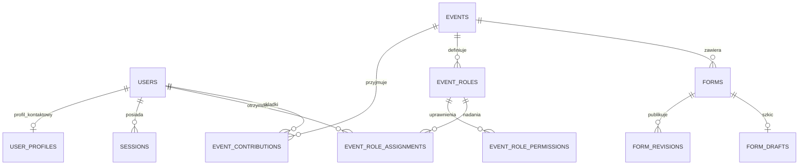
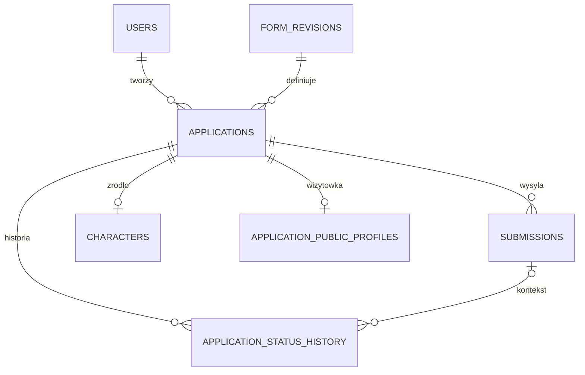
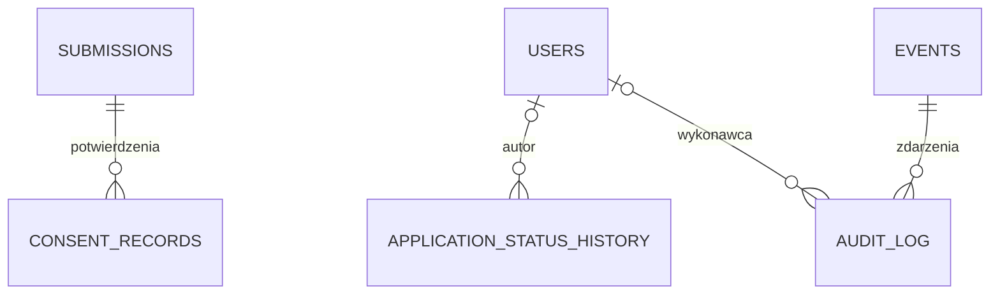
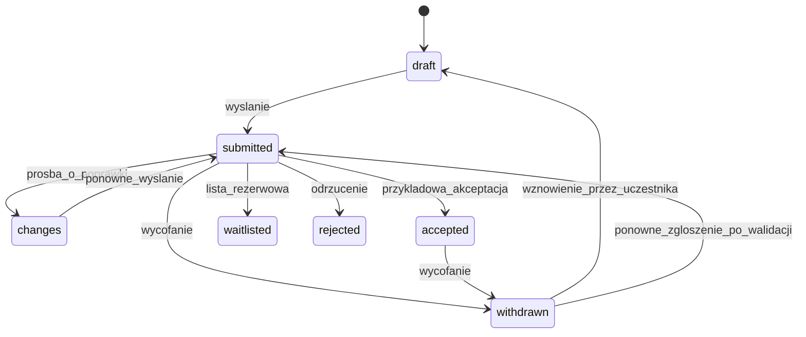

# Ursunalia — model danych, architektura i migracja

Audyt: 13.10.2026, HEAD `68737a8794e426d612fe54c03c88f6d431ba394e`. **Model docelowy jest rekomendacją do zatwierdzenia. SQL poniżej jest projektem, nie wykonaną migracją.** Uzupełnienie biznesowe 13.10.2026: przyjęcie przez akceptację ankiety postaci i ręcznie rejestrowana składka są zatwierdzone; siedem statusów i nieblokujące organizatora reguły zmian zostały zatwierdzone decyzjami C09/D18 i C10/D08. Dowody aktualnego stanu: [FUNCTIONAL_SPEC, mapa S1–S15](../product/FUNCTIONAL_SPEC.md#mapa-źródeł).

## 1. Stan obecny

SQLite ma cztery tabele, tworzone przy starcie przez `CREATE TABLE IF NOT EXISTS` w `server/server.mjs:35–47`:

| Tabela | Kolumny i ograniczenia | Znaczenie |
|---|---|---|
| users | id TEXT PK; name/email/password/role NOT NULL; email UNIQUE; role participant/organizer | Jedna globalna rola, hasło salt:hash; brak metadanych konta. |
| sessions | token_hash TEXT PK; user_id FK users ON DELETE CASCADE; expires INTEGER | Hash tokena; czas ważności jako epoch ms. |
| forms | (id TEXT, revision INTEGER) PK; definition TEXT NOT NULL | Każdy rekord jest wersją; Form i FormRevision nie są rozdzielone. |
| applications | id PK; user_id FK; form_id/form_revision FK forms; answers TEXT; status draft/submitted/accepted/changes; updated_at; submitted_at nullable; feedback; UNIQUE(user_id,form_id) | Szkic i wysłane zgłoszenie w tym samym rekordzie; JSON odpowiedzi, aktualna decyzja bez autora/historii. |

`PRAGMA foreign_keys=ON`, WAL. Brak jawnych dodatkowych indeksów, wersji schematu, CHECK json_valid i kontroli optimistic locking. PK/UNIQUE tworzą swoje indeksy. Event nie jest tabelą; pochodzi z JSON. `forms.eventId` jest tylko wewnątrz definicji, publikacja sprawdza równość z seed.event.id. Charakter postaci wynika z ID pól/formularza. Nie ma Review, Character, Consent, członków wydarzenia ani szkiców kreatora w SQLite.

TypeScript `Application` zawiera pełną definicję formularza, odpowiedzi, status i aktualny feedback. API rekonstruuje definicję z FK; nie ufa przesłanym polom definicji. To dobry fundament wersjonowania. `Answer = string | number | string[]`. Szkice kreatora: localStorage `ursunalia:builder:v27:<id>`, bez użytkownika/trybu. Szkice uczestnika demo mają osobny snapshot localStorage, stare postacie są importowane z sessionStorage (S2/S15).

Obecny model nie zapisuje:

- wcześniejszych decyzji, ich autorów/czasów ani poprzednich zestawów odpowiedzi;
- faktu osobnego potwierdzenia zgody na określony dokument;
- rzeczywistego uczestnictwa niezależnego od odpowiedzi na formularz;
- prywatności pola jako metadanej ani praw konkretnego organizatora;
- dat utworzenia historycznych kont i zgłoszeń.

Tych danych nie wolno wymyślić podczas migracji.

## 2. Rekomendowana architektura

**Modularny monolit:** Angular + jedno API Node 24 + SQLite na trwałym lokalnym dysku, jeden aktywny proces zapisujący, reverse proxy HTTPS. Jedna grupa organizatorska; bez `tenant_id`, tabel organizacji, brokera i orkiestracji.

| Moduł | Odpowiedzialność | Granica |
|---|---|---|
| Identity | Konto, hasła, sesje, odzyskanie dostępu oraz wspólny profil kontaktowy użytkownika | Kontakt wprowadzany podczas rejestracji konta, a nie powielany w ankietach wydarzenia; uprawnienia do odczytu zależą od wydarzenia. |
| Events/access | Metadane wydarzeń, trzy bazowe typy kont, dynamiczne role i uprawnienia read/write | Organizator zarządza rolami w swoim zakresie, Administrator działa globalnie. Akceptacja wskazanego formularza daje udział. |
| Forms | Szkic, walidacja, publikacja niezmiennej rewizji | Nie przepisuje historycznych zgłoszeń. |
| Applications | Szkic, wersja zapisu, wysłanie i immutable snapshot | Właściciel i uprawnieni aktorzy (w tym Administrator globalny) mogą poprawiać aktualne dane; historyczne wysłania są niezmiennymi wersjami. |
| Status history / reviews | Historia wszystkich zmian statusu i decyzji organizatora; odnośnik do wysłanych odpowiedzi, jeśli istnieją | Nie udaje, że administracyjna zmiana statusu oznacza ocenę wysłanego formularza. |
| Characters | Opcjonalny profil fabularny i powiązanie z zaakceptowanym zgłoszeniem | Nie zawiera kontaktu, zgód ani granic uczestnika. |
| Privacy/operations | Ograniczone DTO, retencja, eksport, audyt, backup | Nie kopiuje treści poufnej do logów. |
| Contributions | Ręczne potwierdzenie otrzymania składki za przelew per wydarzenie i użytkownik | Bez operatora płatności, bez statusu płatności jako części decyzji fabularnej. |

Wdrożenie zacząć od wydzielenia funkcji serwisowych/polityk z obecnego `server.mjs`, bez zmiany frameworka. FE: oddzielić `AuthStore`, stan formularzy i roboczych zgłoszeń dopiero w zadaniach dotyczących tych obszarów; serwer nadal jest źródłem prawdy. Walidacja definicji/odpowiedzi pozostaje wspólna; autoryzacja wyłącznie serwerowa. Szablony kart mają korzystać z definicji, `kind` i jawnego mapowania semantyki, nie z porównania do `character-2027`.

Alternatywy:

| Wariant | Ocena |
|---|---|
| Zostać przy 4 tabelach i dopisać eventId w JSON | Krótszy patch, ale nie rozwiązuje integralności i historii; dopuszczalne tylko jako etap krótkiej stabilizacji. |
| Relacyjny rdzeń + wersjonowane JSON | **Rekomendowane**: proste zapytania o właściciela, wydarzenie, status; elastyczne pytania bez migracji dla każdej ankiety. |
| Każda odpowiedź jako osobny rekord EAV | Dodatkowe joiny, konwersje typów i migracje; brak obecnej potrzeby analitycznej uzasadniającej koszt. |
| PostgreSQL teraz | Możliwy później przy wielu procesach/większym obciążeniu; najpierw mierzyć SQLite. |
| Osobny backend Python | Kompetencje zespołu mogą uzasadnić kiedyś, ale teraz koszt przepisania działającej ścieżki i testów bez korzyści MVP. |

## 3. Encje i kardynalności

Zgłoszenie jest procesem odpowiedzi użytkownika na ankietę. Postać jest bytem fabularnym, który może powstać z zaakceptowanego zgłoszenia typu character. Ankieta organizacyjna nie tworzy postaci. **Dla Ursunaliów 2027 akceptacja ankiety postaci oznacza przyjęcie gracza do wydarzenia.** Uczestnictwo wyliczamy z aktywnego zaakceptowanego zgłoszenia ankiety oznaczonej `grants_admission=1`; dla Ursunaliów dotyczy to tylko ankiety postaci, nie logistyki. EventMember oznacza **uprawnienia zespołu**, nie obowiązkowy rekord każdego uczestnika. Składka jest niezależnym faktem rozliczeniowym per użytkownik i wydarzenie.

ERD podzielono na trzy czytelne fragmenty. Tabele techniczne prywatnych odpowiedzi pominięto na diagramach; SQL definiuje je jawnie.







Nie każda encja musi być wdrożona przed pilotażem: **pełna, samodzielna tabela `Character` oraz serwerowy FormDraft mogą wejść później**, ale **panel postaci U36 musi być dostępny po pierwszym faktycznym wysłaniu formularza postaci** (C35/D28a). Panel można projektować bez dodatkowej tabeli `characters`, na podstawie `applications/submissions/application_public_profiles`. Oddzielenie niezmiennego wysłania od szkicu i praw do danych poufnych jest potrzebne przed realnymi zapisami.

## 4. Projekt schematu SQLite

UUID/identyfikatory istniejące zachowujemy jako TEXT, nie zmieniamy ich na INTEGER. Daty techniczne: UTC ISO 8601 TEXT; sesje epoch ms dla kompatybilności. Dni wydarzenia `starts_on/ends_on` w formacie YYYY-MM-DD, bez wymyślania nieznanych godzin; okno zapisów używa timestampów UTC i wskazanej strefy do prezentacji. `created_at` danych historycznych nullable, z jawnym `imported_at`. JSON jako TEXT z walidacją runtime i CHECK; żadnego kodu wykonywalnego w definicji. SQLite musi wspierać JSON functions (zweryfikować w docelowym Node).

Poniższy DDL to **docelowy schemat świeżej bazy** służący przeglądowi. Nie uruchamiać go na bazie v27; plan migracji opisano osobno. Rozdzielone prywatne tabele utrudniają przypadkowy `SELECT *`/serializację, ale same nie stanowią kontroli dostępu.

```sql
PRAGMA foreign_keys = ON;

CREATE TABLE schema_migrations (
  version INTEGER PRIMARY KEY,
  applied_at TEXT NOT NULL,
  checksum TEXT NOT NULL
);

CREATE TABLE users (
  id TEXT PRIMARY KEY NOT NULL,
  name TEXT NOT NULL,
  email TEXT NOT NULL COLLATE NOCASE UNIQUE,
  password_hash TEXT NOT NULL,
  password_scheme TEXT NOT NULL,
  account_type TEXT NOT NULL DEFAULT 'participant'
    CHECK(account_type IN ('administrator','organizer','participant')),
  created_at TEXT,
  imported_at TEXT,
  disabled_at TEXT
);

-- Globalny profil kontaktowy jest wspólny dla wszystkich wydarzeń.
-- Telefon (C13), FB i Discord są opcjonalne i pozostają nullable;
-- brak telefonu nie blokuje rejestracji konta. Istniejące users.name
-- zachować bez automatycznego rozbijania go na first_name/last_name.
CREATE TABLE user_profiles (
  user_id TEXT PRIMARY KEY NOT NULL REFERENCES users(id) ON DELETE CASCADE,
  first_name TEXT,
  last_name TEXT,
  nickname TEXT, -- globalna ksywa, udostępniana tylko po włączeniu globalnego przełącznika
  phone TEXT,
  facebook TEXT,
  discord TEXT,
  show_real_name INTEGER NOT NULL DEFAULT 0 CHECK(show_real_name IN (0,1)),
  show_nickname INTEGER NOT NULL DEFAULT 0 CHECK(show_nickname IN (0,1)),
  show_facebook INTEGER NOT NULL DEFAULT 0 CHECK(show_facebook IN (0,1)),
  show_discord INTEGER NOT NULL DEFAULT 0 CHECK(show_discord IN (0,1)),
  updated_at TEXT NOT NULL
);

CREATE TABLE sessions (
  token_hash TEXT PRIMARY KEY NOT NULL,
  user_id TEXT NOT NULL REFERENCES users(id) ON DELETE CASCADE,
  expires_at_ms INTEGER NOT NULL,
  created_at TEXT
);
CREATE INDEX sessions_user ON sessions(user_id);
CREATE INDEX sessions_expiry ON sessions(expires_at_ms);

CREATE TABLE events (
  id TEXT PRIMARY KEY NOT NULL,
  slug TEXT NOT NULL UNIQUE,
  name TEXT NOT NULL,
  starts_on TEXT NOT NULL,
  ends_on TEXT NOT NULL,
  timezone TEXT NOT NULL DEFAULT 'Europe/Warsaw',
  registration_status TEXT NOT NULL DEFAULT 'closed'
    CHECK(registration_status IN ('closed','open','paused')),
  opens_at TEXT,
  closes_at TEXT,
  description TEXT NOT NULL DEFAULT '',
  location_text TEXT NOT NULL DEFAULT '',
  owner_organizer_user_id TEXT REFERENCES users(id), -- organizator prowadzący wydarzenie; uprawnienia i dostęp nadal sprawdza API
  archived_at TEXT,
  CHECK(ends_on >= starts_on),
  CHECK(opens_at IS NULL OR closes_at IS NULL OR closes_at >= opens_at)
);

-- C18/D21: role i przypisania są wyłącznie per wydarzenie, bez dziedziczenia między eventami.
-- Bazowe typy account_type nie są przechowywane jako role niestandardowe.
CREATE TABLE event_roles (
  id TEXT PRIMARY KEY NOT NULL,
  event_id TEXT NOT NULL REFERENCES events(id),
  name TEXT NOT NULL,
  description TEXT NOT NULL DEFAULT '',
  created_by_user_id TEXT NOT NULL REFERENCES users(id),
  created_at TEXT NOT NULL,
  updated_at TEXT NOT NULL,
  UNIQUE(event_id,name),
  UNIQUE(id,event_id)
);

-- Jedna pozycja oznacza jedno prawo. Brak wpisu = brak dostępu.
-- read/write służą danym; manage/assign/export operacjom administracyjnym.
CREATE TABLE event_role_permissions (
  role_id TEXT NOT NULL REFERENCES event_roles(id) ON DELETE CASCADE,
  resource_group TEXT NOT NULL CHECK(resource_group IN (
    'identity','private_contact','social_contact','character_lore',
    'game_preferences','triggers','interpersonal_exclusions','health',
    'applications','contributions','forms','events','roles','exports'
  )),
  action TEXT NOT NULL CHECK(action IN ('read','write','manage','assign','export')),
  PRIMARY KEY(role_id,resource_group,action)
);

-- Uczestnik może mieć wiele ról; bazowy account_type pozostaje osobny.
CREATE TABLE event_role_assignments (
  event_id TEXT NOT NULL REFERENCES events(id),
  user_id TEXT NOT NULL REFERENCES users(id),
  role_id TEXT NOT NULL,
  assigned_by_user_id TEXT NOT NULL REFERENCES users(id),
  assigned_at TEXT NOT NULL,
  PRIMARY KEY(event_id,user_id,role_id),
  FOREIGN KEY(role_id,event_id) REFERENCES event_roles(id,event_id)
);
CREATE TABLE forms (
  id TEXT PRIMARY KEY NOT NULL,
  event_id TEXT NOT NULL REFERENCES events(id),
  kind TEXT NOT NULL CHECK(kind IN ('character','logistics','generic')),
  grants_admission INTEGER NOT NULL DEFAULT 0 CHECK(grants_admission IN (0,1)),
  status TEXT NOT NULL DEFAULT 'draft'
    CHECK(status IN ('draft','published','closed','archived')),
  current_revision INTEGER,
  max_per_user INTEGER DEFAULT 1 CHECK(max_per_user IS NULL OR max_per_user > 0),
  UNIQUE(id,event_id),
  FOREIGN KEY(id,current_revision) REFERENCES form_revisions(form_id,revision)
    DEFERRABLE INITIALLY DEFERRED
);

CREATE TABLE form_revisions (
  form_id TEXT NOT NULL REFERENCES forms(id),
  revision INTEGER NOT NULL CHECK(revision > 0),
  schema_version INTEGER NOT NULL CHECK(schema_version > 0),
  definition_json TEXT NOT NULL CHECK(json_valid(definition_json) AND json_type(definition_json)='object'),
  content_hash TEXT NOT NULL,
  published_by TEXT REFERENCES users(id),
  published_at TEXT,
  imported_at TEXT,
  PRIMARY KEY(form_id,revision)
);

CREATE TABLE form_drafts (
  form_id TEXT PRIMARY KEY NOT NULL REFERENCES forms(id),
  base_revision INTEGER,
  draft_json TEXT NOT NULL CHECK(json_valid(draft_json) AND json_type(draft_json)='object'),
  lock_version INTEGER NOT NULL DEFAULT 1 CHECK(lock_version > 0),
  updated_by TEXT NOT NULL REFERENCES users(id),
  updated_at TEXT NOT NULL,
  FOREIGN KEY(form_id,base_revision) REFERENCES form_revisions(form_id,revision)
);

CREATE TABLE applications (
  id TEXT PRIMARY KEY NOT NULL,
  event_id TEXT NOT NULL,
  user_id TEXT NOT NULL REFERENCES users(id),
  form_id TEXT NOT NULL,
  form_revision INTEGER NOT NULL,
  slot INTEGER NOT NULL DEFAULT 1 CHECK(slot > 0),
  status TEXT NOT NULL CHECK(status IN (
    'draft','submitted','accepted','changes',
    'waitlisted','rejected','withdrawn'
  )),
  character_edit_locked INTEGER NOT NULL DEFAULT 0
    CHECK(character_edit_locked IN (0,1)), -- C37: blokada calej karty
  -- C43: archiwum postaci niezalezne od 7-statusowego procesu zgłoszenia
  character_archived_at TEXT,
  character_archived_by_user_id TEXT REFERENCES users(id),
  CHECK ((character_archived_at IS NULL) = (character_archived_by_user_id IS NULL)),
  answers_json TEXT NOT NULL CHECK(json_valid(answers_json) AND json_type(answers_json)='object'),
  lock_version INTEGER NOT NULL DEFAULT 1 CHECK(lock_version > 0),
  created_at TEXT,
  updated_at TEXT NOT NULL,
  imported_at TEXT,
  current_submission_id TEXT,
  legacy_feedback TEXT,
  UNIQUE(user_id,form_id,slot),
  UNIQUE(id,event_id,user_id),
  FOREIGN KEY(form_id,event_id) REFERENCES forms(id,event_id),
  FOREIGN KEY(form_id,form_revision) REFERENCES form_revisions(form_id,revision),
  FOREIGN KEY(current_submission_id,id) REFERENCES submissions(id,application_id)
    DEFERRABLE INITIALLY DEFERRED
);

CREATE TABLE application_sensitive_answers (
  application_id TEXT PRIMARY KEY NOT NULL REFERENCES applications(id) ON DELETE CASCADE,
  answers_json TEXT NOT NULL CHECK(json_valid(answers_json) AND json_type(answers_json)='object')
);

CREATE TABLE submissions (
  id TEXT PRIMARY KEY NOT NULL,
  application_id TEXT NOT NULL REFERENCES applications(id),
  attempt INTEGER NOT NULL CHECK(attempt >= 0),
  source TEXT NOT NULL DEFAULT 'submitted' CHECK(source IN ('submitted','legacy_current')),
  answers_json TEXT NOT NULL CHECK(json_valid(answers_json) AND json_type(answers_json)='object'),
  submitted_at TEXT,
  captured_at TEXT NOT NULL,
  idempotency_key TEXT,
  UNIQUE(application_id,attempt),
  UNIQUE(id,application_id),
  UNIQUE(application_id,idempotency_key),
  CHECK(source='legacy_current' OR (attempt > 0 AND submitted_at IS NOT NULL AND idempotency_key IS NOT NULL))
);

CREATE TABLE submission_sensitive_answers (
  submission_id TEXT PRIMARY KEY NOT NULL REFERENCES submissions(id) ON DELETE CASCADE,
  answers_json TEXT NOT NULL CHECK(json_valid(answers_json) AND json_type(answers_json)='object')
);

CREATE TABLE application_status_history (
  id TEXT PRIMARY KEY NOT NULL,
  application_id TEXT NOT NULL REFERENCES applications(id),
  submission_id TEXT,
  actor_user_id TEXT REFERENCES users(id),
  previous_status TEXT CHECK(previous_status IS NULL OR previous_status IN (
    'draft','submitted','changes','accepted','waitlisted','rejected','withdrawn'
  )),
  new_status TEXT NOT NULL CHECK(new_status IN (
    'draft','submitted','changes','accepted','waitlisted','rejected','withdrawn'
  )),
  source TEXT NOT NULL CHECK(source IN ('participant_action','organizer_override','legacy_current')),
  reason TEXT NOT NULL DEFAULT '',
  recorded_at TEXT NOT NULL,
  FOREIGN KEY(submission_id,application_id) REFERENCES submissions(id,application_id),
  CHECK(source='legacy_current' OR actor_user_id IS NOT NULL)
);
CREATE TABLE characters (
  id TEXT PRIMARY KEY NOT NULL,
  event_id TEXT NOT NULL,
  owner_user_id TEXT NOT NULL,
  source_application_id TEXT NOT NULL UNIQUE,
  source_submission_id TEXT NOT NULL,
  name TEXT NOT NULL,
  profile_json TEXT NOT NULL CHECK(json_valid(profile_json) AND json_type(profile_json)='object'),
  created_at TEXT NOT NULL,
  FOREIGN KEY(source_application_id,event_id,owner_user_id)
    REFERENCES applications(id,event_id,user_id),
  FOREIGN KEY(source_submission_id,source_application_id)
    REFERENCES submissions(id,application_id)
);

-- C30/C31/C32: aktualna, natychmiast widoczna wizytówka publiczna.
-- Przed pierwszą podmianą "inherit" korzysta z bieżącego assetu ostatniego
-- wysłania. Po podmianie historyczny obraz trzeba usunąć fizycznie,
-- nie wolno więc powrócić do "inherit" bez nowego uploadu.
-- Wartości portrait_asset_id to identyfikatory zasobów, NIE base64.
-- DDL do przeglądu, wymagane dodatkowe ograniczenia API/cleanup.
CREATE TABLE application_public_profiles (
  application_id TEXT PRIMARY KEY NOT NULL REFERENCES applications(id) ON DELETE CASCADE,
  public_name_override TEXT CHECK(
    public_name_override IS NULL OR length(trim(public_name_override)) > 0
  ), -- C33: NULL = nazwa z ostatniego faktycznego wysłania, niepusta zmiana natychmiastowa
  public_description_override TEXT,
  portrait_override_mode TEXT NOT NULL DEFAULT 'inherit'
    CHECK(portrait_override_mode IN ('inherit','replace','hide')),
  portrait_asset_id TEXT,
  portrait_ever_replaced INTEGER NOT NULL DEFAULT 0
    CHECK(portrait_ever_replaced IN (0,1)),
  lock_version INTEGER NOT NULL DEFAULT 1 CHECK(lock_version > 0),
  updated_by_user_id TEXT NOT NULL REFERENCES users(id),
  updated_at TEXT NOT NULL,
  CHECK(
    (portrait_override_mode='replace' AND portrait_asset_id IS NOT NULL)
    OR
    (portrait_override_mode!='replace' AND portrait_asset_id IS NULL)
  ),
  CHECK(NOT (portrait_ever_replaced=1 AND portrait_override_mode='inherit'))
);

-- C36/D28b: biezaca warstwa zmian fabularnych z panelu, niezalezna od snapshots.
-- Nie przechowywac tu zdrowia, granic, wykluczen, kontaktow ani ustawien konta.
-- Klucze danych/typy walidowac wzgledem semantyki formularza character.
CREATE TABLE application_character_current (
  application_id TEXT PRIMARY KEY NOT NULL REFERENCES applications(id) ON DELETE CASCADE,
  overrides_json TEXT NOT NULL DEFAULT '{}' CHECK(
    json_valid(overrides_json) AND json_type(overrides_json)='object'
  ),
  lock_version INTEGER NOT NULL DEFAULT 1 CHECK(lock_version > 0),
  updated_by_user_id TEXT NOT NULL REFERENCES users(id),
  updated_at TEXT NOT NULL
);

-- C37/C38: blokada jednej calej karty przez applications.character_edit_locked;
-- brak historii kolejnych edycji pol postaci; immutable submissions pozostaja.

CREATE TABLE consent_records (
  id TEXT PRIMARY KEY NOT NULL,
  submission_id TEXT NOT NULL REFERENCES submissions(id),
  statement_key TEXT NOT NULL,
  document_version TEXT NOT NULL,
  statement_hash TEXT NOT NULL,
  statement_text TEXT NOT NULL,
  response INTEGER NOT NULL CHECK(response IN (0,1)),
  recorded_at TEXT NOT NULL,
  source TEXT NOT NULL CHECK(source IN ('submitted','legacy_unverified')),
  withdrawn_at TEXT,
  UNIQUE(submission_id,statement_key)
);

-- MVP: potwierdzenie składki przelewem, dokonywane ręcznie przez organizatora.
-- Brak rekordu oznacza brak potwierdzenia. Nie przechowujemy rachunku bankowego,
-- potwierdzenia przelewu ani danych nadawcy przelewu.
CREATE TABLE event_contributions (
  event_id TEXT NOT NULL REFERENCES events(id),
  user_id TEXT NOT NULL REFERENCES users(id),
  is_paid INTEGER NOT NULL DEFAULT 0 CHECK(is_paid IN (0,1)),
  confirmed_at TEXT,
  confirmed_by TEXT REFERENCES users(id),
  updated_at TEXT NOT NULL,
  PRIMARY KEY (event_id,user_id),
  CHECK (
    (is_paid=0 AND confirmed_at IS NULL AND confirmed_by IS NULL) OR
    (is_paid=1 AND confirmed_at IS NOT NULL AND confirmed_by IS NOT NULL)
  )
);

CREATE TABLE audit_log (
  id TEXT PRIMARY KEY NOT NULL,
  event_id TEXT REFERENCES events(id),
  actor_user_id TEXT REFERENCES users(id),
  action TEXT NOT NULL,
  entity_type TEXT NOT NULL,
  entity_id TEXT NOT NULL,
  occurred_at TEXT NOT NULL,
  metadata_json TEXT NOT NULL DEFAULT '{}'
    CHECK(json_valid(metadata_json) AND json_type(metadata_json)='object')
);

CREATE INDEX forms_event_status ON forms(event_id,status);
-- C41/D04: jeden rekord character na konto i wydarzenie, nawet w roznych
-- formularzach tego samego kind, niezaleznie od statusu oraz slotu.
-- C45/D29c1: skuteczne USUNIECIE zwalnia miejsce na nowa postac.
-- Ponizsze triggery to projekt ochrony dla rekordow istniejacych; przed
-- wdrozeniem usuwania U38 zweryfikowac D29c2 i skorygowac warunek istnienia
-- tak, aby poprawnie usuniete rekordy historyczne (jesli pozostana w DB)
-- NIE blokowaly miejsca. Nie przyjmowac teraz na sztywno soft-delete/DELETE.
-- Przed instalacja zweryfikowac legacy duplikaty, a API ma obslugiwac konflikt.
CREATE TRIGGER one_character_per_user_event_insert
BEFORE INSERT ON applications
WHEN (SELECT kind FROM forms WHERE id=NEW.form_id AND event_id=NEW.event_id)='character'
BEGIN
  SELECT RAISE(ABORT,'one character per user per event')
  WHERE EXISTS (
    SELECT 1 FROM applications a
    JOIN forms f ON f.id=a.form_id AND f.event_id=a.event_id
    WHERE a.user_id=NEW.user_id AND a.event_id=NEW.event_id AND f.kind='character'
  );
END;

CREATE TRIGGER one_character_per_user_event_update
BEFORE UPDATE OF form_id,event_id,user_id ON applications
WHEN (SELECT kind FROM forms WHERE id=NEW.form_id AND event_id=NEW.event_id)='character'
BEGIN
  SELECT RAISE(ABORT,'one character per user per event')
  WHERE EXISTS (
    SELECT 1 FROM applications a
    JOIN forms f ON f.id=a.form_id AND f.event_id=a.event_id
    WHERE a.id<>OLD.id AND a.user_id=NEW.user_id
      AND a.event_id=NEW.event_id AND f.kind='character'
  );
END;

CREATE TRIGGER prevent_form_kind_change_after_applications
BEFORE UPDATE OF kind ON forms
WHEN NEW.kind<>OLD.kind
  AND EXISTS (SELECT 1 FROM applications a WHERE a.form_id=OLD.id)
BEGIN
  SELECT RAISE(ABORT,'cannot change kind of form with applications');
END;

CREATE INDEX applications_owner_event ON applications(user_id,event_id,updated_at DESC);
CREATE INDEX applications_review_queue ON applications(event_id,status,updated_at DESC);
CREATE INDEX applications_revision ON applications(form_id,form_revision);
CREATE INDEX application_status_history_time ON application_status_history(application_id,recorded_at);
CREATE INDEX audit_event_time ON audit_log(event_id,occurred_at);
```

Wzajemne FK forms/revisions oraz applications/submissions są świadome i odroczone. Tworzenie formularza, rewizji i ustawienie wskazania następuje w transakcji. Zgłoszenie draft ma null current_submission_id; wysłanie wstawia snapshot i aktualizuje wskaźnik atomowo. To są obowiązkowe testy U09/U11, nie założenie o automatycznym działaniu SQL.

### Inwarianty aplikacyjne poza DDL

1. W jednej transakcji sprawdzić role, stan, okno zapisów, rewizję, limity i lock_version; zaktualizować rekord warunkowym UPDATE. Zero zmienionych wierszy → 409. Nigdy sam SELECT, a potem bezwarunkowy zapis.
2. **C41/D04:** maksymalnie **jedna nieusunięta aplikacja `kind=character` na parę `(event_id,user_id)`**, niezależnie od identyfikatora formularza, rewizji, `slot`, statusu **i archiwizacji C43** (w tym `draft`, `rejected`, `withdrawn`). Po wycofaniu i przy poprawkach wraca się do **tej samej** aplikacji. Formularz logistyczny/generic jest niezależny; drugie wydarzenie pozwala na osobną postać. `slot <= forms.max_per_user` (MVP: `slot=1`, `max_per_user=1`) to dodatkowa polityka **formularza**, niewystarczająca dla limitu na wydarzenie. Trigger SQLite chroni zapis również przed obejściem przez inne `form_id`; API sprawdza atomowo i obsługuje konflikt. **C45/D29c1:** po skutecznym usunięciu U38 limit zostaje zwolniony dla nowej aplikacji z nowym ID; `rejected`, `withdrawn` i `character_archived_at` same w sobie miejsca nie zwalniają. Projekt triggerów powyżej musi zostać dostosowany do ostatecznej reprezentacji usunięcia (D29c2), jeśli historyczny rekord pozostaje w DB; obecna wersja zakłada brak usuniętego rekordu w `applications` i nie jest gotową migracją U38. Zwolnienie miejsca i utworzenie nowej postaci muszą być chronione transakcyjnie. Przed migracją znaleźć i rozstrzygnąć potencjalne istniejące duplikaty bez ich automatycznego kasowania. Pojemność wydarzenia to odrębne ograniczenie. **C44/C45:** usunięcie zwalnia miejsce — potwierdzone; do D29c2 pozostała wyłącznie polityka kasowania i zachowania danych.
3. Nowy szkic wskazuje bieżącą opublikowaną rewizję i dostępne wydarzenie. Istniejący szkic pozostaje przypięty do swojej rewizji. Niedozwolona zmiana form_id/form_revision/user/event przez update.
4. `definition_json` musi być zgodne z relacyjnym ID/revision/event. Prywatne i zwykłe answers są rozłączne; suma kluczy zgodna z definicją. Brak cichego usuwania danych przy migracji.
5. `FormRevision` i `Submission` nie są edytowalne przez zwykłe API. Retencja/usunięcie to osobny, audytowany proces. Zmiana polityki poufności może zaostrzyć dostęp do starego pola bez przepisywania jego treści.
6. **Decyzja C10/D08:** uprawniony organizator może z każdego statusu ustawić dowolny inny (również `draft → accepted`, `changes → accepted`, `rejected → submitted` i `withdrawn → accepted`). Zmiana statusu rejestruje poprzedni/nowy status, aktora, czas i opcjonalny powód, z odnośnikiem do ostatniego prawdziwego wysłania, jeżeli istnieje. Jeśli nie ma wysłania, zdarzenie `organizer_override` ma `submission_id=NULL` i nie udaje wysłanych odpowiedzi. UI ostrzega przed nietypową zmianą, nie blokując decyzji. Uczestnik może wznowić `withdrawn` i ponownie wysłać tę samą Application, bez utraty ID, danych i historii. Zachowujemy kontrolę dostępu oraz ochronę przed nadpisaniem zmian z innej karty.
7. **Panel postaci U36** powstaje po pierwszym rzeczywistym wysłaniu formularza `kind=character`, również bez statusu `accepted`; aktualne dane panelu projektować ze snapshotu i bezpiecznej wizytówki. `accepted` nadane ręcznie bez wcześniejszego wysłania nadaje uczestnictwo, lecz **nie tworzy fikcyjnego wysłania ani panelu postaci**. Pełna osobna encja `Character` U26 jest późniejszym refaktorem, nie blokadą panelu. Nie kopiować potrzeb, zgód ani wrażliwych odpowiedzi do publicznego DTO. **C41:** jeden panel na parę konto–wydarzenie; przy istniejącym szkicu lub wysłaniu innego formularza `character` nie tworzyć duplikatu.
8. AuditLog zawiera nazwy operacji, ID i wyniki, nie hasła, tokeny, answers, portrety ani pełne treści feedback. Może zawierać hash/wersję operacji i request_id.

## 5. Odpowiedzi, kategorie, obrazy i zgody

Definicja JSON dostaje `schemaVersion`, formularz relacyjny `kind`. Pole może mieć `semanticKey` (np. character.name, character.traits, character.hooks) oraz `dataClass`: `fiction`, `organization`, `sensitive`, `statement`. To klasyfikacja serwerowa ze sprawdzonej definicji, nigdy z żądania uczestnika. W pierwszym wdrożeniu nowe niesklasyfikowane textarea/file mają ostrożną klasę sensitive do decyzji managera; publikacja wymaga świadomego oznaczenia. To zapobiega pominięciu nowego pola „inne potrzeby”.

Dotychczasową rewizję zachować bajtowo i hashować. Klasyfikację starych pól można utrzymać w wersjonowanej polityce serwera `(form_id, revision, field_id)` podczas przejścia. `boundaries`, `exclusions`, `needs` trafiają do prywatnej części. Edytowalna przez klienta etykieta nie może poluzować polityki. Użytkownik widzi własne odpowiedzi; organizator dostaje DTO filtrowane przed serializacją.

**C42/D07a:** wybór `traits` (cech charakteru) w nowych definicjach ma domyślnie **brak biznesowego minimum i maksimum** (`minSelections=null`, `maxSelections=null`); uczestnik może wybrać nawet zero lub wszystkie oferowane cechy. Kreator pozwala Organizatorowi **opcjonalnie** ustawić jedno/both ograniczeń i odrzuca `minSelections>maxSelections`, a backend waliduje je na podstawie **przypiętej opublikowanej rewizji**, nie parametru przesłanego przez uczestnika. Dawne sztywne `2–5` nie jest domyślną regułą nowych formularzy; nie zmieniać automatycznie limitów zapisanych w historycznych rewizjach. Bez obowiązku wyboru pary pozytywna/negatywna. `traits` i `hooks` pozostają różnymi kolekcjami ze stabilnymi ID, opcjonalne `category/polarity` mogą służyć opisom i przyszłej konfiguracji. **Ograniczenia `hooks` i reszty generatora w D07b pozostają otwarte**, więc C42 nie narzuca im nowego domyślnego limitu. Nie przenosić istniejących kategorii automatycznie.

Portret w MVP może pozostać w JSON, jeśli ograniczono go do jednego pola, zweryfikowano dekodowanie/typ/rozmiar/piksele, usunięto zbędne metadane i pominięto obrazy w listach. Przechowywanie plików osobno to U27 po pomiarach. Kopie i eksporty obejmują także obrazy; rozdzielenie plików oznacza konieczność spójnej kopii DB+assets.

`consent_records` oznacza ślad odpowiedzi na wersjonowane oświadczenie, nie automatyczne uznanie podstawy prawnej za „zgodę”. `statement_key` rozróżnia regulamin, przekazanie danych i potwierdzenie poprawności. Wersja/hash odnoszą się do pełnej treści podanej uczestnikowi. Dobrowolne oświadczenie zapisuje faktyczne response, nie wynik walidacji pola. Wycofanie oświadczenia obsługuje zatwierdzona procedura i nie przepisuje wysłanego formularza. Historyczne checkboxy można oznaczyć tylko `legacy_unverified`.

## 6. Uprawnienia i minimalizacja

### Zatwierdzone zasady bazowe (C11–C17)

- **Typ konta** jest jednym z trzech: `participant` (domyślnie po rejestracji), `organizer`, `administrator`. Nie mylić z rolami konfigurowalnymi.
- **Administrator:** pełny odczyt i edycja wszystkich zasobów biznesowych platformy, niezależnie od właściciela i wydarzenia, w tym kont innych organizatorów i uczestników. Administrator może nadawać/odbierać typ `administrator` i zarządzać wszystkimi rolami. Serwer musi egzekwować przywilej globalny; działania szczególne logować.
- **Organizator:** może tworzyć, edytować i przydzielać niestandardowe role z prawami do grup danych oraz nadawać typ `organizer` i inne role z wyłączeniem `administrator`. Nie może uzyskać typu Administrator przez zmianę roli, API, eksport, import ani samodzielną edycję własnego konta. Organizator zarządza zasobami w swoim uprawnionym kontekście; role tworzone przez Organizatora i ich nadania są zawsze związane z jednym `event_id` (C18/D21).
- **Tworzenie nowych wydarzeń – przyszły etap C19/D22:** sam typ konta `organizer` **nie daje automatycznie** prawa do tworzenia wydarzenia. Administrator może nadać mu osobną, platformową capability `events.create` (poza tabelami ról per-event). Po utworzeniu wydarzenia system **w jednej transakcji** zapisuje nowe Event i automatycznie przypisuje twórcę jako Organizatora uprawnionego do tego wydarzenia; nie nadaje uprawnień do cudzych wydarzeń. Prawo nie jest częścią bieżącego MVP i ma być wdrożone wraz z U25 po Ursunaliach 2027.
- **Uczestnik:** korzysta ze swoich danych; może otrzymać niestandardową rolę bez utraty bazowego typu `participant`. Nadane prawo do odczytu/edycji cudzych zasobów zawsze wymaga weryfikacji na serwerze.
- **Szablon Fabularzysta (C14):** przykładowa niestandardowa rola z odczytem całej fabuły postaci (również tajemnic i haków) i kontaktów FB/Discord, bez dostępu do prywatnych kontaktów, granic czy zdrowia. Szablon nie jest szczególnym typem konta ani obowiązkową rolą systemową.

### Grupy uprawnień

| Klucz grupy danych | Pola/zasoby | Podstawowe akcje |
|---|---|---|
| `identity` | imię, nazwisko, pełnoletniość | read / write |
| `private_contact` | e-mail, telefon | read / write |
| `social_contact` | Facebook, Discord | read / write |
| `character_lore` | postać, jej historia, pochodzenie, cele, relacje i tajemnice fabularne | read / write |
| `game_preferences` | preferencje rozgrywki, skale i oczekiwany styl gry | read / write |
| `triggers` | granice oraz triggery | read / write |
| `interpersonal_exclusions` | osoby, z którymi gracz nie chce grać | read / write |
| `health` | alergie, urazy, informacje zdrowotne | read / write |
| `applications` | zgłoszenia i statusy, bez automatycznego prawa do pełnej treści odpowiedzi z innych grup | read / write |
| `contributions` | ręcznie potwierdzane składki | read / write |
| `forms` | konfiguracja formularzy i ich publikacja | read / write / manage |
| `events` | konfiguracja wydarzeń | read / write / manage |
| `roles` | tworzenie, edycja i nadawanie ról | read / write / manage / assign |
| `exports` | eksport danych ograniczony do innych przyznanych uprawnień read | export |

Uprawnienie odczytu i edycji jest definiowane osobno dla każdej grupy, zamiast osobnych kolumn `can_read_x`/`can_write_x` w tabeli użytkownika. Edycja w zwykłym UI powinna implikować możliwość odczytu danego pola, a próby obejścia tego przez API wymagają egzekwowania obu praw. Akcje operacyjne (`manage`, `assign`, `export`) podlegają dodatkowym regułom bezpieczeństwa – np. `roles.assign` nie uprawnia nikogo do nadania Administratora, jeżeli nie ma bazowego typu `administrator`.

**Globalny profil konta:** `first_name/last_name` i `email/phone` oraz opcjonalne `facebook/discord` są przypisane do konta niezależnie od wydarzenia. `users.email` jako login nie jest automatycznie publiczny dla organizatorów. Telefon jest opcjonalny (C13). Dane zdrowotne wymagają szczególnej ochrony. Kontakty FB/Discord widoczne w przykładowej roli Fabularzysta nie stają się automatycznie publiczne dla graczy.

**Domyślne uprawnienia użytkownika do własnych danych** działają niezależnie od niestandardowych ról i nie zapewniają uprawnień do cudzych danych. Zgłoszenia i informacje organizacyjne są powiązane z wydarzeniem; każda definicja roli i jej przypisanie ma konkretny `event_id` (C18/D21). Uprawnienia z wydarzenia A nie działają na B, nawet jeżeli nazwy ról są identyczne. Organizator nie uzyskuje przez rolę dostępu do wszystkich kont ani danych innych wydarzeń. Administrator może zarządzać każdym zasobem platformy.

**Historia decyzji a edycje postaci:** zgodnie z C38 zwykłe edycje pól postaci zapisują jedynie **aktualne wartości**, bez zapisywania poprzednich/nowych wartości w `audit_log` lub osobnej tabeli historii. `lock_version` zabezpiecza współbieżność, a nie jest dziennikiem. **Wcześniejsze naprawdę wysłane formularze** (`submissions`), ich rewizje, decyzje/statusy, składki i administracyjne operacje blokowania pozostają zachowane. C37 nakazuje dodatkowo sprawdzać jedną blokadę całej karty. Administrator nie nadpisuje po cichu historycznych zgłoszeń i decyzji. Nie przechowywać jawnych haseł.

**Rozdzielenie praw platformowych od eventowych:** `events.create` jest przyszłą uprawnioną przez Administratora capability na poziomie konta (projekt semantyczny, bez nowej tabeli w obecnym DDL); po jej użyciu nadanie praw do *nowo utworzonego wydarzenia* następuje automatycznie. Samo `events.manage` nadane w wydarzeniu A nie pozwala stworzyć B ani uzyskać dostępu do istniejącego B. Administrator ma globalny wyjątek. 

**Weryfikacja event scope:** przed zastosowaniem roli serwer sprawdza, czy `event_role_assignments.event_id` odpowiada żądanemu wydarzeniu i czy przypisana `event_roles.event_id` jest taka sama. Próba odczytu danych z wydarzenia B z rolą nadaną tylko na A jest zabroniona; `account_type=administrator` pozostaje globalnym wyjątkiem. Test regresyjny: jeden użytkownik jest Fabularzystą na Ursunaliach 2027, ale zwykłym Uczestnikiem na drugim wydarzeniu. 

**Weryfikacja dostępu** następuje po stronie API przed odczytem, serializacją, edycją, eksportem i wydrukiem. Utrata uprawnienia obowiązuje od następnego żądania (bez konieczności ponownego logowania). Klasyfikacja danych wynika z serwerowej definicji pola, a nie z etykiety frontendowej. Export wymaga i `exports.export`, i read właściwych grup. Bez prawa odczytu danych zdrowotnych API nie ujawnia ich w listach, szczegółach, błędach, logach ani wydrukach. Historia przydzielania i odbierania ról jest audytowana.

**D03 otwarte:** predefiniowane szablony ról i dostęp graczy do FB/Discord. **D21/C18 zatwierdzone:** role konfigurowalne i nadania tylko dla jednego wydarzenia, typ konta pozostaje globalny. Dopóki polityka i migracja nie przejdą testów, nie zbierać realnych danych o zdrowiu, triggerach ani wykluczeniach. Retencję i podstawy przetwarzania ocenić przed otwarciem zapisów (D06/U19).

## 6a. Publiczny katalog postaci i kontakty dostępne po zalogowaniu (C20/C21/C25/C27/C29, U34)

**Odróżnić trzy fakty:**
- **Zgłoszenie postaci wystawionej w katalogu:** musi mieć rzeczywiste wysłanie (`submissions` ze źródłem `submitted`, ewentualnie zweryfikowany `legacy_current`). Nie publikować nigdy niewysłanego szkicu, nie traktować administracyjnego `draft → accepted` bez wysłania jako podstawy publikacji. Bieżący status postaci `rejected` lub `withdrawn` ukrywa ją z całej listy i szczegółów bez usuwania zgłoszenia i historii (C22). Bieżący `changes` wyświetla **ostatni prawdziwy, niezmienny snapshot** postaci, nie robocze poprawki (C23).
- **Tożsamość odbiorcy katalogu:** anonimowy widzi podstawową, publiczną projekcję nazwy, jawnego opisu i portretu; **każdy zalogowany użytkownik platformy** widzi te same dane oraz dobrowolnie udostępnione kontakty (C29/D25c). **Nie trzeba własnego zgłoszenia, wysłania formularza, statusu, udziału ani uprawnień do wydarzenia.** Dawne ograniczenia po submit (C26) i utracie statusu (C28) zostały zastąpione przez C29. Nie należy stosować statusu zgłoszenia **oglądającego** do filtrowania kontaktów.
- **Decyzja właściciela profilu:** widoczność opcjonalnych kontaktów zależy od czterech **globalnych**, niezależnych przełączników `user_profiles.show_real_name`, `show_nickname`, `show_facebook`, `show_discord` (C27/D26); wszystkie domyślnie 0. Nie ma `event_profile_publicity` ani innych kopii wyboru per wydarzenie. Cofnięcie globalnego wyboru usuwa pole z kolejnych odpowiedzi katalogów wszystkich wydarzeń. Nawet jeśli właściciel udostępnił pole, **anonimowy** odbiorca go nie widzi.

**Jeden rekord katalogu na zgłoszoną postać (`applicationId`) w jednym wydarzeniu**, bez obowiązkowego wdrażania przyszłego bytu `characters` (U26). **Pierwotna nazwa** i niejawne informacje wynikają z ostatniego prawdziwego wysłania, nigdy z roboczego szkicu. **C33/D27d:** po wysłaniu właściciel może także samodzielnie zmienić **pełną bieżącą nazwę postaci**. Jest ona zapisana jako `application_public_profiles.public_name_override` (NULL = odziedziczona nazwa ze snapshotu). Nowa nazwa jest używana od razu w katalogu, szczegółach, wyszukiwaniu i bieżących panelach postaci; oryginalna wartość pozostaje w prawdziwym historycznym `submissions.answers_json`, ale kolejnych zmian nazwy nie zapisujemy w historii (C38). Nie zmienia to `applicationId`, statusu, składki ani prywatnych odpowiedzi. `character.publicDescription` musi być jawnie oddzielonym polem od biografii, tajemnic, celów i haków. **C30/D27a, C31/D27b, C33/D27d:** po pierwszym wysłaniu uczestnik może edytować odrębnie **pełną nazwę postaci, publiczny opis i zdjęcie**; **poprawny zapis publikuje nowe wartości natychmiast, bez akceptacji Organizatora i bez resubmit, o ile karta nie jest zablokowana** (C37). Aktualne publiczne pola z `application_public_profiles` zastępują odpowiednie pola z wysłania, jeśli ustawiono override. Zmiany nie zmieniają `applications.status` i nie tworzą nowego `submissions`. Weryfikacja dostępu i dane publiczne nie mogą ujawniać prywatnego szkicu przy `changes`; status `rejected/withdrawn` nadal ukrywa całą postać (C22).

**C32/D27c – kasowanie starego zdjęcia:** po każdej skutecznej podmianie publicznego portretu **stary plik w aktywnym storage musi zostać fizycznie usunięty**, razem z miniaturami, kopiami renderów oraz starym adresem do niego. Nie utrzymywać w systemie galerii poprzednich portretów ani funkcji przywracania starego zdjęcia. Najpierw przeprowadzić walidację nowego pliku i bezpieczny upload do lokalizacji tymczasowej; następnie aktualizować wskazanie aktywnego zdjęcia oraz wersję profilu, po czym usunąć poprzedni asset i jego pochodne. Usuwanie nie jest atomowe z transakcją SQLite: potrzebna **trwała kolejka/polecenie sprzątania z retry i alarmowaniem**; nie zgłaszać użytkownikowi pełnego sukcesu usunięcia, jeśli fizyczne sprzątanie się nie powiodło. W razie nieudanego uploadu/zapisu nie wolno usunąć poprzedniego zdjęcia. Przed usunięciem sprawdzić własność pliku; docelowo unikać współdzielenia fizycznego assetu między postaciami albo bezpiecznie rozdzielić takie referencje. Unieważniać cache miniatur i odpowiedzi, aby stare zdjęcie nie było nadal dostępne przez aktywny URL.

**Niezmienność wysłania a fizyczne usunięcie obrazu:** logiczna historia odpowiedzi, ich statusy, teksty i metadane (np. techniczny identyfikator nieaktywnego zasobu (tombstone), potrzebny jedynie do bezpiecznego cleanup, a **nie jako historia edycji postaci**) pozostają, ale **nie wolno utrwalać binariów starych zdjęć w `submissions.answers_json`, w `application_sensitive_answers`, innych aktywnych snapshotach lub logach jako `base64`**. Referencja zdjęcia z dawnego wysłania po podmianie może stać się niedostępna (media tombstone); nie próbować odzyskać z niej obrazu. Jeśli dane legacy zawierają obrazy inline, usunięcie wymaga kontrolowanej migracji/redakcji **wyłącznie mediów** i pozostawienia audytu tej operacji — to świadomy wyjątek od dotychczasowego założenia niezmienności dosłownych bajtów całego JSON; nie zmienia innych odpowiedzi. **Backupy** mogą nadal zawierać stare obrazy do momentu wygaśnięcia retencji D06/U19/U17; nie gwarantować natychmiastowego wymazania wszystkich odseparowanych kopii. Po odtworzeniu backupu trzeba zastosować dziennik usunięć, aby nie opublikować ponownie wcześniej zastąpionych zdjęć.

**Projekt `application_public_profiles` i API:** `PATCH /events/:eventId/applications/:applicationId/public-profile` tylko dla właściciela (lub uprawnionego do edycji tej grupy, Administrator globalny). Pola edycji: `public_name_override`, `public_description_override`, aktualny portret. **Nowa pełna nazwa musi być niepusta po trim**, bezpiecznie renderowana jako tekst; wymagane walidacja opisu, formatu/wymiarów obrazu, limit rozmiaru, kontrola wersji `lock_version` i serwerowa weryfikacja `applications.character_edit_locked=0` przed edycją właściciela. Nie utrwalać historii kolejnych nazw/opisów/zdjęć (C38). Edycja samej nazwy nie uruchamia procedury usuwania portretu. Zmiany bieżącej nazwy uwzględniać w serwerowym wyszukiwaniu i w aktualnych panelach; nie traktować `characters.name` ani dawnego `answers_json` jako jedynego źródła nazwy po C33. `portrait_override_mode=inherit` jest dopuszczalne **wyłącznie przed pierwszą wymianą portretu**; `portrait_override_mode=replace` oznacza aktualny `portrait_asset_id`, zaś `hide` ukrywa portret (nie tworzy galerii). Flaga `portrait_ever_replaced=1` jest nieodwracalna, aby nie ujawnić usuniętego zdjęcia przez przełączenie na `inherit`; po ukryciu ponowne pokazanie zdjęcia wymaga nowego uploadu. Weryfikacja przejść i fizycznego usuwania pozostaje zadaniem warstwy serwerowej, nie samych CHECK w DDL. Ponowne wysłanie formularza nie czyści nadpisanych pól wizytówki i **musi przestrzegać cyklu życia zdjęć**, aby nie odtworzyć wcześniej usuniętego portretu.

**Globalne kontakty użytkownika:** imię/nazwisko, opcjonalna ksywa, FB i Discord pochodzą z `user_profiles` i mają po jednym przełączniku `show_*` na całe konto. Imię i nazwisko prezentować razem wyłącznie gdy włączone `show_real_name`; puste lub niewłączone pola pominąć, nie serializować ich jako ukryte wartości. Własność konta i sama możliwość zobaczenia publicznego katalogu nie ujawniają e-maila, telefonu, informacji zdrowotnych, triggerów, wykluczeń ani niejawnej treści postaci. Globalny wybór oznacza udostępnienie wybranych kontaktów **wszystkim zalogowanym kontom platformy**, niezależnie od wydarzenia, co należy jasno zakomunikować przy ustawianiu przełączników.

**Kontrakt API:** paginowany `GET /events/:eventId/characters/directory` oraz endpoint szczegółów z taką samą polityką. Anonimowe żądanie → whitelistowana projekcja `{applicationId, characterName, publicDescription, portrait?}`, gdzie `characterName/publicDescription/portrait` są obliczane z bieżącej, natychmiast aktualizowanej wizytówki C30/C31/C33 (lub odpowiednich pól źródłowego wysłania przed nadpisaniem), a nie ze starych binariów usuniętego portretu C32. Żądanie z **ważną sesją** → projekcja podstawowa + opcjonalne `disclosedContact?`, wyliczane na serwerze tylko z włączonych `show_*` i niepustych pól właściciela. Serwer nie wymaga od odbiorcy posiadania `applications`, `submissions`, `event_role_assignments` ani kwalifikującego statusu na dane wydarzenie. Listy i szczegóły nie mogą zwracać `answers_json`, `application_sensitive_answers`, `submission_sensitive_answers`, danych zdrowotnych, granic, wykluczeń, nieudostępnionych kontaktów, e-maila, telefonu, składek ani uwag organizacyjnych. `character_lore.read` pozostaje niezależnym prawem personelu, nie skutkiem przeglądania katalogu.

**Bezpieczeństwo / cache:** rozdzielić treści anonimowe i uwierzytelnione po stronie serwera, w tym przy stronicowaniu, wyszukiwaniu, szczegółach, podglądach i eksportach. Preferowane `Cache-Control: no-store` na obu projekcjach do czasu wdrożenia prawidłowej separacji cache. Wylogowanie powinno usunąć `disclosedContact` z UI i odpowiedzi; cofnięcie globalnego przełącznika działa dla wszystkich wydarzeń i nie powinno zostać nadpisane starą wersją w pamięci przeglądarki. Link do samego portretu nie może prowadzić do poufnych załączników.

**Testy graniczne:** anonimowy na katalogu i szczegółach → tylko podstawowe pola; zalogowany bez żadnego formularza, ze szkicem, `rejected`, `withdrawn` lub zgłoszeniem na innym wydarzeniu → identyczne uprawnienie do wybranych przez właścicieli kontaktów; wylogowanie blokuje kontakty. Osobno każda flaga `show_*`, jej cofnięcie w dwóch wydarzeniach, brak wartości, konto właściciela bez zaznaczonych pól. Odrębnie sprawdzić statusy **samej wystawionej postaci**: `rejected`/`withdrawn` ukrywają wpis dla wszystkich, `changes` pokazuje stary snapshot bez roboczych poprawek. Testy API/filtrów/paginacji/CSV oraz izolacji cache powinny wykrywać niejawne pola. Historyczne wymagania C26 i C28 nie są podstawą autoryzacji odbiorców po C29. Test edycji **pełnej nazwy, publicznego opisu i zdjęcia** po submit bez resubmit: brak nowego rekordu `submissions`, brak zmiany statusu, zachowany pierwotny wysłany snapshot (bez historii kolejnych edycji), bieżąca nazwa w katalogu i wyszukiwaniu, nowa publiczna wizytówka oraz brak ujawnienia roboczych odpowiedzi; test pustej nazwy i konfliktu dwóch edycji; test dostępu do obcej postaci, `changes`, `rejected/withdrawn`, konkurencyjnej edycji oraz niedopuszczenia przywrócenia fizycznie usuniętego zdjęcia z poprzedniego wysłania; test natychmiastowej publikacji i fizycznego usunięcia starego pliku, miniaturek i starych URL, odmowy kasowania współdzielonego pliku, cleanup retry, redakcji legacy inline-base64 oraz bezpiecznego odtwarzania backupu (C30/C31/C32/U35).

## 6b. Panel postaci po wysłaniu i brak powiadomienia o zmianie nazwy (C34/C35, U36)

**C35/D28a – tworzenie panelu po pierwszym submit:** po zatwierdzeniu rzeczywistego `submission` formularza typu `kind=character` dla `eventId + applicationId` od razu dostępny jest **panel postaci właściciela**, niezależnie od oceny i późniejszego statusu `accepted/changes/rejected/withdrawn`. Nie tworzyć panelu dla formularza `kind=logistics`, szkicu bez wysłania ani samego `organizer_override` statusu. To **projekcja danych**, nie obowiązek wdrożenia docelowej osobnej encji `characters` U26 przed Ursunaliami 2027. Jeden `applicationId` identyfikuje jedną postać/panel, kolejne wysłania tej aplikacji nie tworzą duplikatu. **C41/D04:** najwyżej jedna postać/panel na `(eventId,userId)`, niezależnie od liczby formularzy postaci; `logistics` nie zużywa limitu.

**Źródła danych:** `submissions` (ostatnie prawdziwe wysłanie) dostarcza treści przesłanych odpowiedzi zgodnych z uprawnieniami właściciela, `applications` dostarcza bieżący status i feedback, a `application_public_profiles` — ewentualne najnowsze nadpisanie pełnej nazwy, publicznego opisu i aktywnego zdjęcia. Po submit panel początkowo wypełnia wszystkie zmapowane sekcje formularza postaci, nie tylko pola widoczne publicznie. **Nie kopiować wrażliwych danych do publicznego katalogu** `GET /events/:eventId/characters/directory`, który pozostaje odrębną, bezpieczną projekcją U34. Własny panel może zawierać prywatne informacje swojego właściciela; odczyt cudzych kategorii wymaga odrębnych, serwerowych uprawnień `read`, także przy dostępie organizacyjnym. Nie ujawniać cudzych informacji przez wspólny endpoint.

**Bieżąca edycja postaci (C36/C37/C38):** po pierwszym faktycznym wysłaniu właściciel pracuje w panelu, nie wraca do formularza. Gdy `applications.character_edit_locked=0`, może swobodnie edytować fabułę (`application_character_current.overrides_json`: aktualne pochodzenie, profesja, cechy, historia, tajemnice itp.) oraz nazwę, publiczny opis i zdjęcie (`application_public_profiles`). Poprawny zapis staje się widoczny natychmiast, nie tworzy `submissions` ani nowej decyzji/statusu. Gdy `character_edit_locked=1`, **cała karta** uczestnika jest tylko do odczytu, włącznie z trzema polami wizytówki U35 i uploadem zdjęcia. **C40/D28f (skorygowane):** panel uczestnika pokazuje informację **„Karta zablokowana”** oraz bieżące dane wyłącznie do odczytu. Nie wymagamy dodatkowego uzasadnienia, okna modalnego, toasta ani powiadomienia. Personel nadal widzi flagę i możliwość odblokowania w swoim panelu. Nie dotyczy to globalnego profilu konta, odrębnych zgód, składek ani administracyjnego zmieniania statusu; te funkcje mają własne reguły.

**Bez historii kolejnych edycji pól (C38):** `application_character_current` i `application_public_profiles` przechowują tylko **bieżące** wartości, `lock_version` chroni przed jednoczesnym nadpisaniem, a `updated_at/updated_by_user_id` jest metadanymi ostatniego zapisu. **Nie zapisywać osobno poprzednich wartości każdego pola, nie zakładać `application_character_change_history` ani nie wrzucać treści edycji do `audit_log`.** Zachować wcześniejsze rzeczywiście wysłane snapshoty w `submissions`, historię statusów, płatności i administracyjne działania blokady Organizatora — to nie jest historia edycji karty. Pierwotna nazwa może nadal występować w pierwszym wysłaniu, ale nie tworzymy listy wszystkich jej późniejszych zmian. Stary portret jest fizycznie usuwany zgodnie z C32.

**Blokada jednej karty i wszystkich postaci (C37):** uprawniony Organizator może zablokować/odblokować **całą kartę** jednym przełącznikiem. Z listy graczy/postaci może zaznaczyć wybrane lub **„Zaznacz wszystkie postacie wydarzenia”** – wszystkie **istniejące** postacie, także na innych stronach paginacji – i wykonać zbiorczo „Zablokuj edycję” / „Odblokuj edycję”. Akcja wymaga potwierdzenia, `characters.edit_lock.manage` w tym wydarzeniu lub globalnego Administratora, sprawdzenia realnie wysłanych zgłoszeń typu character i raportu liczby wyników. `applications.character_edit_locked` (domyślnie 0) ma być sprawdzane **w tej samej transakcji co zapis** i nie może zostać ominięte przez bezpośrednie API. Ustawienie/zdjęcie blokady ma osobny **minimalny audyt administracyjny** (aktor, czas, ID postaci, blokada/odblokowanie), ale nie loguje treści edycji gracza. **C39/D28e zatwierdzone:** zbiorcza blokada obejmuje **wyłącznie postacie istniejące w chwili jej wykonania**. Nowa postać wysłana po operacji pozostaje domyślnie odblokowana (`character_edit_locked=0`), niezależnie od wcześniejszej blokady reszty wydarzenia. Organizator może zablokować ją później pojedynczo lub kolejną akcją zbiorczą.

**C34 – bez notyfikacji i historii edycji nazwy:** bieżąca nazwa aktualizuje katalog i panel Organizatora, bez e-maila/push/alertu. Nie archiwizować kolejnych zmian nazwy, opisu i zdjęcia w historii edycji; bieżące dane to źródło widoków, a historyczne `submissions` pozostają dokumentami faktycznych wysłań.

**Kontrakty API:** `GET /events/:eventId/applications/:applicationId/character-panel` składa ostatnie faktyczne wysłanie, bieżące `application_character_current` i `application_public_profiles`, a także status, feedback i `characterEditLocked`; nie serializuje cudzych danych bez uprawnień. `PATCH .../character-fields` i `PATCH .../public-profile` sprawdzają właściciela i **jedną flagę** `character_edit_locked=0`; blokada → 403/`CHARACTER_EDIT_LOCKED`, konflikt `lock_version` → 409. Własny panel pozostaje dostępny do odczytu. `characterEditLocked` służy do ustawienia widoku tylko do odczytu **z czytelnym statusem „Karta zablokowana”** (C40). Jeżeli blokada zaczęła obowiązywać w trakcie edycji, klient po odmowie serwera odświeża stan i pokazuje status blokady; kod błędu 403/`CHARACTER_EDIT_LOCKED` jest kontraktem technicznym. Nie wyświetlać dodatkowego powodu ani powiadomienia. Uprawniony Organizator lub Administrator może edytować cudze dane tylko w granicach RBAC; sama blokada dotyczy swobodnej edycji właściciela.

**API Organizatora:** `PATCH /events/:eventId/applications/:applicationId/character-edit-lock` (pojedynczo) oraz `POST /events/:eventId/characters/edit-lock/bulk` (`applicationIds` lub `scope=all_existing_event_characters`). Bulk musi być niezależny od paginacji, odrzucać obce wydarzenia i logistyki, wymagać uprawnienia `characters.edit_lock.manage`, potwierdzenia w UI i raportu zliczającego wynik; operacje blokady podlegają wyłącznie audytowi administracyjnemu. **Nie wprowadzać automatycznej blokady przyszłych postaci** (C39/D28e): każda dopiero utworzona karta zaczyna z domyślnym `character_edit_locked=0`, wcześniejsza akcja bulk nie zmienia konfiguracji wydarzenia.

**Testy:** wolna edycja wszystkich pól postaci bez tworzenia historii poprzednich wartości; zamrożona cała karta odrzuca PATCH fabuły, publicznych pól i upload portretu nawet bez UI; uczestnik widzi wyłącznie odczyt **z widocznym tekstem „Karta zablokowana”**, także po odświeżeniu, bez dodatkowego uzasadnienia i toasta; odblokowanie usuwa tekst i przywraca edycję; konflikt 409 oraz wyścig blokady z zapisem. Bulk działa dla pojedynczych, zaznaczonych i wszystkich istniejących postaci wydarzenia także przy 200+ i wielu stronach; **nowo wysłana postać po takiej operacji nie jest zablokowana**, dopóki Organizator nie uruchomi osobnej/kolejnej blokady; cudze wydarzenia nieobjęte, brak uprawnienia odrzucony. Historia faktycznie wysłanych formularzy, statusów i audytu lock/unlock pozostaje niezależna. Katalog nadal ma tylko publiczne informacje i globalnie udostępnione kontakty; `rejected/withdrawn` ukrywa wpis niezależnie od blokady. **C41:** odrzucenie drugiej postaci przy istniejącym szkicu, odrzuconym i wycofanym zgłoszeniu; dwa formularze `character` na ten sam event; próba użycia `slot=2`, równoległe inserty, drugi event, osobna logistyka i audyt migracyjny legacy duplikatów.

## 6c. Archiwum postaci, usuwanie i kontynuacja zasady jednego miejsca (C41–C44)

**C43/D29a – osobny cykl życia archiwum:** po pierwszym faktycznym wysłaniu postaci właściciel ma operację **„Archiwizuj postać”**. Organizator posiada po **zakończeniu LARPa** akcję archiwizacji wszystkich postaci swojego wydarzenia. `applications.character_archived_at` + `character_archived_by_user_id` wskazują archiwizację bez zmiany jednej z siedmiu wartości `applications.status`. Właściciel widzi zarchiwizowane karty przez **„Moje konto → Archiwum postaci”**, z nazwą wydarzenia i aktualnymi bezpiecznie przechowywanymi danymi. Operacja jest ograniczona do właściciela lub personelu z jawnym eventowym `characters.archive.manage`; Organizator wykonuje ją wyłącznie dla przypisanego wydarzenia po jego zakończeniu, również hurtowo. System przechowuje minimalny audyt akcji archiwizacji Organizatora, ale nie przywraca wycofanej przez C38 historii edycji pól. `archived_at` nie zwalnia limitu C41, nie kasuje `submissions` i nie jest synonimem `withdrawn`. Rozróżnić aktywne i archiwalne postacie w panelu; widoki katalogu aktywnych nie powinny automatycznie ujawniać prywatnych archiwów.

**Przywrócenie i tryb edycji po archiwizacji – otwarte D29d:** użytkownik może przeglądać własną archiwalną postać; nie przesądzać jeszcze, czy możliwe jest samodzielne cofnięcie archiwizacji i edycja oraz jak blokada edycji Organizatora C37 oddziałuje na archiwalne karty. To **oddzielna polityka** od siedmiu statusów zgłoszenia i od `character_edit_locked`.

**C44/D29b + C45/D29c1 – usuwanie przez właściciela:** udostępnić możliwość „Usuń postać” z potwierdzeniem. **Po skutecznym usunięciu użytkownik może założyć nową postać na tym samym wydarzeniu i otrzymuje nowe `applicationId`.** Zwolnienie miejsca musi nastąpić dopiero po potwierdzonym wykonaniu operacji usunięcia; błędne/anulowane usunięcie nie może pozwalać na drugą kartę. `rejected`, `withdrawn`, `archived` nadal zajmują miejsce. **D29c2 otwarte:** ustalić co jest fizycznie kasowane, co anonimizowane, a co zachowane zgodnie z D06/U19/U17 (historyczne wysłania, składki, załączniki, backupy). **Nie implementować przed decyzją D29c2 destrukcyjnego `DELETE FROM applications` lub soft-delete powodującego niekontrolowane zachowanie danych.** Jeżeli nieusunięta techniczna historia pozostanie w bazie, trigger C41 musi filtrować ją tak, by nie rezerwowała zajętego wcześniej miejsca; szczegółowy model zależy od D29c2. Archiwizacja i samo wycofanie nie zwalniają miejsca.

**API i testy:** `GET /account/characters/archived` tylko dla właściciela, `POST /events/:eventId/applications/:applicationId/archive` dla właściciela oraz `POST /events/:eventId/characters/archive/bulk` dla Organizatora z uprawnieniem `characters.archive.manage` i odpowiednim warunkiem końca LARPa. Potwierdzony rezultat archiwizacji zapisuje datę/aktora i nie zmienia statusu/zgłoszenia ani limitu C41; archiwizacja wszystkich działa na każdym uprawnionym rekordzie niezależnie od paginacji. Testować izolację kont/wydarzeń, brak dostępu do cudzej archiwalnej karty, wiele wydarzeń, różne statusy, ponowną idempotentną archiwizację, obecne zarchiwizowane jako blokujące nową postać w tym samym evencie, niezmienną historię statusów/rozliczeń i oddzielny zakres danych prywatnych. Zwolnienie limitu po skutecznym usunięciu: C45/D29c1. Zakres usuwanych danych i sposób przechowywania ewentualnej historii: D29c2; przywracanie archiwum: D29d. **C45:** usunięcie → nowa karta tego samego użytkownika/wydarzenia (nowy ID) po skutecznym kasowaniu; podczas błędu usunięcia blokada pozostaje; równoległe żądania nie mogą stworzyć dwóch. Nie implementować finalnego endpointu przed D29c2.



**Diagram przedstawia rekomendowane ścieżki, NIE ograniczenia API dla organizatora.** Decyzja C10/D08: organizator z uprawnieniem oceny może zmienić status z każdego z siedmiu stanów na każdy inny. Także `draft → accepted`, `withdrawn → waitlisted` i `rejected → accepted` są dozwolone. UI może pokazać ostrzeżenie i żądać potwierdzenia, lecz nie blokuje zmiany statusu z powodu poprzedniego stanu. Zgłoszenie wycofane można wznowić i ponownie wysłać, zachowując jego ID i wszystkie wcześniejsze wysłania; wycofanie nie jest usunięciem. Administracyjne nadanie statusu bez wysłanego snapshotu otrzymuje jawny wpis historii z pustym `submission_id`; nie należy sugerować, że oceniono robocze odpowiedzi. `accepted` oznacza przyjęcie na wydarzenie **wyłącznie** dla formularza z `grants_admission=1`; nie potwierdza wpłaty ani fizycznej obecności.
**Oś składki jest niezależna od statusu zgłoszenia:** pole `event_contributions.is_paid` może zmienić tylko uprawniony organizator po ręcznej weryfikacji przelewu. Brak rekordu = „Niepotwierdzona”. Zmiana wymaga audytu (kto, kiedy, poprzednia i nowa wartość); wycofanie potwierdzenia nie anuluje automatycznie udziału. Kwoty, zwolnienia i zwroty – otwarta decyzja D19, nie rozbudowywać obecnego schematu bez zatwierdzenia.

Publikacja formularza tworzy nowy numer i hash. Nie zmienia definicji starej rewizji. FormDraft ma `base_revision` i `lock_version`; konflikt publikacji lub zapisu daje 409 i porównanie. Jedna wspólna wersja robocza na formularz wystarczy bez współedycji w czasie rzeczywistym. Nowy import ma jawne tryby „nowa ankieta” i „nowa wersja istniejącej”; pierwszy generuje nowe form.id.

Proponowane zmiany API (niezaimplementowane):

- bootstrap: metadane wydarzenia i zwięzłe listy; `/events/:id/forms`, bez masowego ładowania obrazów;
- zapis draft: ID + expectedVersion + answers, serwer sprawdza właściciela i klasę danych;
- submit: expectedVersion + idempotencyKey; powtórzenie tego samego klucza zwraca ten sam wynik; status i snapshot w jednej transakcji;
- organizer status: `applicationId + expectedVersion + newStatus + opcjonalny powód`; organizator ma dostęp do wszystkich siedmiu wartości niezależnie od statusu źródłowego. Przy istniejącym wysłaniu historia może wskazywać prawdziwy snapshot, a bez wysłania jawnie zapisuje `organizer_override` z `submission_id=NULL`; sugestie UI nie są blokadami API.
- organizer list: filtry wydarzenia/formularza/statusu i cursor/limit; osobne detale i kontrolowany eksport; status przyjęcia użytkownika wyliczony z uprawnionego zgłoszenia oraz osobny status ręcznie potwierdzonej składki;
- organizer contribution: odczyt/zmiana flagi `is_paid` dla pary `(event_id,user_id)` zgodnie z `contributions.read/write` niestandardowej roli albo przez globalnego Administratora; rejestrowanie w audit_log; bez bramki bankowej;
- wspólny błąd `{code,message,fieldErrors?,currentVersion?,requestId}`; 401/403/404/409/413/422 obsługiwane jawnie przez frontend.

Nie utrzymywać na stałe dwóch API. Podczas krótkiego wdrożenia można zastosować adapter starych DTO; dla serwera i klienta w jednej wersji wdrożenie atomowe jest prostsze. Stare buildy/cache muszą dostawać czytelny błąd wersji i prośbę odświeżenia, nie cicho nadpisywać danych.

**Zadania realizujące tę część modelu:** U05 (kontrola dostępu), U14 (role), U30 (statusy/przyjęcie), U31 (ręczne składki), U32 (profile), U33 (typy kont/Administrator), U34 (katalog i kontakty), U35 (edycja nazwy/opisu/portretu bez resubmit), U36 (panel, bieżąca edycja bez historii i blokada całej karty dla jednej/wszystkich postaci), U37 (archiwum postaci), U38 (własne usunięcie po D29c2), przy zależnościach U09/U11/U23. Szczegóły kryteriów akceptacji – [BACKLOG](../planning/BACKLOG.md).

## 8. Plan migracji bez utraty informacji

### M0 — inwentaryzacja i kopia

1. Ustalić, czy istnieje produkcyjna baza i prawdziwe zgłoszenia (w audycie brak dostępu do takiej bazy). Pobrać liczniki i metadane bez niepotrzebnej ekspozycji treści.
2. Oznaczyć wersję kodu, schematu i konfiguracji; zaplanować okno maintenance. Nie zmieniać `.env` w audycie.
3. Wykonać spójną kopię SQLite Online Backup albo zatrzymać proces i skopiować pełny zestaw plików bazy po bezpiecznym zamknięciu. **Nie kopiować wyłącznie .sqlite podczas aktywnego WAL.**
4. W izolacji otworzyć kopię, wykonać integrity_check i foreign_key_check, porównać liczby kont, sesji, form/revisions, zgłoszeń i odpowiedzi. Ograniczyć dostęp i szyfrować kopię zgodnie z wybraną infrastrukturą.
5. Zebrać lokalne szkice organizatorów przez jawny eksport każdego urządzenia. Nie można ich odzyskać migracją serwera. Demo uczestników nie importować automatycznie do cudzych kont.

### M1 — stabilizacja bez zmiany domeny

Najpierw U01/U02/U03/U04/U06/U07: rozróżnienie administracyjnej zmiany statusu od oceny wysłanych odpowiedzi, konflikt zapisu, kompletność widoków i walidacja. Dodanie lock_version ma migrację addytywną z default 1. Nie zmieniać ID, hashy haseł ani rewizji. Ograniczyć zbieranie poufnych danych do czasu U05.

### M2 — wydarzenie i definicje

1. Na kopii utworzyć nowy schemat pod nazwami przejściowymi. Zachować wszystkie users.id i stare hashe dokładnie; oznaczyć `password_scheme='scrypt-legacy'`. Email już jest normalizowany przez rejestrację; konflikt przy zmianie collation zgłosić, nie scalać kont.
2. Utworzyć jedno Event `ursunalia-2027`, starts_on=2027-04-22, ends_on=2027-04-24. Nie wymyślać godzin rozpoczęcia i zakończenia. Terminy zapisów wymagają D01; opens_at/closes_at pozostają null, publiczne zapisy domyślnie closed.
2a. Dodać profile kont globalne: zachować istniejące `users.name` oraz email i hash hasła; nie rozcinać automatycznie starego `name` na imię i nazwisko bez potwierdzenia uczestnika. Brakujące dane kontaktowe uzupełnia użytkownik w swoim profilu; zachować niezależność profilu od zgłoszeń wydarzenia. Migracja danych profilu ma własne testy i kopię.
3. Każde stare forms.id → nowy Form; każda para id/revision → FormRevision. Definition JSON zachować bez kosmetycznego przepisywania. Hash wyliczyć z zachowanych bajtów; bez utraty wersji. kind z zatwierdzonej mapy, nie „pierwsza ankieta”. Dla Ursunaliów mapowanie: `character-2027` → `kind=character,grants_admission=1`; `logistics-2027` → `kind=logistics,grants_admission=0`. Zmiana `grants_admission` po przyjęciu zgłoszeń wymaga jawnej migracji/polityki, nie zwykłej edycji ankiety.
4. Ustawić current_revision na największą istniejącą; sprawdzić niezgodności statusów/eventId przed aktywacją. Wszystkie istniejące applications zachowują ID, user, form, revision, status i znaczniki czasu.
5. Ustalić migrację dawnej roli `organizer` do bazowego typu `organizer`, pozostałych zwykłych użytkowników do `participant`; nadanie `administrator` wymaga jawnej autoryzacji i nie wynika z dawnej roli organizatora. Zgodnie z C18/D21 przypisać role i prawa do konkretnego wydarzenia w `event_roles` / `event_role_permissions` / `event_role_assignments`. Nie rozszerzać dostępu automatycznie na inne wydarzenia; zachować mapę historycznych uprawnień i przetestować ją.

### M3 — odpowiedzi, wysłania i aktualne decyzje

1. Zachować pełną oryginalną answers w zaszyfrowanej kopii migracyjnej na czas zatwierdzonej retencji. Rozdzielić zwykłe i poufne klucze zgodnie z zatwierdzoną mapą. Porównać sumę kluczy i wartości z oryginałem; nieznany klucz zatrzymuje migrację do przeglądu, zamiast zostać odrzucony przez cleanAnswers.
2. Draft nie tworzy historycznego wysłania. Dla submitted/accepted/changes utworzyć `legacy_current`, attempt=0, captured_at=czas migracji; zachować stare submitted_at jako informację źródłową.
3. **Dla changes obecne answers mogą już być poprawionym szkicem.** Nie nazywać ich oryginalnymi odpowiedziami ocenionymi wcześniej. UI historii oznacza „stan zastany podczas migracji; poprzednie wysłanie niedostępne”.
4. Aktualne accepted/changes przenieść jako wpis application_status_history source=legacy_current, reviewer i reviewed_at null, recorded_at=migracja. Nie rekonstruować wcześniejszych ocen z updated_at. Każdy zastany feedback dodatkowo zachować dokładnie w `applications.legacy_feedback`, zwłaszcza przy statusie submitted po ponownym wysłaniu. Dla takiego submitted nie tworzyć review z wymyśloną decyzją. Wyświetlać „zastany komentarz, autor i czas nieznane”. Kolumna objęta tymi samymi uprawnieniami co feedback i usuwana dopiero zgodnie z retencją. Nie kopiować jej do audit_log.
5. Historyczne checkboxy, jeśli migrowane do consent_records, oznaczyć legacy_unverified, wersja dokumentu „legacy-form:<id>:<revision>”. Nie twierdzić, że istniało nowe oświadczenie ani aktualna zgoda.
6. **Panel postaci U36** zapewnić już po pierwszym prawdziwym wysłaniu formularza `kind=character`, na podstawie projekcji z aplikacji i wysłań, bez czekania na `accepted`. **Docelową osobną encję `Character` (U26) tworzyć dopiero w późniejszym etapie**, przy uzasadnionej potrzebie, z zachowaniem działania panelu, historii i prywatności. Nie generować panelu z logistyki ani ze szkicu; nie uzależniać migracji rdzenia od docelowej tabeli.

### M3a — składki i przyjęci uczestnicy

- Utworzyć pustą tabelę `event_contributions` w ramach kontrolowanej migracji; **nie zakładać wpłat z istniejących statusów lub formularzy**. Brak historycznego potwierdzenia oznacza „Niepotwierdzona”, nie „na pewno nie zapłacił”.
- Lista przyjętych: unikatowi użytkownicy wydarzenia z `applications.status='accepted'` oraz `forms.grants_admission=1`, bez materializacji (`withdrawn` i `rejected` nie spełniają warunku aktualnego `accepted`) i bez drugiej decyzji.
- Test: zaakceptowanie formularza logistycznego nie przyjmuje gracza; zaakceptowanie ankiety postaci przyjmuje, niezależnie od `is_paid`; zaznaczenie składki nie zmienia statusu zgłoszenia; rezygnacja nie usuwa informacji o potwierdzonej wpłacie (możliwy późniejszy zwrot).

### M4 — szkice przeglądarkowe i kompatybilność

Import do FormDraft jest osobną, świadomą operacją organizatora: backup pliku, walidacja, przypisanie wydarzenia, wybór nowej ankiety/wersji, sprawdzenie base_revision. Zachować oryginalne localStorage i wyeksportowany plik do potwierdzenia powodzenia. Nie odgadywać właściciela lokalnego szkicu na wspólnym komputerze.

Nie wykonywać automatycznej aktualizacji formularza istniejącego zgłoszenia. Jeśli stara definicja musi być zastąpiona z przyczyn produktu, osobna mapa pól, prezentacja różnic i jawne potwierdzenie uczestnika; to nie jest standardowa migracja bazy.

### M5 — przełączenie i rollback

- Migracja na izolowanej kopii jest obowiązkowa. Na produkcji maintenance blokuje mutacje; po świeżej kopii migracja transakcyjna, bez jednoczesnego działania starego procesu zapisującego.
- Sprawdzić wszystkie FK, constraints, liczniki, statusy, odpowiedzi, pary rewizji, hashe definicji i logowanie starym hasłem. Wykonać pełny smoke na nowym kodzie przed otwarciem zapisów.
- Awaria przed commit → rollback transakcji, pozostawienie oryginału. Awaria po przełączeniu, przed wznowieniem zapisów → zatrzymanie nowej aplikacji i odtworzenie kopii razem z poprzednim buildem.
- Awaria po przyjęciu nowych zapisów → najpierw zatrzymanie zapisów i kopia nowego stanu; **nie przywracać starej kopii kosztem nowych zgłoszeń**. Preferowana poprawka naprzód; ewentualny rollback wymaga kontrolowanego przeniesienia nowych danych i uzgodnienia okna utraty danych.
- Migracje identyfikowane wersją/checksum; ponowne uruchomienie nie dubluje seedów/snapshotów. Usuwanie starych tabel dopiero w kolejnym wydaniu po potwierdzeniu retencji i odtwarzania.

## 9. Testy modelu i migracji

W **pierwotnym audycie Work** przetestowano proponowane DDL dla 16 tabel, wstawianie rekordów z odroczonymi FK i oczekiwane odrzucenia niepoprawnych danych. **Wcześniejsza wersja DDL**, po dopisaniu `event_contributions`, przeszła kontrolę na nowej bazie SQLite `:memory:` (Python sqlite3 3.46.1): 17 tabel, `integrity_check=ok`, `foreign_key_check=[]`. **Po decyzjach C10–C17 zrewidowano DDL: historia statusów i `user_profiles` oraz nowy `users.account_type`; zamiast `event_members` wprowadzono projekt `event_roles`, `event_role_permissions`, `event_role_assignments`**. Po decyzjach C20/C21/C26/C27 dodano opcjonalną ksywę i **globalne przełączniki widoczności w `user_profiles`, usuwając proponowaną wcześniej (niewdrożoną) tabelę `event_profile_publicity`**. C30/C33 dodają projekt `application_public_profiles` do niezależnej edycji nazwy/opisu/zdjęcia postaci bez nadpisywania snapshotów; C36/C38 pozostawiają wyłącznie `application_character_current` z aktualnymi wartościami, **bez tabeli `application_character_change_history`**; C37 dodaje jedną flagę `applications.character_edit_locked` do blokady całej karty i akcji masowych, a C39/D28e potwierdza brak dziedziczenia zbiorczej blokady przez przyszłe zgłoszenia; D27b/C31 potwierdza natychmiastową publikację bez moderacji, a D27c/C32 wymaga fizycznego usuwania starszych zdjęć z aktywnego magazynu i wydzielenia ich bajtów ze snapshotów. Jest to propozycja do przeglądu, a nie zweryfikowana migracja; liczba i powiązania tabel wymagają testów SQLite. Przed implementacją obowiązkowe są próba utworzenia nowej bazy i testy FK, wszystkich statusów, uprawnień, składek oraz migracji danych. DDL nie jest dowodem prawidłowości całego wdrożenia.

Fixture: dwa konta uczestników, dwóch organizatorów, sesje aktywne/wygasłe, oba formularze, kilka rewizji, wszystkie 4 statusy, feedback przy submitted, changes z już edytowanymi answers, polskie znaki, portret graniczny, nieznane stare klucze, brak dawnego autora/czasu decyzji.

Wymagane asercje: identyczne ID/hash hasła/answers po złożeniu części; 1:1 wszystkie rewizje; brak FK violation; widoczny legacy provenance; konflikt zapisu 409; odrzucenie powiązania form/event i character/owner z inną osobą; brak eksportu poufnych pól dla nieuprawnionego; poprawne odtworzenie sesji lub udokumentowane kontrolowane wylogowanie; rollback przy przerwaniu; idempotentna ponowna migracja; restore i pełny proces na odtworzonej bazie.

Przed implementacją przygotować skrypty migracji U09/U11 i testy opisane powyżej; projekt DDL nie zastępuje migracji i nie upoważnia do uruchomienia jej na realnej bazie. Kolejność i warunki gotowości opisuje [ROADMAP](../planning/ROADMAP.md).
