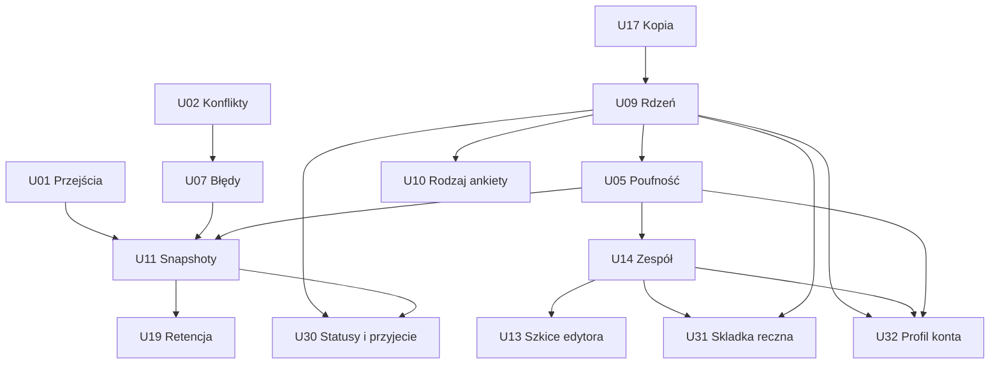

# Ursunalia — propozycje GitHub Issues

Stan: 13.10.2026, audyt HEAD `68737a8`. **Issues nie zostały opublikowane.** U01–U31 są lokalnymi identyfikatorami propozycji, nie numerami GitHub. Odczyt listy wszystkich stanów Issues przed utworzeniem dokumentacyjnego PR zwrócił pustą listę; nie znaleziono duplikatów. Ponowić deduplikację bezpośrednio przed późniejszą publikacją.

Priorytety: P0 — bloker/krytyczny problem; P1 — wymagane dla publicznego MVP; P2 — ważne, możliwe odłożenie; P3 — przyszły/opcjonalny rozwój. Rozmiary XS/S/M/L/XL są względną złożonością, nie estymacją dni. Nie ma jednego zadania „przebudować wszystko”. Epiki są grupami, a do realizacji służą konkretne zadania poniżej.

Dowody S1–S15 i ustalenia F01–F12: [FUNCTIONAL_SPEC](../product/FUNCTIONAL_SPEC.md). Decyzje Dxx: [DECISIONS](DECISIONS.md). Projekt zmian: [DATA_MODEL](../architecture/DATA_MODEL.md). Akceptacja każdego zadania wymaga zachowania dotychczasowych testów właściwych dla zmienianego zakresu; nie każdy mały UI fix wymaga powtarzania całego pilotażu.

## Epiki i indeks

| Epik | Cel | Zadania |
|---|---|---|
| E1 Stabilny proces uczestnika | Brak utraty pracy, prawidłowe statusy i kompletne widoki | U01/U02/U03/U07/U08/U22 |
| E2 Bezpieczne formularze | Walidacja, publikacja, struktura generatora | U04/U06/U12/U13/U21 |
| E3 Rdzeń i organizacja | Event, typy ankiet, historia, statusy, przyjęcie na wydarzenie i wydajne przeglądanie | U09/U10/U11/U23/U30 |
| E4 Prywatność i konta | Globalny profil kontaktowy, role wydarzenia, hasła, odzyskanie dostępu, retencja i składki | U05/U14/U15/U19/U29/U31/U32 |
| E5 Uruchomienie | Testy, kopie, hosting, pilot | U16/U17/U18/U20/U24 |
| E6 Późniejszy rozwój | Kolejne wydarzenia i funkcje fabularne | U25/U26/U27/U28 |

| ID | Tytuł skrócony | Priorytet | Rozmiar | Milestone | API / migracja |
|---|---|---|---|---|---|
| U01 | Jawna administracyjna zmiana statusu, bez fałszywej oceny wysłania | P0 | S/M | v27.3 | API / etapowo |
| U02 | Stan szkicu i konflikty zapisu | P1 | L | v27.3 | API / tak |
| U03 | Kompletne podsumowanie i dostępność | P1 | M | v27.3 | nie / nie |
| U04 | Definicje JSON i portrety | P1 | M | v27.3 | walidacja / nie |
| U05 | Poufność egzekwowana na serwerze | P0 | L | v28.0 | API / tak |
| U06 | Otwarcie zapisów i polityka rewizji | P1 | M | v27.3 | API / etapowo |
| U07 | Błędy sieci i uzgadnianie stanu | P1 | M | v27.3 | API / nie |
| U08 | Aktualizacja decyzji u uczestnika | P1 | S | v27.3 | opcjonalnie / nie |
| U09 | Minimalny model wydarzenia i migracja | P1 | L | v28.0 | API / tak |
| U10 | Rodzaj ankiety i semantyka pól | P1 | M | v28.0 | API / tak |
| U11 | Snapshoty wysłań i historia decyzji | P1 | L | v28.1 | API / tak |
| U12 | Kopiowanie i bezpieczna publikacja | P1 | M | v27.3 | API / nie |
| U13 | Serwerowy szkic kreatora | P2* | M | v28.1 | API / tak |
| U14 | Zespół i kontrolowany eksport | P1 | M | v28.1 | API / tak |
| U15 | Parametry haseł i cykl sesji | P1 | M | v29.0 | API / tak |
| U16 | E2E i macierz urządzeń | P1 | L | v27.3→v29.0 | nie / nie |
| U17 | Backup, restore i procedura migracji | P1 | M | v29.0** | nie / nie |
| U18 | Staging, HTTPS, proxy i monitoring | P1 | M | v29.0 | operacyjne / nie |
| U19 | Oświadczenia, retencja i usunięcie | P1 | L | v28.1 | API / tak |
| U20 | Spójna dokumentacja i bramki CI | P2 | S | v27.3 | nie / nie |
| U21 | Struktura generatora i katalogi | P1 | M | v27.3 | walidacja / bez przepisywania rewizji |
| U22 | Przywracanie eksportowanego szkicu | P2 | M | v28.1 | możliwe / nie |
| U23 | Zwięzła lista i stronicowanie | P1 | M | v28.1 | API / indeksy |
| U24 | Pilot i decyzja o otwarciu | P1 | M | v29.0 | nie / nie |
| U25 | Kreator następnych wydarzeń | P3 | L | po-2027 | API / zależnie od zakresu |
| U26 | Osobna postać fabularna | P2 | M | po-2027 | API / tak |
| U27 | Osobne przechowywanie obrazów | P3 | M | po-2027 | API / tak |
| U28 | Obsługa grup i relacji postaci | P3 | M | po-2027 | API / tak |
| U29 | Odzyskanie dostępu do konta | P1 | M | v29.0 | API / tak |
| U30 | Statusy i przyjęcie uczestnika przez akceptację postaci | P1 | M | v28.1 | API / tak |
| U31 | Ręczne potwierdzenie składki per wydarzenie i użytkownik | P1 | S/M | v28.1 | API / tak |
| U32 | Profil kontaktowy konta i edycja danych przy rejestracji | P1 | M | v28.1 | API / tak |

\* U13 staje się P1, jeśli kilku organizatorów lub kilka urządzeń ma edytować te same formularze przed wydarzeniem. ** U17: kopia i rehearsal są wymagane już przed U09; finalna automatyzacja odebrana w v29.0.

## E1/E2 — stabilizacja

### U01 — Rozróżnić zmianę statusu organizatora od oceny wysłanych odpowiedzi

- **Typ / priorytet / rozmiar:** bug/product / P0 / S/M.
- **Problem i obecne zachowanie:** F01: obecne API może zmienić `changes → accepted` mimo edycji niewysłanych odpowiedzi, bez wskazania, że jest to świadoma decyzja organizatora, bez autora i historii. Nie oznacza to, że samo przejście ma być zakazane.
- **Zatwierdzona reguła C10/D08:** organizator z uprawnieniem do oceny może zmienić status **z dowolnego na dowolny**. Rekomendowane ścieżki nie stanowią serwerowej listy dozwolonych zmian.
- **Rezultat:** jawna zmiana administracyjna nie udaje weryfikacji wysłanych odpowiedzi; brak sztucznych blokad.
- **Zakres / moduły:** status API, panel organizatora, ostrzeżenie/potwierdzenie nietypowej decyzji; zapis aktora, czasu, poprzedniego/nowego statusu i pochodzenia zmiany. Docelowa historia w U11.
- **Kryteria akceptacji:** `draft → accepted`, `changes → accepted`, `rejected → accepted` i `withdrawn → submitted` są dostępne uprawnionemu organizatorowi; jeżeli nie było faktycznego submit, źródło ma status `organizer_override` bez fikcyjnego `submissionId`; komunikat uprzedza przy niekompletnych/niewysłanych odpowiedziach, ale nie blokuje potwierdzenia; 401/403 oraz 409 przy konflikcie wersji nadal obowiązują.
- **Testy:** scenariusz F01, administracyjna akceptacja bez submission, wszystkie 7×7 przejść dla organizatora (po U30), historia, uprawnienia i regresja submit.
- **Zależności:** C10/D08 potwierdzone; U11 pełna historia, U30 nowe statusy.
- **Ryzyko regresji:** wysokie – odróżnić nadanie statusu od zatwierdzenia treści formularza.
- **Milestone / etykiety:** v27.3 / `bug`, `P0`, `api`, `workflow`, `epic:E1`.
### U02 — Chronić każdy szkic przed utratą i starym zapisem

- **Typ / priorytet / rozmiar:** bug / P1 / L.
- **Problem i obecne zachowanie:** F03/F04. Globalny dirty, bez wersji zapisu; zapis B może wyłączyć ostrzeżenie dla A; stary POST nadpisuje nowsze answers.
- **Rezultat:** znany stan zapisu każdego ID i jawny konflikt równoczesnej edycji.
- **Zakres / moduły:** PlatformStore, guard opuszczenia/logowania, aplikacje API/DB, addytywne lock_version.
- **Kryteria akceptacji:** dirty per zgłoszenie; zapis B nie oznacza A jako zapisane; expectedVersion egzekwowane atomowym UPDATE; stary zapis zwraca 409 i nie zmienia DB; UI pozwala zachować lokalne odpowiedzi i świadomie rozwiązać konflikt; brak kopii poufnych danych w localStorage bez zatwierdzonej polityki.
- **Testy:** dwie karty tego samego szkicu, przełączenie A/B, zamknięcie z dirty, zapis przy opóźnieniu odpowiedzi, migracja default version dla starych rekordów.
- **Zależności:** brak; uzgodnić DTO z U07/U11.
- **Ryzyko regresji:** wysokie — zapis i nawigacja.
- **Milestone / etykiety:** v27.3 / `bug`, `P1`, `data-integrity`, `migration`, `epic:E1`.

### U03 — Zapewnić kompletne i dostępne podsumowanie na każdym ekranie

- **Typ / priorytet / rozmiar:** bug / P1 / M.
- **Problem i obecne zachowanie:** F05; ręczna karta mobile pomija odpowiedzi, file poza portrait znika, zgody pokazują walidację zamiast wartości.
- **Rezultat:** uczestnik może sprawdzić każdą przesyłaną odpowiedź na telefonie i desktopie.
- **Zakres / moduły:** SummaryPage, FieldControl, SCSS, błędy/focus formularza; zachować Royal Manuscript.
- **Kryteria akceptacji:** skale, wykluczenia, wszystkie nowe pola i obrazy widoczne; faktyczne odpowiedzi zgód; wszystkie opisy dostępne dotykiem; select przewidywalny przy Tab/Escape/wyborze; błędy powiązane z kontrolkami; brak overflow przy 320/390/768/1440 px i 200% zoom.
- **Testy:** fixture ze wszystkimi typami i polem dodanym przez kreator, porównanie treści mobile/desktop, klawiatura i czytnik, długa treść. Druk z polityką U05.
- **Zależności:** U10 później uogólnia semantykę; naprawa brakujących wartości możliwa wcześniej.
- **Ryzyko regresji:** średnie — CSS i oba widoki.
- **Milestone / etykiety:** v27.3 / `bug`, `P1`, `ux`, `a11y`, `epic:E1`.

### U04 — Walidować cały kontrakt JSON i rzeczywiste obrazy

- **Typ / priorytet / rozmiar:** bug / P1 / M.
- **Problem i obecne zachowanie:** F06/F07; niewłaściwe typy opisów i fałszywy base64 PNG przechodzą walidator.
- **Rezultat:** import i API przyjmują tylko poprawne, ograniczone dane.
- **Zakres / moduły:** shared validation, import kreatora, parser API, upload i serwerowe sprawdzenie obrazu. Wybrać utrzymywaną bibliotekę dekodującą po sprawdzeniu zależności.
- **Kryteria akceptacji:** jawne typy/limity opcjonalnych właściwości; wspólne limity bajtów UTF-8; odrzucenie niepoprawnego obrazu i nadmiernych wymiarów; usunięcie zbędnych metadanych; brak fetch zewnętrznego URL; zgodność starego prawidłowego seeda.
- **Testy:** null/array/object w opisach, duplikaty, 300/301 pól, 200/201 opcji, polskie znaki przy limicie, zły MIME/base64, obraz graniczny i zbyt duże wymiary; przykład Aleny nadal działa.
- **Zależności:** brak; D14 dla limitów zasobów.
- **Ryzyko regresji:** średnie — dotychczasowe importy; błędy wyjaśnić zamiast tracić szkic.
- **Milestone / etykiety:** v27.3 / `bug`, `P1`, `validation`, `security`, `epic:E2`.

### U06 — Egzekwować dostępność zapisów i politykę rewizji

- **Typ / priorytet / rozmiar:** feature / P1 / M.
- **Problem i obecne zachowanie:** F10; stałe „Zapisy otwarte”, nowe zgłoszenia na każdej znanej rewizji.
- **Rezultat:** organizator może zamknąć nowe zapisy bez utraty istniejących szkiców i poprawek.
- **Zakres / moduły:** konfiguracja jednego wydarzenia, API start/save/submit, lista formularzy; U09 przeniesie politykę do relacyjnego Event/Form.
- **Kryteria akceptacji:** jawne closed/open/paused; UI i API zgodne; nowe zgłoszenie tylko na current published revision; istniejący draft zachowuje wersję; zasady wysłania po terminie oraz poprawek określone w D11; brak cichego rebase.
- **Testy:** granice terminów Europe/Warsaw/UTC, stare i nowe szkice, nieaktualny frontend, wywołanie API z pominięciem UI.
- **Zależności:** D01/D11; nie wymaga pełnego kreatora wydarzeń.
- **Ryzyko regresji:** wysokie — omyłkowa blokada zgłoszeń.
- **Milestone / etykiety:** v27.3 / `feature`, `P1`, `registration`, `api`, `epic:E2`.

### U07 — Zachować pracę przy błędach sieci i sesji

- **Typ / priorytet / rozmiar:** bug / P1 / M.
- **Problem i obecne zachowanie:** S2 request/save/submit odrzuca field errors, komunikaty znikają; sukces serwera z utraconą odpowiedzią pozostawia stary status klienta.
- **Rezultat:** użytkownik wie, co zapisano, i może bezpiecznie kontynuować.
- **Zakres / moduły:** error DTO, store, konto, toasty, powrót po logowaniu i reconciliation.
- **Kryteria akceptacji:** trwały błąd przy danym szkicu; fieldErrors widoczne; 401 nie kasuje tekstu podczas ponownego logowania; 409 pobiera stan bez automatycznego nadpisania lokalnej pracy; timeout po submit rozpoznaje udany zapis; błędy logout widoczne także w widoku konta zalogowanego.
- **Testy:** offline/timeout przed i po commit, 401/409/413/422/500, retry bez duplikatu; scenariusz utraty odpowiedzi po submit.
- **Zależności:** U02 dla konfliktów; finalny protokół idempotency z U11.
- **Ryzyko regresji:** wysokie — synchronizacja stanu.
- **Milestone / etykiety:** v27.3 / `bug`, `P1`, `network`, `ux`, `epic:E1`.

### U08 — Pokazywać aktualne decyzje po wejściu na listę

- **Typ / priorytet / rozmiar:** feature / P1 / S.
- **Problem i obecne zachowanie:** uczestnik ma stan z bootstrapu; decyzja innego użytkownika pozostaje niewidoczna do ponownego ładowania aplikacji.
- **Rezultat:** czytelny status i feedback bez konieczności odgadywania, że potrzebne jest F5.
- **Zakres / moduły:** lista uczestnika, bezpieczne odświeżenie, status ostatniej synchronizacji.
- **Kryteria akceptacji:** odświeżenie przy wejściu i przyciskiem; nie zastępuje dirty szkiców; changes pokazuje komentarz i możliwość edycji; błędy odświeżenia nie kasują danych. Email nie jest warunkiem tego zadania.
- **Testy:** dwa konta/konteksty, decyzja organizatora, powrót na listę, jednoczesny dirty draft i błąd sieci.
- **Zależności:** U02/U07; D13 tylko dla rozszerzenia powiadomień.
- **Ryzyko regresji:** średnie — refresh może wyczyścić pracę.
- **Milestone / etykiety:** v27.3 / `feature`, `P1`, `participant`, `epic:E1`.

### U12 — Oddzielić kopię formularza od nowej rewizji

- **Typ / priorytet / rozmiar:** bug / P1 / M.
- **Problem i obecne zachowanie:** F11; import zachowuje ID, lokalny szkic nie śledzi aktualnej rewizji; slot new może przywracać poprzednią ankietę.
- **Rezultat:** wydawca świadomie tworzy nową ankietę albo nową wersję.
- **Zakres / moduły:** builder import/duplicate/publish, baseRevision w publikacji, localStorage namespace z trybem/użytkownikiem; reorder opcji klawiaturą.
- **Kryteria akceptacji:** „Kopia” ma nowe form.id; „Nowa wersja” zachowuje ID po potwierdzeniu; publikacja starej bazy zwraca 409; stan po publikacji pokazuje nową rewizję; „Nowa ankieta” nie edytuje opublikowanego poprzednika; kolejność opcji dostępna bez DnD.
- **Testy:** import tej samej ankiety w obu trybach, dwie karty wydawcy, publikacja i ponowne otwarcie, użytkownicy współdzielący przeglądarkę, klawiatura.
- **Zależności:** U04 dla importu; U13 później zastępuje localStorage jako źródło prawdy.
- **Ryzyko regresji:** średnie — zachować kopie dawnych szkiców.
- **Milestone / etykiety:** v27.3 / `bug`, `P1`, `builder`, `versioning`, `epic:E2`.

### U21 — Zatwierdzić strukturę generatora i sprawdzać spójność katalogów

- **Typ / priorytet / rozmiar:** product/quality / P1 / M.
- **Problem i obecne zachowanie:** S10/S15: 2–5 cech, 0–4 haki; odrębne katalogi i zagnieżdżone opcje mogą się rozjechać. Brak reguły polaryzacji cech.
- **Rezultat:** zatwierdzona struktura i jedna kontrolowana ścieżka tworzenia definicji.
- **Zakres / moduły:** lista decyzji o sekcjach/limitach, walidacja katalogów i generator publikowanej definicji lub test porównania; dopiero później opisy tagów.
- **Kryteria akceptacji:** D07 zapisuje wybraną regułę; cechy/haki pozostają osobne; test wychwytuje rozbieżne ID/etykiety/opisy; żadna historyczna rewizja nie jest automatycznie przepisywana; brak zmian lore poza zatwierdzonym zakresem.
- **Testy:** rozbieżna opcja, usunięty tag, limit cech, seed/example, zachowanie starych odpowiedzi po nowej publikacji.
- **Zależności:** D07; ewentualna reguła kategorii wymaga U04/U10.
- **Ryzyko regresji:** średnie — zgodność katalogu ze starymi zgłoszeniami.
- **Milestone / etykiety:** v27.3 / `product`, `P1`, `catalog`, `epic:E2`.

## E3/E4 — dane i dostęp

### U09 — Dodać minimalny Event/Form i migrację istniejących danych

- **Typ / priorytet / rozmiar:** architecture / P1 / L.
- **Problem i obecne zachowanie:** S1 schema: wydarzenie w seed, Form utożsamiony z rewizją; brak rejestru migracji.
- **Rezultat:** relacyjny rdzeń dla jednej grupy i wielu możliwych wydarzeń, z jednym aktywnym wydarzeniem w UI.
- **Zakres / moduły:** schema_migrations, events, forms/revisions, FK applications, mapowanie starych ról do event_members; API bootstrap; rehearsal/rollback.
- **Kryteria akceptacji:** zachowane ID użytkowników, hashe, wszystkie szkice/answers/revisions; poprawne FK; seed Ursunalia tylko raz; niewłaściwy event/form odrzucony; brak kreatora wielu imprez w zakresie. Daty bez wymyślonych godzin.
- **Testy:** fixture z każdą rewizją/statusem, restart, ponowienie migracji, przerwanie w połowie, login historycznym hasłem, rollback i porównanie danych.
- **Zależności:** D04/D15, pierwsza część U17, U02; projekt uprawnień z D03.
- **Ryzyko regresji:** wysokie — migracja danych i bootstrap.
- **Milestone / etykiety:** v28.0 / `architecture`, `P1`, `migration`, `api`, `epic:E3`.

### U10 — Uogólnić formularze przez kind i semanticKey

- **Typ / priorytet / rozmiar:** refactor / P1 / M.
- **Problem i obecne zachowanie:** S5/S14: pierwsza ankieta oznacza postać; ID pól sterują podsumowaniem i poufnością.
- **Rezultat:** logistyka i zwykła ankieta mają poprawny widok bez udawania postaci.
- **Zakres / moduły:** models, renderer, listy, event page, publikowane definicje schemaVersion i mapowanie starych pól.
- **Kryteria akceptacji:** character/logistics/generic jawne; każde pole widoczne niezależnie od jego ID; nowa zwykła ankieta nie pokazuje „POSTAĆ”; niezmienione stare rewizje obsługiwane adapterem; klasyfikacja poufności z serwera U05.
- **Testy:** ankieta bez pól name/portrait/identity, zmieniona kolejność formularzy, nowe sekcje, stare snapshoty.
- **Zależności:** U09, U03; polityka danych D03.
- **Ryzyko regresji:** średnie — prezencja i stare dane.
- **Milestone / etykiety:** v28.0 / `refactor`, `P1`, `forms`, `epic:E3`.

### U05 — Ograniczyć odczyt poufnych odpowiedzi przed serializacją

- **Typ / priorytet / rozmiar:** security / P0 / L.
- **Problem i obecne zachowanie:** F02, pełne boundaries/exclusions/needs i portrety trafiają do każdego organizer przez masową listę; CSS to jedyna część oznaczenia poufności.
- **Rezultat:** dostęp zależy od wydarzenia i capability; nieuprawniony klient nigdy nie otrzymuje chronionej treści.
- **Zakres / moduły:** klasyfikacja pól, event_members, rozdzielenie answers, DTO list/detail/export, wydruk, audyt odczytu; brak logowania wartości.
- **Kryteria akceptacji:** fabularzysta domyślnie widzi **całość informacji fabularnych wszystkich postaci wydarzenia, również tajemnice i haki**, a z kontaktów wyłącznie podane FB i Discord; nie otrzymuje imienia/nazwiska uczestnika, e-maila, telefonu, granic ani danych zdrowotnych (C14). Główny organizator widzi dane uczestników swojego wydarzenia, w tym granice i zdrowie, ale nie hasła i sesje; pozostałe role według praw. Lista nie zawiera nieuprawnionych danych; filtracja na serwerze dla list/detail/export/print; brak globalnego katalogu kontaktów organizatorów. Nowe pola muszą mieć jawną politykę. Do wdrożenia zabezpieczeń nie zbierać realnych poufnych odpowiedzi.
- **Testy:** macierz uczestnik/inna osoba/reviewer/safety/manager, cross-event, bezpośrednie API, list/detail/export/print i kontrola logów.
- **Zależności:** D03, U09; U10 dostarcza semantykę, ale uprawnienia nie mogą zależeć wyłącznie od UI.
- **Ryzyko regresji:** wysokie — migracja i możliwe ujawnienie danych.
- **Milestone / etykiety:** v28.0 / `security`, `P0`, `privacy`, `migration`, `epic:E4`.

### U11 — Zapisać niezmienne wysłania i historię decyzji

- **Typ / priorytet / rozmiar:** feature / P1 / L.
- **Problem i obecne zachowanie:** S1 applications.answers/feedback nadpisywane; brak autora/czasu oceny i historii, poprawki mieszają się z wysłanym stanem.
- **Rezultat:** każde wysłanie i decyzja mają jednoznaczne powiązanie.
- **Zakres / moduły:** submissions, `application_status_history`, audyt, submit transakcyjny/idempotentny, UI historii, migracja stanu zastanego z legacy provenance.
- **Kryteria akceptacji:** rzeczywiste wysłanie ma niezmienny snapshot, a każda zmiana statusu ma historię z aktorem, poprzednim i nowym statusem oraz czasem. `submission_id` może być NULL przy administracyjnym nadaniu statusu bez wcześniejszego wysłania; nie tworzyć fikcyjnych wysłań. Retry submit idempotentny, zmiana szkicu nie przepisuje starego snapshotu, zachowany historyczny feedback i jawne pochodzenie danych legacy.
- **Testy:** cykl 2 poprawek, dwóch recenzentów, równoczesny submit/review, utrata odpowiedzi, migracja changes z edytowanym szkicem i submitted ze starym feedback.
- **Zależności:** U01/U02/U07/U09/U05, D08/D09.
- **Ryzyko regresji:** wysokie — transakcje, historia i prywatność.
- **Milestone / etykiety:** v28.1 / `feature`, `P1`, `workflow`, `migration`, `epic:E3`.

### U13 — Przechowywać wspólny szkic ankiety na serwerze

- **Typ / priorytet / rozmiar:** feature / P2 warunkowo P1 / M.
- **Problem i obecne zachowanie:** S6 82–130: szkic tylko w localStorage, bez współpracy między urządzeniami.
- **Rezultat:** jeden wspólny FormDraft z wersją blokady i rewizją bazową.
- **Zakres / moduły:** tabela drafts, API CRUD/uprawnienia, lista szkiców, import istniejącego eksportu; brak realtime collaboration.
- **Kryteria akceptacji:** szkic dostępny na drugim urządzeniu; konflikt zwraca 409; publikacja nie gubi draftu przy awarii; import nie usuwa starej lokalnej kopii; błędny/niekompletny draft można zapisać, ale nie opublikować.
- **Testy:** dwaj wydawcy, awaria zapisu/publikacji, import legacy v1 i v27, uprawnienia wydarzenia.
- **Zależności:** D10, U09/U12/U14.
- **Ryzyko regresji:** średnie — przenoszenie lokalnych szkiców.
- **Milestone / etykiety:** v28.1 / `feature`, `P2`, `builder`, `migration`, `epic:E2`.

### U14 — Zarządzać uprawnieniami zespołu i zakresem eksportu

- **Typ / priorytet / rozmiar:** feature / P1 / M.
- **Problem i obecne zachowanie:** jeden globalny organizer publikuje, ocenia i eksportuje całość; brak procedury odebrania dostępu.
- **Rezultat:** jawna, mała macierz ról wydarzenia i kontrola eksportu.
- **Zakres / moduły:** EventMember, role `head_organizer` i `storyteller`, narzędzie nadawania/odbierania uprawnień, osobne prawa do FB/Discord, imienia/nazwiska, e-mail/telefonu, danych fabularnych, granic i danych zdrowotnych; kontrolowany eksport i audyt.
- **Kryteria akceptacji:** główny organizator czyta dane uczestników przypisanych do jego wydarzenia i zarządza uprawnieniami; fabularzysta bez dodatkowej konfiguracji widzi fabułę wszystkich postaci (łącznie z tajemnicami i hakami) oraz z kontaktów wyłącznie podane FB/Discord, ale nie e-mail/telefon/nazwisko, granice ani zdrowie; domyślne role nie rozszerzają dostępu między wydarzeniami; uprawniony zarządca może nadawać/odbierać capabilities, odebranie działa od następnego żądania mimo aktywnej sesji; eksport zawiera wyłącznie dozwolone pola i nie ujawnia danych z innych wydarzeń.
- **Testy:** ustawienie roli storyteller nadaje `can_read_story=1` i `can_read_social_contacts=1`, pełna historia/sekrety/haki wszystkich postaci w danym wydarzeniu, brak prywatnego kontaktu/granic/zdrowia, zmiana roli podczas sesji, cross-event, próba eskalacji, eksport bez prawa, log audytowy bez danych odpowiedzi.
- **Zależności:** D03, U09/U05.
- **Ryzyko regresji:** wysokie — nadanie zbyt szerokiego dostępu lub utrata dostępu zespołu.
- **Milestone / etykiety:** v28.1 / `feature`, `P1`, `authorization`, `epic:E4`.

### U15 — Wersjonować parametry haseł i dopracować sesje

- **Typ / priorytet / rozmiar:** security / P1 / M.
- **Problem i obecne zachowanie:** F08; domyślny scrypt, salt:hash bez parametrów; brak unieważnienia wszystkich sesji.
- **Rezultat:** mierzalny koszt haszowania, kompatybilne stare loginy i kontrolowany cykl sesji.
- **Zakres / moduły:** auth, password_scheme, parametry/rehash, zmiana hasła i revocation; porównać koszt na docelowym serwerze z aktualną rekomendacją OWASP.
- **Kryteria akceptacji:** jawne zapisane parametry; logowanie starym hasłem działa i aktualizuje hash bez wymuszania utraty konta; reset/zmiana hasła unieważnia stare sesje; cookie flagi poprawne za HTTPS; brak haseł/tokenów w logach.
- **Testy:** stare/nowe hashe, błędne hasło, expiry/logout/revoke, Secure/SameSite/HttpOnly; pomiar czasu i zużycia pamięci przy obciążeniu.
- **Zależności:** U09 dla schematu lub mała addytywna migracja; U18 dla pomiaru; D05.
- **Ryzyko regresji:** wysokie — możliwość zablokowania kont.
- **Milestone / etykiety:** v29.0 / `security`, `P1`, `auth`, `epic:E4`.

### U19 — Wdrożyć zatwierdzone oświadczenia, retencję i usuwanie danych

- **Typ / priorytet / rozmiar:** privacy / P1 / L.
- **Problem i obecne zachowanie:** S10 checkboxy bez wersji dokumentu; brak retencji/usunięcia, poufne needs w zwykłej ankiecie. Audyt techniczny nie ustala podstaw prawnych.
- **Rezultat:** minimalny zatwierdzony zakres danych i wykonalna procedura ich obsługi.
- **Zakres / moduły:** informacja dla uczestnika, metadane dokumentów i consent_records, retencja odpowiedzi/snapshotów/portretów/logów/backupów, usunięcie konta przez kontrolowaną procedurę.
- **Kryteria akceptacji:** właściciel zatwierdził D06 po odpowiedniej weryfikacji; rzeczywista wartość i wersja oświadczenia zapisana przy submit; dane legacy nie są przedstawiane jako nowe zgody; dry-run usunięcia pokazuje zakres; wykonanie usuwa lub anonimizuje zatwierdzone dane bez naruszenia cudzych zgłoszeń.
- **Testy:** wersjonowanie dokumentu, dobrowolna odmowa, usunięcie z snapshotów/eksportu, polityka backupów, próba nieuprawniona, rekord legacy.
- **Zależności:** D03/D06, U05/U11/U14; harmonogram backupów z U17.
- **Ryzyko regresji:** wysokie — nieodwracalne usunięcie; operacje wymagają procedury i kopii w dozwolonym okresie.
- **Milestone / etykiety:** v28.1 / `privacy`, `P1`, `retention`, `epic:E4`.

### U23 — Oddzielić listę zgłoszeń od szczegółów i dodać stronicowanie

- **Typ / priorytet / rozmiar:** performance / P1 / M.
- **Problem i obecne zachowanie:** S1 366–373 i S7 pobierają wszystkie definicje, answers i portrety dla filtrów frontendowych.
- **Rezultat:** szybka lista minimalnych danych, szczegóły na żądanie.
- **Zakres / moduły:** DTO list/detail, filtry SQL, indeksy, cursor pagination, organizer UI.
- **Kryteria akceptacji:** lista bez portretów i poufnych treści; stabilne sortowanie przy identycznych datach; filtr osoby/form/status/event na serwerze; limit strony; kontrola dostępu na szczegółach; pomiar przy uzgodnionej skali D14 bez pełnego pobierania bazy.
- **Testy:** paginacja bez pomijania/duplikacji, filtry, odrzucony obcy cursor/ID, fixture 200 osób×2 ankiety z portretami; ustalony budżet odpowiedzi i czasu na staging.
- **Zależności:** U09/U05; U11 dla szczegółów historii.
- **Ryzyko regresji:** średnie — wyniki filtrów i uprawnienia.
- **Milestone / etykiety:** v28.1 / `performance`, `P1`, `organizer`, `api`, `epic:E3`.

### U29 — Zapewnić bezpieczne odzyskanie dostępu do konta

- **Typ / priorytet / rozmiar:** feature / P1 / M.
- **Problem i obecne zachowanie:** brak resetu i weryfikacji email; zapomniane hasło blokuje dostęp do zapisanych zgłoszeń.
- **Rezultat:** uczestnik odzyskuje konto bez tworzenia duplikatu i bez ujawnienia danych innej osobie.
- **Zakres / moduły:** wybrany kanał email i jednorazowe hashowane tokeny z TTL, rate limit, formularz resetu, unieważnienie sesji; ewentualny ręczny wariant pilota zgodnie z D05.
- **Kryteria akceptacji:** token jednorazowy, wygasający i niedostępny w logach; odpowiedź publiczna nie potwierdza istnienia konta; link do zaufanej domeny; stare sesje unieważnione; procedura wsparcia ma właściciela. Emaile nie zawierają odpowiedzi ani informacji poufnych.
- **Testy:** zużyty/wygasły token, zły użytkownik, dwa równoczesne użycia, ograniczenie prób, dostarczenie na staging, zachowanie zgłoszeń po resecie.
- **Zależności:** D05/D02, U15/U18.
- **Ryzyko regresji:** wysokie — przejęcie konta przy błędzie implementacji.
- **Milestone / etykiety:** v29.0 / `feature`, `P1`, `auth`, `epic:E4`.

## E5 — testy i uruchomienie

### U16 — Dodać E2E rzeczywistego procesu i kontrolę urządzeń

- **Typ / priorytet / rozmiar:** test / P1 / L.
- **Problem i obecne zachowanie:** 13 jsdom + 6 HTTP, brak testu browser→żywe API. Dawne QA nie sprawdza całej produkcyjnej ścieżki.
- **Rezultat:** odtwarzalny test najważniejszego procesu na tym samym buildzie i API co wdrożenie.
- **Zakres / moduły:** Playwright lub równoważny runner, izolowana baza, dwa konta/konteksty, CI artifacts bez realnych danych.
- **Kryteria akceptacji:** rejestracja→szkic→zamknięcie/reopen→submit→changes→resubmit→accepted; publikacja nowej rewizji nie zmienia starego zgłoszenia; scenariusze offline i 401/409; 390/768/1440 px, 320 smoke; Chrome/Firefox/WebKit i ręczny telefon/klawiatura. Testy nie stubują API głównego procesu.
- **Testy:** samo zadanie dostarcza scenariusze, dowody i instrukcję wykonania; później regresja U05/U11 i granice poufności.
- **Zależności:** szkielet niezależny; zielony odbiór po U01/U02/U03/U07; finalny po zmianach danych.
- **Ryzyko regresji:** niskie dla aplikacji, średnie dla niestabilności CI; brak realnych danych w raportach.
- **Milestone / etykiety:** v27.3, rozszerzane do v29.0 / `test`, `P1`, `e2e`, `epic:E5`.

### U17 — Wdrożyć i sprawdzić kopię oraz odtworzenie SQLite

- **Typ / priorytet / rozmiar:** operations / P1 / M.
- **Problem i obecne zachowanie:** README zaleca backup, brak sprawdzonej automatyzacji, restore i RPO/RTO.
- **Rezultat:** odtworzenie na pustym środowisku bez utraty rewizji i odpowiedzi.
- **Zakres / moduły:** spójny backup SQLite/WAL, szyfrowanie/uprawnienia, rotacja, monitoring, runbook migracji i rollback.
- **Kryteria akceptacji:** kopia z aktywnej bazy spójna; restore przechodzi integrity_check/FK i porównanie danych; logowanie i proces działają; kopie poza pojedynczym dyskiem aplikacji; RPO/RTO zatwierdzone i zmierzone. Pierwszy rehearsal przed U09, finalny po U11/U19.
- **Testy:** zapis podczas backupu, brak miejsca, uszkodzona kopia, odzyskanie na czystym hoście, alarm błędu i rotacja.
- **Zależności:** D02/D14/D15; zakres retencji z D06, nie wymaga implementacji U19 do pierwszego testu.
- **Ryzyko regresji:** wysokie przy operacji restore; testy wyłącznie na kopii.
- **Milestone / etykiety:** v29.0 z warunkiem wcześniejszego odbioru / `operations`, `P1`, `backup`, `epic:E5`.

### U18 — Przygotować staging HTTPS, limiter za proxy i monitoring

- **Typ / priorytet / rozmiar:** operations/security / P1 / M.
- **Problem i obecne zachowanie:** Pages to demo; brak dowodu serwerowego wdrożenia. Limiter widzi remoteAddress wspólnego proxy.
- **Rezultat:** powtarzalne wdrożenie jednej instancji ze sprawdzonym TLS, trwałością i sygnałem awarii.
- **Zakres / moduły:** proxy/host/service, konfiguracja poza repo, zaufane proxy, per-client limiter i globalny limit kosztu auth, health/readiness, logi bez danych osobistych, alerty, rollout/rollback.
- **Kryteria akceptacji:** produkcyjny Secure cookie działa; app/API jedna domena; fake X-Forwarded-For nie omija limitu; jeden klient nie blokuje wszystkich; restart nie traci DB; monitoring wykrywa 5xx/brak miejsca/backup failure; nie ma sekretów w git/raportach.
- **Testy:** pełna ścieżka HTTPS, ruch przez proxy, spoofed headers, 429, restart, niedostępna DB, rollback builda na staging.
- **Zależności:** D02, U17 dla docelowego restore; przygotowania niezależne od zmian UI.
- **Ryzyko regresji:** wysokie — dostępność i sesje.
- **Milestone / etykiety:** v29.0 / `operations`, `P1`, `security`, `epic:E5`.

### U20 — Uporządkować instrukcję uruchomienia i bramki CI

- **Typ / priorytet / rozmiar:** docs/chore / P2 / S.
- **Problem i obecne zachowanie:** README/stare QA opisują ograniczenia minionego środowiska, package version 27.0.0 nie zgadza się z nazewnictwem prac; deploy Pages ma osobną ścieżkę build.
- **Rezultat:** jedna bieżąca instrukcja, historyczne QA jawnie opisane i czytelny wynik weryfikacji.
- **Zakres / moduły:** README, odnośniki do tych 5 dokumentów, wersjonowanie wydania, workflow verify i bezpieczna zależność deploy od odpowiednich kontroli; bez wdrożenia przy zmianie samej dokumentacji.
- **Kryteria akceptacji:** czyste środowisko odtwarza build/test; jasno rozróżnione demo/server; komplet dokumentów ma indeks; wymagane kontrole PR wskazane; nie deklaruje testu przeglądarki na podstawie jsdom.
- **Testy:** przejście instrukcji na czystym checkout, kontrola YAML i linków, sprawdzenie triggerów bez produkcyjnego deploy.
- **Zależności:** brak; aktualizować wraz z U16/U18.
- **Ryzyko regresji:** niskie/średnie — zmiana workflow.
- **Milestone / etykiety:** v27.3 / `docs`, `P2`, `ci`, `epic:E5`.

### U24 — Przeprowadzić pilot i zatwierdzić publiczne zapisy

- **Typ / priorytet / rozmiar:** release / P1 / M.
- **Problem i obecne zachowanie:** brak dowodu działania całej ścieżki na docelowym wdrożeniu z użytkownikami.
- **Rezultat:** konkretna decyzja go/no-go przed T z listą warunków i właścicielem.
- **Zakres / moduły:** staging, scenariusze uczestnika i dwóch organizatorów, obsługa zgłoszeń problemów, test odtworzenia i końcowa kontrola bezpieczeństwa.
- **Kryteria akceptacji:** brak otwartych P0; wymagane P1 odebrane lub funkcja formalnie wyłączona; pełny E2E/telefon/klawiatura; D01/D02/D03/D05/D06/D14 zatwierdzone; kanał wsparcia i odpowiedzialność; zmierzony backup/restore. Otwarcie zapisów jako osobna świadoma decyzja właściciela.
- **Testy:** cykl bez pomocy programisty, awaria sieci, zapomniane hasło, odzyskanie DB, uprawnienia, długie opisy; raport z błędami i powtórnym odbiorem.
- **Zależności:** U01–U12 w zakresie P0/P1, U14/U15/U16/U17/U18/U19/U21/U23/U29. U13 tylko gdy D10 wymaga współpracy.
- **Ryzyko regresji:** wysokie operacyjnie; początkowy pilot na fikcyjnych danych.
- **Milestone / etykiety:** v29.0 / `release`, `P1`, `pilot`, `epic:E5`.

## Ulepszenia opcjonalne i po wydarzeniu

### U22 — Przywracać pobrany szkic uczestnika z JSON

- **Typ / priorytet / rozmiar:** feature / P2 / M.
- **Problem i obecne zachowanie:** eksport jest sugerowany przy quota, ale brak importu uczestnika.
- **Rezultat:** kontrolowany powrót do pracy z własnej kopii.
- **Zakres / moduły:** import, walidacja, mapa rewizji i podgląd różnic; nigdy import roli/statusu decyzji z pliku.
- **Kryteria akceptacji:** wymagane logowanie; plik nie zastępuje cudzego ID; konflikt istniejącego szkicu wymaga świadomego wyboru; nieznana rewizja nie jest zgadywana; stare dane nie są kasowane przed sukcesem.
- **Testy:** własny poprawny eksport, duży/uszkodzony plik, obce ID, submitted/accepted w pliku, nieznana wersja, powtórny import.
- **Zależności:** U02/U04/U07, D04.
- **Ryzyko regresji:** średnie — nadpisanie pracy.
- **Milestone / etykiety:** v28.1 opcjonalnie / `feature`, `P2`, `recovery`, `epic:E1`.

### U25 — Dodać prosty kreator kolejnego wydarzenia

- **Typ / priorytet / rozmiar:** feature / P3 / L.
- **Problem i obecne zachowanie:** wydarzenie seed i stałe teksty; cel przyszły wymaga konfigurowania wydarzeń bez kopiowania aplikacji.
- **Rezultat:** druga prosta impreza jednej grupy, bez generatora postaci.
- **Zakres / moduły:** panel Event, daty/miejsce, ankiety i publikacja; bez mikroserwisów/wielu organizacji.
- **Kryteria akceptacji:** manager tworzy warsztat, wybiera generic form, publikuje i zamyka zapisy; Ursunalia/historyczne dane nie zmieniają się; prywatność i role działają osobno per event.
- **Testy:** dwa wydarzenia, inne formularze, cross-event permissions, archiwum.
- **Zależności:** U09/U10/U14/U24, retrospektywa po wydarzeniu.
- **Ryzyko regresji:** średnie — routing, zakres wydarzenia.
- **Milestone / etykiety:** po-2027 / `feature`, `P3`, `events`, `epic:E6`.

### U26 — Utworzyć odrębny profil postaci z zaakceptowanego zgłoszenia

- **Typ / priorytet / rozmiar:** feature / P2 / M.
- **Problem i obecne zachowanie:** odpowiedź formularza jest traktowana jako postać; nie ma niezależnego bytu do pracy fabularnej.
- **Rezultat:** Character wskazuje właściciela, wydarzenie i źródłowe wysłanie, bez danych organizacyjnych/poufnych.
- **Zakres / moduły:** tabela characters, jawne mapowanie pól fabularnych, idempotentna projekcja po akceptacji, oddzielny widok.
- **Kryteria akceptacji:** logistyka nigdy nie tworzy Character; jeden source_application tworzy najwyżej jedną postać; historia zgłoszenia pozostaje; brak boundaries/needs/zgód w profilu; sposób ponownego otwarcia źródła uzgodniony.
- **Testy:** ponowienie akceptacji/projekcji, błędne event/owner, stary snapshot, brak pola imienia, filtr danych.
- **Zależności:** D12/D08, U10/U11/U05.
- **Ryzyko regresji:** średnie — dwa modele tej samej informacji fabularnej.
- **Milestone / etykiety:** po-2027, wcześniej tylko z uzasadnioną potrzebą / `feature`, `P2`, `characters`, `epic:E6`.

### U27 — Oddzielić magazyn obrazów, jeśli pomiary wykażą potrzebę

- **Typ / priorytet / rozmiar:** performance / P3 / M.
- **Problem i obecne zachowanie:** obrazy base64 powiększają JSON, snapshoty i kopie.
- **Rezultat:** prywatne zasoby z uprawnieniami i spójnym backupem.
- **Zakres / moduły:** storage adapter, asset ID, autoryzowany odczyt, migracja i sprzątanie sierot; bez publicznego bucketu.
- **Kryteria akceptacji:** zachowane obrazy, ograniczenie dostępu, lista nie pobiera plików; DB+assets odtwarzają się razem; usunięcie/retencja usuwa niepotrzebne kopie; uzasadnienie pomiarami.
- **Testy:** migracja i checksum, przerwany upload, obcy asset ID, restore, usunięcie użytkownika.
- **Zależności:** U04/U05/U17/U19/U23.
- **Ryzyko regresji:** wysokie — utrata plików przy niespójnym restore.
- **Milestone / etykiety:** po-2027 / `performance`, `P3`, `assets`, `epic:E6`.

### U28 — Dodać pierwszy moduł relacji postaci

- **Typ / priorytet / rozmiar:** feature / P3 / M.
- **Problem i obecne zachowanie:** relacje są tekstem, nie ma zarządzania powiązaniami i widocznością.
- **Rezultat:** minimalna relacja między dwiema postaciami bez ujawnienia cudzych zgłoszeń.
- **Zakres / moduły:** jedna relacja z opisem i stanem potwierdzenia; wyraźnie określona widoczność. Grupy/przydziały jako późniejsze osobne Issues.
- **Kryteria akceptacji:** właściciel widzi tylko dozwolone powiązania; organizator zatwierdza; wykluczenia/bezpieczeństwo nie trafiają do publicznego opisu; istniejący tekst zachowany przy imporcie.
- **Testy:** obce wydarzenie, wycofanie potwierdzenia, różne prawa stron, usunięcie postaci, migracja starego tekstu bez zgadywania osób.
- **Zależności:** U26/U14/U19, osobna decyzja produktowa po retrospektywie.
- **Ryzyko regresji:** wysokie prywatności — ujawnienie relacji/niechcianych kontaktów.
- **Milestone / etykiety:** po-2027 / `feature`, `P3`, `relations`, `epic:E6`.

## E3/E4 — dodatkowe wymagania Ursunaliów 2027, zgłoszone po audycie

### U30 — Wdrożyć siedem statusów i przyjęcie przez zaakceptowanie postaci

- **Typ / priorytet / rozmiar:** feature / P1 / M.
- **Potwierdzona reguła:** akceptacja postaci oznacza przyjęcie na Ursunalia 2027; zatwierdzenie formularza logistycznego nie przyjmuje gracza (C07/D16). Składka nie zmienia statusu automatycznie.
- **Zatwierdzone statusy (C09/D18):** `draft`, `submitted`, `changes`, `accepted`, `waitlisted`, `rejected`, `withdrawn`. `cancelled` skreślono na rzecz `rejected`.
- **Zatwierdzone C10/D08:** organizator może ustawić każdy z siedmiu statusów z każdego stanu, również `withdrawn` i `rejected`. Rekomendowane przejścia w UI nie blokują dowolnej decyzji. Uczestnik po `withdrawn` może wznowić tę samą Application, edytować i ponownie wysłać postać.
- **Zakres / moduły:** API statusów, serwerowe uprawnienia i walidacja właściciela, `forms.grants_admission`, lista przyjętych, historia U11, UI i audyt. Nie tworzyć drugiej encji przyjęcia.
- **Kryteria akceptacji:** accepted na postaci oznacza przyjęcie niezależnie od wcześniejszego stanu; accepted logistyki nie; withdrawn/rejected nie przyjmują; 7×7 przejść dla uprawnionego organizatora; wznawianie `withdrawn → draft → submitted` lub ponowne wysłanie po walidacji, bez utraty ID i odpowiedzi; administracyjne nadanie statusu bez submission ma jawną historię i ostrzeżenie, nie blokadę; składka zachowana.
- **Testy:** wszystkie statusy źródłowe/docelowe, historia, odzyskanie wycofanej postaci, przyjęcie wprost ze szkicu, ochrona obcych danych, niezależność składki, brak dublowania uczestników.
- **Zależności:** U01/U09/U11, C07/C09/C10; U26 nie blokuje MVP.
- **Ryzyko regresji:** wysokie – historia i uprawnienia; nie przepisywać historycznych zgłoszeń.
- **Milestone / etykiety:** v28.1 / `feature`, `P1`, `workflow`, `events`, `epic:E3`.
### U31 — Potwierdzać składkę przelewem ręcznie w panelu organizatora

- **Typ / priorytet / rozmiar:** feature / P1 / S/M.
- **Potwierdzona reguła:** pieniądze są wpłacane przelewem; informacje organizator przekazuje mailowo poza systemem; brak operatora płatniczego i integracji bankowej. D17 / C08.
- **Zakres / moduły:** `event_contributions` (klucz wydarzenie/użytkownik), flaga `is_paid` domyślnie niepotwierdzona, uprawnienie `can_manage_contributions`, widok statusu przy uczestniku oraz w listach, API zmiany i odczytu, audit_log (kto/kiedy/poprzednia i nowa wartość) oraz bezpieczna migracja.
- **Kryteria akceptacji:** organizator z uprawnieniem zaznacza/odznacza wpływ składki i stan przetrwa restart; dwa zgłoszenia tej samej osoby nie tworzą dwóch składek; brak potwierdzenia nie oznacza automatycznej odmowy przyjęcia; ręczna zmiana składki nigdy automatycznie nie akceptuje, nie wycofuje i nie anuluje zgłoszenia; brak wymagania konta bankowego lub screenshotu przelewu; cofnięcie zaznaczenia pozostawia ślad w audycie; brak możliwości zmiany przez uczestnika.
- **Testy:** role/uprawnienia, dwa formularze tego samego uczestnika, zmiana/odwołanie po restarcie, rezygnacja gracza ze składką, dwa wydarzenia, próby przekroczenia dostępu, wyszukiwanie i filtry w UI.
- **Otwarte decyzje:** D19 – kwoty, zwolnienia, częściowe wpłaty i zwroty; D20 – czy uczestnik widzi potwierdzenie. Nie poszerzać MVP bez decyzji.
- **Zależności:** U09/U14, audyt, D19 w zakresie ewentualnych rozszerzeń; U17 kopia przed migracją.
- **Ryzyko regresji:** średnie – nieprawidłowe przypisanie przelewu do konta. Brak integracji finansowej.
- **Milestone / etykiety:** v28.1 / `feature`, `P1`, `contributions`, `organizer`, `epic:E4`.

### U32 — Profil kontaktowy konta współdzielony między wydarzeniami

- **Typ / priorytet / rozmiar:** feature / P1 / M.
- **Potwierdzone C11/C13:** imię, nazwisko, e-mail oraz opcjonalne: telefon, Facebook i Discord podaje się podczas rejestracji konta, nie osobno przy zgłoszeniu na każdy LARP. Profil użytkownika jest globalny; dostęp organizatorów do jego danych zależy od wydarzenia i uprawnień (C12/D03).
- **Zakres / moduły:** globalny `user_profiles` dla imienia/nazwiska, telefonu, FB i Discord, istniejące `users.email` jako login, formularz rejestracji i edycja własnego profilu, migracja danych historycznych bez niepewnego parsowania `users.name`, serwerowe DTO ograniczone do uprawnionych pól.
- **Kryteria akceptacji:** użytkownik wprowadza dane podczas tworzenia konta, może je później aktualizować; telefon, FB i Discord są opcjonalne; brak telefonu nie blokuje rejestracji; profil nie jest duplikowany w applications; odczyt organizatora ogranicza się do uczestników powiązanych z jego wydarzeniem; brak wycieku e-mail, telefonu i nazwiska do roli fabularzysty bez dodatkowego przyznania prawa; stary login i wszystkie istniejące zgłoszenia zachowane.
- **Otwarte:** czy inni uczestnicy mogą widzieć podane FB/Discord; dokładny zakres odczytu danych zdrowotnych dla ról innych niż główny organizator. Nie uznawać opcjonalnego identyfikatora społecznościowego za publiczny dla internetu.
- **Testy:** rejestracja, aktualizacja danych konta, migracja starych `users.name`, widok fabularzysty i głównego organizatora, obsługa brakujących opcjonalnych pól, odczyt bez uprawnień i cross-event.
- **Zależności:** U09/U05/U14 oraz doprecyzowanie D03; kopia danych U17 przed migracją.
- **Ryzyko regresji:** migracja kont i przypadkowe ujawnienie danych kontaktowych.
- **Milestone / etykiety:** v28.1 / `feature`, `P1`, `accounts`, `authorization`, `epic:E4`.

## Zależności i zasady publikowania

Równolegle można realizować U03/U04/U12, przygotowanie U16 i operacje U17/U18. U05 projektować od początku; zależność od U09 dotyczy wdrożenia polityki per event. Nie uruchamiać zbierania poufnych danych w oczekiwaniu na późniejszy etap.

Kolejność pierwszych 15 zadań oraz finalna bramka U24: [ROADMAP](ROADMAP.md). Każda karta powyżej nadaje się na body Issue po zatwierdzeniu. Przed utworzeniem: ponownie sprawdzić istniejące Issues, zamienić Uxx na rzeczywiste linki, założyć potrzebne milestone/etykiety, przypisać właściciela. Nie publikować propozycji P3 jako obowiązków na krytycznej ścieżce Ursunaliów.
