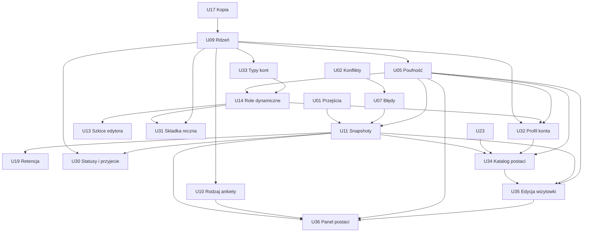

# Ursunalia — propozycje GitHub Issues

Stan: 13.10.2026, audyt HEAD `68737a8`. **Issues nie zostały opublikowane.** U01–U31 są lokalnymi identyfikatorami propozycji, nie numerami GitHub. Odczyt listy wszystkich stanów Issues przed utworzeniem dokumentacyjnego PR zwrócił pustą listę; nie znaleziono duplikatów. Ponowić deduplikację bezpośrednio przed późniejszą publikacją.

Priorytety: P0 — bloker/krytyczny problem; P1 — wymagane dla publicznego MVP; P2 — ważne, możliwe odłożenie; P3 — przyszły/opcjonalny rozwój. Rozmiary XS/S/M/L/XL są względną złożonością, nie estymacją dni. Nie ma jednego zadania „przebudować wszystko”. Epiki są grupami, a do realizacji służą konkretne zadania poniżej.

Dowody S1–S15 i ustalenia F01–F12: [FUNCTIONAL_SPEC](../product/FUNCTIONAL_SPEC.md). Decyzje Dxx: [DECISIONS](DECISIONS.md). Projekt zmian: [DATA_MODEL](../architecture/DATA_MODEL.md). Akceptacja każdego zadania wymaga zachowania dotychczasowych testów właściwych dla zmienianego zakresu; nie każdy mały UI fix wymaga powtarzania całego pilotażu.

## Epiki i indeks

| Epik | Cel | Zadania |
|---|---|---|
| E1 Stabilny proces uczestnika | Brak utraty pracy, prawidłowe statusy i kompletne widoki | U01/U02/U03/U07/U08/U22 |
| E2 Bezpieczne formularze | Walidacja, publikacja, struktura generatora | U04/U06/U12/U13/U21 |
| E3 Rdzeń i organizacja | Event, formularze, historia wysłań/statusów, panel postaci i edycja bez historii pól, zbiorcza blokada, katalog, archiwum tylko do odczytu i tworzenie nowej karty na podstawie archiwum | U09/U10/U11/U23/U30/U34/U35/U36/U37/U39 |
| E4 Prywatność i konta | Trzy typy kont, dynamiczne role z uprawnieniami read/write, globalny profil i składki | U05/U14/U15/U19/U29/U31/U32/U33 |
| E5 Uruchomienie | Testy, kopie, hosting, pilot | U16/U17/U18/U20/U24 |
| E6 Późniejszy rozwój | Kolejne wydarzenia i funkcje fabularne | U25/U26/U27/U28 |

| ID | Tytuł skrócony | Priorytet | Rozmiar | Milestone | API / migracja |
|---|---|---|---|---|---|
| U01 | Jawna administracyjna zmiana statusu, bez fałszywej oceny wysłania | P0 | S/M | v27.3 | API / etapowo |
| U02 | Stan szkicu i konflikty zapisu | P1 | L | v27.3 | API / tak |
| U03 | Kompletne podsumowanie i dostępność | P1 | M | v27.3 | nie / nie |
| U04 | Definicje JSON i portrety | P1 | M | v27.3 | walidacja / nie |
| U05 | Poufność egzekwowana na serwerze | P0 | L | v28.0 | API / tak |
| U06 | Otwarcie zapisów i polityka rewizji | P1 | M | v27.3 | API / etapowo |
| U07 | Błędy sieci i uzgadnianie stanu | P1 | M | v27.3 | API / nie |
| U08 | Aktualizacja decyzji u uczestnika | P1 | S | v27.3 | opcjonalnie / nie |
| U09 | Minimalny model wydarzenia i migracja | P1 | L | v28.0 | API / tak |
| U10 | Rodzaj ankiety i semantyka pól | P1 | M | v28.0 | API / tak |
| U11 | Snapshoty wysłań i historia decyzji | P1 | L | v28.1 | API / tak |
| U12 | Kopiowanie i bezpieczna publikacja | P1 | M | v27.3 | API / nie |
| U13 | Serwerowy szkic kreatora | P2* | M | v28.1 | API / tak |
| U14 | Dynamiczne role i prawa odczytu/edycji grup danych | P1 | L | v28.1 | API / tak |
| U15 | Parametry haseł i cykl sesji | P1 | M | v29.0 | API / tak |
| U16 | E2E i macierz urządzeń | P1 | L | v27.3→v29.0 | nie / nie |
| U17 | Backup, restore i procedura migracji | P1 | M | v29.0** | nie / nie |
| U18 | Staging, HTTPS, proxy i monitoring | P1 | M | v29.0 | operacyjne / nie |
| U19 | Oświadczenia, retencja i usunięcie | P1 | L | v28.1 | API / tak |
| U20 | Spójna dokumentacja i bramki CI | P2 | S | v27.3 | nie / nie |
| U21 | Struktura generatora i katalogi | P1 | M | v27.3 | walidacja / bez przepisywania rewizji |
| U22 | Przywracanie eksportowanego szkicu | P2 | M | v28.1 | możliwe / nie |
| U23 | Zwięzła lista i stronicowanie | P1 | M | v28.1 | API / indeksy |
| U24 | Pilot i decyzja o otwarciu | P1 | M | v29.0 | nie / nie |
| U25 | Kreator następnych wydarzeń | P3 | L | po-2027 | API / zależnie od zakresu |
| U26 | Osobna postać fabularna | P2 | M | po-2027 | API / tak |
| U27 | Osobne przechowywanie obrazów | P3 | M | po-2027 | API / tak |
| U28 | Obsługa grup i relacji postaci | P3 | M | po-2027 | API / tak |
| U29 | Odzyskanie dostępu do konta | P1 | M | v29.0 | API / tak |
| U30 | Statusy i przyjęcie uczestnika przez akceptację postaci | P1 | M | v28.1 | API / tak |
| U31 | Ręczne potwierdzenie składki per wydarzenie i użytkownik | P1 | S/M | v28.1 | API / tak |
| U32 | Profil kontaktowy konta i edycja danych przy rejestracji | P1 | M | v28.1 | API / tak |
| U33 | Bazowe konta i globalne uprawnienia Administratora | P1 | M | v28.0 | API / tak |
| U34 | Katalog zgłoszonych postaci i dobrowolna publikacja kontaktów | P1 | M/L | v28.1 | API / tak |
| U35 | Edycja nazwy, publicznego opisu i zdjęcia po wysłaniu | P1 | M | v28.1 | API / tak |
| U36 | Panel postaci, swobodna edycja danych i zbiorcza blokada całej karty | P1 | M/L | v28.1 | API / tak |
| U37 | Archiwum postaci w koncie i zbiorcza archiwizacja po wydarzeniu | P1 | M | v29.0 / po evencie | API / tak |
| U38 | Trwałe kasowanie fabuły/opisu/zdjęcia postaci i zwolnienie miejsca | P1 | L | v29.0 (po D06/U19) | API / tak |
| U39 | Nowe zgłoszenie na bazie własnej archiwalnej postaci | P1 | M | v29.0 / po archiwum | API / tak |

\* U13 staje się P1, jeśli kilku organizatorów lub kilka urządzeń ma edytować te same formularze przed wydarzeniem. ** U17: kopia i rehearsal są wymagane już przed U09; finalna automatyzacja odebrana w v29.0.

## E1/E2 — stabilizacja

### U01 — Rozróżnić zmianę statusu organizatora od oceny wysłanych odpowiedzi

- **Typ / priorytet / rozmiar:** bug/product / P0 / S/M.
- **Problem i obecne zachowanie:** F01: obecne API może zmienić `changes → accepted` mimo edycji niewysłanych odpowiedzi, bez wskazania, że jest to świadoma decyzja organizatora, bez autora i historii. Nie oznacza to, że samo przejście ma być zakazane.
- **Zatwierdzona reguła C10/D08:** organizator z uprawnieniem do oceny może zmienić status **z dowolnego na dowolny**. Rekomendowane ścieżki nie stanowią serwerowej listy dozwolonych zmian.
- **Rezultat:** jawna zmiana administracyjna nie udaje weryfikacji wysłanych odpowiedzi; brak sztucznych blokad.
- **Zakres / moduły:** status API, panel organizatora, ostrzeżenie/potwierdzenie nietypowej decyzji; zapis aktora, czasu, poprzedniego/nowego statusu i pochodzenia zmiany. Docelowa historia w U11.
- **Kryteria akceptacji:** `draft → accepted`, `changes → accepted`, `rejected → accepted` i `withdrawn → submitted` są dostępne uprawnionemu organizatorowi; jeżeli nie było faktycznego submit, źródło ma status `organizer_override` bez fikcyjnego `submissionId`; komunikat uprzedza przy niekompletnych/niewysłanych odpowiedziach, ale nie blokuje potwierdzenia; 401/403 oraz 409 przy konflikcie wersji nadal obowiązują.
- **Testy:** scenariusz F01, administracyjna akceptacja bez submission, wszystkie 7×7 przejść dla organizatora (po U30), historia, uprawnienia i regresja submit.
- **Zależności:** C10/D08 potwierdzone; U11 pełna historia, U30 nowe statusy.
- **Ryzyko regresji:** wysokie – odróżnić nadanie statusu od zatwierdzenia treści formularza.
- **Milestone / etykiety:** v27.3 / `bug`, `P0`, `api`, `workflow`, `epic:E1`.
### U02 — Chronić każdy szkic przed utratą i starym zapisem

- **Typ / priorytet / rozmiar:** bug / P1 / L.
- **Problem i obecne zachowanie:** F03/F04. Globalny dirty, bez wersji zapisu; zapis B może wyłączyć ostrzeżenie dla A; stary POST nadpisuje nowsze answers.
- **Rezultat:** znany stan zapisu każdego ID i jawny konflikt równoczesnej edycji.
- **Zakres / moduły:** PlatformStore, guard opuszczenia/logowania, aplikacje API/DB, addytywne lock_version.
- **Kryteria akceptacji:** dirty per zgłoszenie; zapis B nie oznacza A jako zapisane; expectedVersion egzekwowane atomowym UPDATE; stary zapis zwraca 409 i nie zmienia DB; UI pozwala zachować lokalne odpowiedzi i świadomie rozwiązać konflikt; brak kopii poufnych danych w localStorage bez zatwierdzonej polityki.
- **Testy:** dwie karty tego samego szkicu, przełączenie A/B, zamknięcie z dirty, zapis przy opóźnieniu odpowiedzi, migracja default version dla starych rekordów.
- **Zależności:** brak; uzgodnić DTO z U07/U11.
- **Ryzyko regresji:** wysokie — zapis i nawigacja.
- **Milestone / etykiety:** v27.3 / `bug`, `P1`, `data-integrity`, `migration`, `epic:E1`.

### U03 — Zapewnić kompletne i dostępne podsumowanie na każdym ekranie

- **Typ / priorytet / rozmiar:** bug / P1 / M.
- **Problem i obecne zachowanie:** F05; ręczna karta mobile pomija odpowiedzi, file poza portrait znika, zgody pokazują walidację zamiast wartości.
- **Rezultat:** uczestnik może sprawdzić każdą przesyłaną odpowiedź na telefonie i desktopie.
- **Zakres / moduły:** SummaryPage, FieldControl, SCSS, błędy/focus formularza; zachować Royal Manuscript.
- **Kryteria akceptacji:** skale, wykluczenia, wszystkie nowe pola i obrazy widoczne; faktyczne odpowiedzi zgód; wszystkie opisy dostępne dotykiem; select przewidywalny przy Tab/Escape/wyborze; błędy powiązane z kontrolkami; brak overflow przy 320/390/768/1440 px i 200% zoom.
- **Testy:** fixture ze wszystkimi typami i polem dodanym przez kreator, porównanie treści mobile/desktop, klawiatura i czytnik, długa treść. Druk z polityką U05.
- **Zależności:** U10 później uogólnia semantykę; naprawa brakujących wartości możliwa wcześniej.
- **Ryzyko regresji:** średnie — CSS i oba widoki.
- **Milestone / etykiety:** v27.3 / `bug`, `P1`, `ux`, `a11y`, `epic:E1`.

### U04 — Walidować cały kontrakt JSON i rzeczywiste obrazy

- **Typ / priorytet / rozmiar:** bug / P1 / M.
- **Problem i obecne zachowanie:** F06/F07; niewłaściwe typy opisów i fałszywy base64 PNG przechodzą walidator.
- **Rezultat:** import i API przyjmują tylko poprawne, ograniczone dane.
- **Zakres / moduły:** shared validation, import kreatora, parser API, upload i serwerowe sprawdzenie obrazu. Wybrać utrzymywaną bibliotekę dekodującą po sprawdzeniu zależności.
- **Kryteria akceptacji:** jawne typy/limity opcjonalnych właściwości; wspólne limity bajtów UTF-8; odrzucenie niepoprawnego obrazu i nadmiernych wymiarów; usunięcie zbędnych metadanych; brak fetch zewnętrznego URL; zgodność starego prawidłowego seeda.
- **Testy:** null/array/object w opisach, duplikaty, 300/301 pól, 200/201 opcji, polskie znaki przy limicie, zły MIME/base64, obraz graniczny i zbyt duże wymiary; przykład Aleny nadal działa.
- **Zależności:** brak; D14 dla limitów zasobów.
- **Ryzyko regresji:** średnie — dotychczasowe importy; błędy wyjaśnić zamiast tracić szkic.
- **Milestone / etykiety:** v27.3 / `bug`, `P1`, `validation`, `security`, `epic:E2`.

### U06 — Egzekwować dostępność zapisów i politykę rewizji

- **Typ / priorytet / rozmiar:** feature / P1 / M.
- **Problem i obecne zachowanie:** F10; stałe „Zapisy otwarte”, nowe zgłoszenia na każdej znanej rewizji.
- **Rezultat:** organizator może zamknąć nowe zapisy bez utraty istniejących szkiców i poprawek.
- **Zakres / moduły:** konfiguracja jednego wydarzenia, API start/save/submit, lista formularzy; U09 przeniesie politykę do relacyjnego Event/Form.
- **Kryteria akceptacji:** jawne closed/open/paused; UI i API zgodne; nowe zgłoszenie tylko na current published revision; istniejący draft zachowuje wersję; zasady wysłania po terminie oraz poprawek określone w D11; brak cichego rebase.
- **Testy:** granice terminów Europe/Warsaw/UTC, stare i nowe szkice, nieaktualny frontend, wywołanie API z pominięciem UI.
- **Zależności:** D01/D11; nie wymaga pełnego kreatora wydarzeń.
- **Ryzyko regresji:** wysokie — omyłkowa blokada zgłoszeń.
- **Milestone / etykiety:** v27.3 / `feature`, `P1`, `registration`, `api`, `epic:E2`.

### U07 — Zachować pracę przy błędach sieci i sesji

- **Typ / priorytet / rozmiar:** bug / P1 / M.
- **Problem i obecne zachowanie:** S2 request/save/submit odrzuca field errors, komunikaty znikają; sukces serwera z utraconą odpowiedzią pozostawia stary status klienta.
- **Rezultat:** użytkownik wie, co zapisano, i może bezpiecznie kontynuować.
- **Zakres / moduły:** error DTO, store, konto, toasty, powrót po logowaniu i reconciliation.
- **Kryteria akceptacji:** trwały błąd przy danym szkicu; fieldErrors widoczne; 401 nie kasuje tekstu podczas ponownego logowania; 409 pobiera stan bez automatycznego nadpisania lokalnej pracy; timeout po submit rozpoznaje udany zapis; błędy logout widoczne także w widoku konta zalogowanego.
- **Testy:** offline/timeout przed i po commit, 401/409/413/422/500, retry bez duplikatu; scenariusz utraty odpowiedzi po submit.
- **Zależności:** U02 dla konfliktów; finalny protokół idempotency z U11.
- **Ryzyko regresji:** wysokie — synchronizacja stanu.
- **Milestone / etykiety:** v27.3 / `bug`, `P1`, `network`, `ux`, `epic:E1`.

### U08 — Pokazywać aktualne decyzje po wejściu na listę

- **Typ / priorytet / rozmiar:** feature / P1 / S.
- **Problem i obecne zachowanie:** uczestnik ma stan z bootstrapu; decyzja innego użytkownika pozostaje niewidoczna do ponownego ładowania aplikacji.
- **Rezultat:** czytelny status i feedback bez konieczności odgadywania, że potrzebne jest F5.
- **Zakres / moduły:** lista uczestnika, bezpieczne odświeżenie, status ostatniej synchronizacji.
- **Kryteria akceptacji:** odświeżenie przy wejściu i przyciskiem; nie zastępuje dirty szkiców; changes pokazuje komentarz i możliwość edycji; błędy odświeżenia nie kasują danych. Email nie jest warunkiem tego zadania.
- **Testy:** dwa konta/konteksty, decyzja organizatora, powrót na listę, jednoczesny dirty draft i błąd sieci.
- **Zależności:** U02/U07; D13 tylko dla rozszerzenia powiadomień.
- **Ryzyko regresji:** średnie — refresh może wyczyścić pracę.
- **Milestone / etykiety:** v27.3 / `feature`, `P1`, `participant`, `epic:E1`.

### U12 — Oddzielić kopię formularza od nowej rewizji

- **Typ / priorytet / rozmiar:** bug / P1 / M.
- **Problem i obecne zachowanie:** F11; import zachowuje ID, lokalny szkic nie śledzi aktualnej rewizji; slot new może przywracać poprzednią ankietę.
- **Rezultat:** wydawca świadomie tworzy nową ankietę albo nową wersję.
- **Zakres / moduły:** builder import/duplicate/publish, baseRevision w publikacji, localStorage namespace z trybem/użytkownikiem; reorder opcji klawiaturą.
- **Kryteria akceptacji:** „Kopia” ma nowe form.id; „Nowa wersja” zachowuje ID po potwierdzeniu; publikacja starej bazy zwraca 409; stan po publikacji pokazuje nową rewizję; „Nowa ankieta” nie edytuje opublikowanego poprzednika; kolejność opcji dostępna bez DnD.
- **Testy:** import tej samej ankiety w obu trybach, dwie karty wydawcy, publikacja i ponowne otwarcie, użytkownicy współdzielący przeglądarkę, klawiatura.
- **Zależności:** U04 dla importu; U13 później zastępuje localStorage jako źródło prawdy.
- **Ryzyko regresji:** średnie — zachować kopie dawnych szkiców.
- **Milestone / etykiety:** v27.3 / `bug`, `P1`, `builder`, `versioning`, `epic:E2`.

### U21 — Zatwierdzić strukturę generatora i skonfigurować opcjonalne limity cech

- **Typ / priorytet / rozmiar:** product/quality / P1 / M.
- **Problem i obecne zachowanie:** S10/S15: dziś 2–5 cech i 0–4 haki; katalogi i zagnieżdżone opcje mogą się rozjechać. Ten limit cech **nie jest już domyślną regułą produktu** (C42/D07a).
- **Zatwierdzone C42/D07a:** gracz może domyślnie wskazać **dowolną liczbę cech charakteru, w tym zero**, bez podziału wymuszającego dokładnie jedną cechę pozytywną i jedną negatywną. Organizator tworzący formularz może **opcjonalnie** włączyć minimum i/lub maksimum zaznaczeń dla pola cech; jeśli brak konfiguracji, `minSelections` i `maxSelections` są `null` i walidator nie ogranicza liczby wybranych opcji. Brak limitu biznesowego nie znosi technicznej ochrony API przed nadmiernymi payloadami.
- **Zakres / moduły:** konfiguracja min/max w kreatorze i walidatorze front/backend, migracja/adapter historycznych definicji **bez nadpisywania opublikowanych rewizji**, wyświetlanie świadomie skonfigurowanych limitów przy polu, wspólne sprawdzenie ID/etykiet/opisów katalogów. **D07b pozostaje otwarte** dla dalszej struktury generatora i limitów haków — nie rozciągać automatycznie C42 na haki.
- **Kryteria akceptacji:** pole cech z niezdefiniowanymi limitami przyjmuje 0, 1, 2 i więcej wyborów do granic istniejącej listy; po ustawieniu min/max przez Organizatora oba klient i API egzekwują wartości, a walidacja konfiguracji odrzuca `min>max`. Historie już opublikowanych formularzy nie zmieniają znaczenia samoczynnie; domyślna reguła dotyczy **nowych definicji**, istniejące `min/max=2/5` pozostają jawnie skonfigurowane do czasu nowej rewizji. Polaryzacja dodatnia/ujemna nie jest obligatoryjna; katalog cech i haków pozostaje oddzielny.
- **Testy:** brak min/max, samodzielny min, samodzielny max, min+max, zero wyborów, wszystkie możliwe wybory, niepoprawne kombinacje, przeniesienie starej rewizji `2..5`, nowa wersja bez limitu, zmiana definicji w kreatorze, zgodność opisu/ID i limit techniczny payloadu.
- **Zależności:** C42/D07a zatwierdzone; D07b (struktura i haki) przed pełnym odbiorem generatora; U04/U10/U12 przy zmianie definicji.
- **Ryzyko regresji:** średnie — przypadkowe odziedziczenie starych limitów `2–5` przez nową definicję albo zniesienie ograniczeń historycznego formularza.
- **Milestone / etykiety:** v27.3 / `product`, `P1`, `catalog`, `validation`, `epic:E2`.

## E3/E4 — dane i dostęp

### U09 — Dodać minimalny Event/Form i migrację istniejących danych

- **Typ / priorytet / rozmiar:** architecture / P1 / L.
- **Problem i obecne zachowanie:** S1 schema: wydarzenie w seed, Form utożsamiony z rewizją; brak rejestru migracji.
- **Rezultat:** relacyjny rdzeń dla jednej grupy i wielu możliwych wydarzeń, z jednym aktywnym wydarzeniem w UI.
- **Zakres / moduły:** schema_migrations, events, forms/revisions, FK applications, mapowanie legacy `organizer` do typu bazowego oraz ról powiązanych z jednym wydarzeniem (C18/D21 zatwierdzone); API bootstrap; rehearsal/rollback. **C41/D04:** limit jednej aplikacji `kind=character` na parę `(event_id,user_id)`, niezależnie od ID formularza; szkice i wszystkie statusy liczą się do limitu. Logistyka/generic nie zużywają miejsca postaci. **C45:** po wykonaniu zatwierdzonej procedury usunięcia U38 limit zwalnia się dla nowej postaci; metoda implementacji zależy od D29c2, więc nie utrwalać triggerów C41 ignorujących poprawnie usuniętą kartę.
- **Kryteria akceptacji:** zachowane ID użytkowników, hashe, wszystkie szkice/answers/revisions; poprawne FK; seed Ursunalia tylko raz; niewłaściwy event/form odrzucony; brak kreatora wielu imprez w zakresie. Daty bez wymyślonych godzin. **Żadnej drugiej postaci dla tego samego użytkownika i wydarzenia** – również gdy istnieją dwie definicje formularza postaci; przy konflikcie API zwraca istniejące zgłoszenie do kontynuowania lub zrozumiały błąd, nie tworzy kolejnego rekordu. Dozwolony osobny formularz logistyczny.
- **Testy:** fixture z każdą rewizją/statusem, restart, ponowienie migracji, przerwanie w połowie, login historycznym hasłem, rollback i porównanie danych. **C41:** dwie równoczesne próby utworzenia postaci, dwa różne formularze `character` jednego eventu, ta sama osoba na drugim wydarzeniu, niezależna `logistics`, istniejący draft/odrzucone/wycofane, wykrycie zastanych duplikatów podczas migracji.
- **Zależności:** C41/D04, D15, pierwsza część U17, U02; projekt uprawnień z D03.
- **Ryzyko regresji:** wysokie — migracja danych i bootstrap.
- **Milestone / etykiety:** v28.0 / `architecture`, `P1`, `migration`, `api`, `epic:E3`.

### U10 — Uogólnić formularze przez kind i semanticKey

- **Typ / priorytet / rozmiar:** refactor / P1 / M.
- **Problem i obecne zachowanie:** S5/S14: pierwsza ankieta oznacza postać; ID pól sterują podsumowaniem i poufnością.
- **Rezultat:** logistyka i zwykła ankieta mają poprawny widok bez udawania postaci.
- **Zakres / moduły:** models, renderer, listy, event page, publikowane definicje schemaVersion i mapowanie starych pól.
- **Kryteria akceptacji:** character/logistics/generic jawne; każde pole widoczne niezależnie od jego ID; nowa zwykła ankieta nie pokazuje „POSTAĆ”; niezmienione stare rewizje obsługiwane adapterem; klasyfikacja poufności z serwera U05. **`kind=character` jest rozpoznawany semantycznie przez backend** przy liczeniu globalnego limitu jednej postaci na wydarzenie (C41), nie po ID pól ani pozycji ankiety. Zwykła/logistyczna ankieta pozostaje niezależna.
- **Testy:** ankieta bez pól name/portrait/identity, zmieniona kolejność formularzy, nowe sekcje, stare snapshoty.
- **Zależności:** U09, U03; polityka danych D03.
- **Ryzyko regresji:** średnie — prezencja i stare dane.
- **Milestone / etykiety:** v28.0 / `refactor`, `P1`, `forms`, `epic:E3`.

### U05 — Ograniczyć odczyt poufnych odpowiedzi przed serializacją

- **Typ / priorytet / rozmiar:** security / P0 / L.
- **Problem i obecne zachowanie:** F02, pełne boundaries/exclusions/needs i portrety trafiają do każdego organizer przez masową listę; CSS to jedyna część oznaczenia poufności.
- **Rezultat:** dostęp zależy od wydarzenia i capability; nieuprawniony klient nigdy nie otrzymuje chronionej treści.
- **Zakres / moduły:** serwerowa klasyfikacja grup pól, kontrola uprawnień `read/write` ról niestandardowych, globalny bypass Administratora, rozdzielenie answers, filtrowane DTO list/detail/export, wydruk i audyt operacji; brak logowania treści.
- **Kryteria akceptacji:** bez roli dodatkowej uczestnik widzi i edytuje tylko własne dane zgodnie z regułami procesu; uprawnienia konfigurowalnych ról udostępniają osobny `read` i `write` każdej grupy (identity/private_contact/social_contact/character_lore/game_preferences/triggers/interpersonal_exclusions/health/applications/contributions). Przykładowa rola Fabularzysta (C14) czyta fabułę i FB/Discord, ale nie prywatny kontakt ani zdrowie. Administrator (C17) może czytać i poprawiać wszystkie dane platformy, także innych organizatorów i uczestników, z historią zmian. Zwykły Organizator/rola nie może przekraczać swojego zatwierdzonego zakresu. API egzekwuje prawa w odczycie, zapisie, eksportach i wydruku; brak prawa = brak wartości w odpowiedzi. Nie należy dopuszczać do zbierania realnych informacji szczególnych przed odbiorem ochrony.
- **Testy:** administrator globalnie (również zasoby innego organizatora), organizer zwykły, participant, rola konfigurowana bez przyznanych praw, role z read tylko i read+write; próba edycji cudzych danych, cross-event, list/detail/export/print i brak wycieku w logach.
- **Zależności:** D03/C15/C16/C17, U09/U33; U10 dostarcza semantykę, ale uprawnienia nie mogą zależeć wyłącznie od UI.
- **Ryzyko regresji:** wysokie — migracja i możliwe ujawnienie danych.
- **Milestone / etykiety:** v28.0 / `security`, `P0`, `privacy`, `migration`, `epic:E4`.

### U11 — Zapisać niezmienne wysłania i historię decyzji

- **Typ / priorytet / rozmiar:** feature / P1 / L.
- **Problem i obecne zachowanie:** S1 applications.answers/feedback nadpisywane; brak autora/czasu oceny i historii, poprawki mieszają się z wysłanym stanem.
- **Rezultat:** każde wysłanie i decyzja mają jednoznaczne powiązanie.
- **Zakres / moduły:** submissions, `application_status_history`, audyt, submit transakcyjny/idempotentny, UI historii, migracja stanu zastanego z legacy provenance.
- **Kryteria akceptacji:** rzeczywiste wysłanie ma niezmienny snapshot, a każda zmiana statusu ma historię z aktorem, poprzednim i nowym statusem oraz czasem. `submission_id` może być NULL przy administracyjnym nadaniu statusu bez wcześniejszego wysłania; nie tworzyć fikcyjnych wysłań. Retry submit idempotentny, zmiana szkicu nie przepisuje starego snapshotu, zachowany historyczny feedback i jawne pochodzenie danych legacy. **Wyjątek C46/U38:** na wyraźne usunięcie postaci wykonywać kontrolowaną **redakcję fabuły i mediów z treści historycznych snapshotów**, zachowując tylko wymagane metadane zdarzenia i statusu zgodnie z D06/U19. Nie używać niezmienności U11 do przechowywania skasowanej postaci.
- **Testy:** cykl 2 poprawek, dwóch recenzentów, równoczesny submit/review, utrata odpowiedzi, migracja changes z edytowanym szkicem i submitted ze starym feedback. **C46:** po usunięciu postaci dawne snapshoty nie zawierają jej fabuły/opisu/portretu, ale zachowane dopuszczone metadane audytu nadal wiążą zdarzenia; brak odtworzenia skasowanych danych z backupu.
- **Zależności:** U01/U02/U07/U09/U05, D08/D09.
- **Ryzyko regresji:** wysokie — transakcje, historia i prywatność.
- **Milestone / etykiety:** v28.1 / `feature`, `P1`, `workflow`, `migration`, `epic:E3`.

### U13 — Przechowywać wspólny szkic ankiety na serwerze

- **Typ / priorytet / rozmiar:** feature / P2 warunkowo P1 / M.
- **Problem i obecne zachowanie:** S6 82–130: szkic tylko w localStorage, bez współpracy między urządzeniami.
- **Rezultat:** jeden wspólny FormDraft z wersją blokady i rewizją bazową.
- **Zakres / moduły:** tabela drafts, API CRUD/uprawnienia, lista szkiców, import istniejącego eksportu; brak realtime collaboration.
- **Kryteria akceptacji:** szkic dostępny na drugim urządzeniu; konflikt zwraca 409; publikacja nie gubi draftu przy awarii; import nie usuwa starej lokalnej kopii; błędny/niekompletny draft można zapisać, ale nie opublikować.
- **Testy:** dwaj wydawcy, awaria zapisu/publikacji, import legacy v1 i v27, uprawnienia wydarzenia.
- **Zależności:** D10, U09/U12/U14.
- **Ryzyko regresji:** średnie — przenoszenie lokalnych szkiców.
- **Milestone / etykiety:** v28.1 / `feature`, `P2`, `builder`, `migration`, `epic:E2`.

### U14 — Dynamiczne role organizatorów i uprawnienia read/write

- **Typ / priorytet / rozmiar:** feature/security / P1 / L.
- **Decyzje C12/C14/C15/C16/C17:** system zawiera tylko trzy bazowe typy kont: Administrator, Organizator, Uczestnik. Nazwy „Fabularzysta”, „Główny organizator”, „Logistyk” itd. nie są twardo zakodowane – to możliwe role tworzone i ustawiane przez Organizatora.
- **Rezultat:** Organizator tworzy role o dowolnej nazwie i przydziela użytkownikom prawa do grup danych; osobne flagi odczytu i edycji oraz operacje administracyjne.
- **Zakres / moduły:** tabele `event_roles`, `event_role_permissions`, `event_role_assignments` (każda definicja i nadanie roli ograniczone do jednego `event_id`, C18/D21), UI tworzenia/edycji/kopiowania/usuwania ról i przypisań, serwerowa autoryzacja; rejestrowanie kto i kiedy zmienił konfigurację; akcje `read/write/manage/assign/export` na pogrupowanych zasobach, bez ujawniania pól ponad zakres.
- **Kryteria akceptacji:** Organizator może utworzyć rolę „Fabularzysta” i nadać np. tylko odczyt informacji fabularnych oraz FB/Discord; może nadać, odebrać i edytować rolę, w tym nadać innej osobie typ Organizator; nie może nadać Administratora. Administrator ma wszystkie uprawnienia globalnie. Uczestnik pozostaje uczestnikiem po uzyskaniu roli dodatkowej. Brak uprawnień w roli domyślnie oznacza odmowę; cofnięcie roli obowiązuje od następnego żądania; serwer odrzuca eskalację przez API lub import. Nie dopuścić do odczytu/edycji cudzych danych na podstawie samej znajomości ich ID.
- **Testy:** 3 typy kont, tworzenie i modyfikacja niestandardowych ról, kilka ról u użytkownika, prawa read/write osobno dla każdej grupy, rola przykładowa Fabularzysta, nadanie typu Organizator, próba nadania Administratora przez Organizatora, Administrator zarządza zasobami innych organizatorów, eksport i odwołanie uprawnień. Ten sam użytkownik na A ma rolę Fabularzysta, na B jej nie ma lub ma inne prawa; żadna rola ani przypisanie nie przenika z A do B.
- **Zależności:** U33 bazowe typy i superadmin, U09/U05 model/filtracja, U32 profil; D21/C18 zatwierdzone: role są per wydarzenie.
- **Ryzyko regresji:** bardzo wysokie – niejawna eskalacja roli lub danych, zmiany tożsamości i zakresu wydarzeń.
- **Milestone / etykiety:** v28.1 / `feature`, `P1`, `authorization`, `roles`, `epic:E4`.
### U15 — Wersjonować parametry haseł i dopracować sesje

- **Typ / priorytet / rozmiar:** security / P1 / M.
- **Problem i obecne zachowanie:** F08; domyślny scrypt, salt:hash bez parametrów; brak unieważnienia wszystkich sesji.
- **Rezultat:** mierzalny koszt haszowania, kompatybilne stare loginy i kontrolowany cykl sesji.
- **Zakres / moduły:** auth, password_scheme, parametry/rehash, zmiana hasła i revocation; porównać koszt na docelowym serwerze z aktualną rekomendacją OWASP.
- **Kryteria akceptacji:** jawne zapisane parametry; logowanie starym hasłem działa i aktualizuje hash bez wymuszania utraty konta; reset/zmiana hasła unieważnia stare sesje; cookie flagi poprawne za HTTPS; brak haseł/tokenów w logach.
- **Testy:** stare/nowe hashe, błędne hasło, expiry/logout/revoke, Secure/SameSite/HttpOnly; pomiar czasu i zużycia pamięci przy obciążeniu.
- **Zależności:** U09 dla schematu lub mała addytywna migracja; U18 dla pomiaru; D05.
- **Ryzyko regresji:** wysokie — możliwość zablokowania kont.
- **Milestone / etykiety:** v29.0 / `security`, `P1`, `auth`, `epic:E4`.

### U19 — Wdrożyć zatwierdzone oświadczenia, retencję i usuwanie danych

- **Typ / priorytet / rozmiar:** privacy / P1 / L.
- **Problem i obecne zachowanie:** S10 checkboxy bez wersji dokumentu; brak retencji/usunięcia, poufne needs w zwykłej ankiecie. Audyt techniczny nie ustala podstaw prawnych.
- **Rezultat:** minimalny zatwierdzony zakres danych i wykonalna procedura ich obsługi.
- **Zakres / moduły:** informacja dla uczestnika, metadane dokumentów i consent_records, retencja odpowiedzi/snapshotów/portretów/logów/backupów, usunięcie konta przez kontrolowaną procedurę. **C46:** obsłużyć wymazanie danych postaci również z treści historycznych wysłań i aktywnych assetów; chronić niezbędne minimalne dane organizacyjne/rozliczeniowe, według zatwierdzonej retencji.
- **Kryteria akceptacji:** właściciel zatwierdził D06 po odpowiedniej weryfikacji; rzeczywista wartość i wersja oświadczenia zapisana przy submit; dane legacy nie są przedstawiane jako nowe zgody; dry-run usunięcia pokazuje zakres; wykonanie usuwa lub anonimizuje zatwierdzone dane bez naruszenia cudzych zgłoszeń.
- **Testy:** wersjonowanie dokumentu, dobrowolna odmowa, usunięcie z snapshotów/eksportu, polityka backupów, próba nieuprawniona, rekord legacy.
- **Zależności:** D03/D06, U05/U11/U14; harmonogram backupów z U17.
- **Ryzyko regresji:** wysokie — nieodwracalne usunięcie; operacje wymagają procedury i kopii w dozwolonym okresie.
- **Milestone / etykiety:** v28.1 / `privacy`, `P1`, `retention`, `epic:E4`.

### U23 — Oddzielić listę zgłoszeń od szczegółów i dodać stronicowanie

- **Typ / priorytet / rozmiar:** performance / P1 / M.
- **Problem i obecne zachowanie:** S1 366–373 i S7 pobierają wszystkie definicje, answers i portrety dla filtrów frontendowych.
- **Rezultat:** szybka lista minimalnych danych, szczegóły na żądanie.
- **Zakres / moduły:** DTO list/detail, filtry SQL, indeksy, cursor pagination, organizer UI.
- **Kryteria akceptacji:** lista bez portretów i poufnych treści; stabilne sortowanie przy identycznych datach; filtr osoby/form/status/event na serwerze; limit strony; kontrola dostępu na szczegółach; pomiar przy uzgodnionej skali D14 bez pełnego pobierania bazy.
- **Testy:** paginacja bez pomijania/duplikacji, filtry, odrzucony obcy cursor/ID, fixture 200 osób×2 ankiety z portretami; ustalony budżet odpowiedzi i czasu na staging.
- **Zależności:** U09/U05; U11 dla szczegółów historii.
- **Ryzyko regresji:** średnie — wyniki filtrów i uprawnienia.
- **Milestone / etykiety:** v28.1 / `performance`, `P1`, `organizer`, `api`, `epic:E3`.

### U29 — Zapewnić bezpieczne odzyskanie dostępu do konta

- **Typ / priorytet / rozmiar:** feature / P1 / M.
- **Problem i obecne zachowanie:** brak resetu i weryfikacji email; zapomniane hasło blokuje dostęp do zapisanych zgłoszeń.
- **Rezultat:** uczestnik odzyskuje konto bez tworzenia duplikatu i bez ujawnienia danych innej osobie.
- **Zakres / moduły:** wybrany kanał email i jednorazowe hashowane tokeny z TTL, rate limit, formularz resetu, unieważnienie sesji; ewentualny ręczny wariant pilota zgodnie z D05.
- **Kryteria akceptacji:** token jednorazowy, wygasający i niedostępny w logach; odpowiedź publiczna nie potwierdza istnienia konta; link do zaufanej domeny; stare sesje unieważnione; procedura wsparcia ma właściciela. Emaile nie zawierają odpowiedzi ani informacji poufnych.
- **Testy:** zużyty/wygasły token, zły użytkownik, dwa równoczesne użycia, ograniczenie prób, dostarczenie na staging, zachowanie zgłoszeń po resecie.
- **Zależności:** D05/D02, U15/U18.
- **Ryzyko regresji:** wysokie — przejęcie konta przy błędzie implementacji.
- **Milestone / etykiety:** v29.0 / `feature`, `P1`, `auth`, `epic:E4`.

## E5 — testy i uruchomienie

### U16 — Dodać E2E rzeczywistego procesu i kontrolę urządzeń

- **Typ / priorytet / rozmiar:** test / P1 / L.
- **Problem i obecne zachowanie:** 13 jsdom + 6 HTTP, brak testu browser→żywe API. Dawne QA nie sprawdza całej produkcyjnej ścieżki.
- **Rezultat:** odtwarzalny test najważniejszego procesu na tym samym buildzie i API co wdrożenie.
- **Zakres / moduły:** Playwright lub równoważny runner, izolowana baza, dwa konta/konteksty, CI artifacts bez realnych danych.
- **Kryteria akceptacji:** rejestracja→szkic→zamknięcie/reopen→submit→changes→resubmit→accepted; publikacja nowej rewizji nie zmienia starego zgłoszenia; scenariusze offline i 401/409; 390/768/1440 px, 320 smoke; Chrome/Firefox/WebKit i ręczny telefon/klawiatura. Testy nie stubują API głównego procesu.
- **Testy:** samo zadanie dostarcza scenariusze, dowody i instrukcję wykonania; później regresja U05/U11 i granice poufności.
- **Zależności:** szkielet niezależny; zielony odbiór po U01/U02/U03/U07; finalny po zmianach danych.
- **Ryzyko regresji:** niskie dla aplikacji, średnie dla niestabilności CI; brak realnych danych w raportach.
- **Milestone / etykiety:** v27.3, rozszerzane do v29.0 / `test`, `P1`, `e2e`, `epic:E5`.

### U17 — Wdrożyć i sprawdzić kopię oraz odtworzenie SQLite

- **Typ / priorytet / rozmiar:** operations / P1 / M.
- **Problem i obecne zachowanie:** README zaleca backup, brak sprawdzonej automatyzacji, restore i RPO/RTO.
- **Rezultat:** odtworzenie na pustym środowisku bez utraty rewizji i odpowiedzi.
- **Zakres / moduły:** spójny backup SQLite/WAL, szyfrowanie/uprawnienia, rotacja, monitoring, runbook migracji i rollback.
- **Kryteria akceptacji:** kopia z aktywnej bazy spójna; restore przechodzi integrity_check/FK i porównanie danych; logowanie i proces działają; kopie poza pojedynczym dyskiem aplikacji; RPO/RTO zatwierdzone i zmierzone. Pierwszy rehearsal przed U09, finalny po U11/U19.
- **Testy:** zapis podczas backupu, brak miejsca, uszkodzona kopia, odzyskanie na czystym hoście, alarm błędu i rotacja.
- **Zależności:** D02/D14/D15; zakres retencji z D06, nie wymaga implementacji U19 do pierwszego testu.
- **Ryzyko regresji:** wysokie przy operacji restore; testy wyłącznie na kopii.
- **Milestone / etykiety:** v29.0 z warunkiem wcześniejszego odbioru / `operations`, `P1`, `backup`, `epic:E5`.

### U18 — Przygotować staging HTTPS, limiter za proxy i monitoring

- **Typ / priorytet / rozmiar:** operations/security / P1 / M.
- **Problem i obecne zachowanie:** Pages to demo; brak dowodu serwerowego wdrożenia. Limiter widzi remoteAddress wspólnego proxy.
- **Rezultat:** powtarzalne wdrożenie jednej instancji ze sprawdzonym TLS, trwałością i sygnałem awarii.
- **Zakres / moduły:** proxy/host/service, konfiguracja poza repo, zaufane proxy, per-client limiter i globalny limit kosztu auth, health/readiness, logi bez danych osobistych, alerty, rollout/rollback.
- **Kryteria akceptacji:** produkcyjny Secure cookie działa; app/API jedna domena; fake X-Forwarded-For nie omija limitu; jeden klient nie blokuje wszystkich; restart nie traci DB; monitoring wykrywa 5xx/brak miejsca/backup failure; nie ma sekretów w git/raportach.
- **Testy:** pełna ścieżka HTTPS, ruch przez proxy, spoofed headers, 429, restart, niedostępna DB, rollback builda na staging.
- **Zależności:** D02, U17 dla docelowego restore; przygotowania niezależne od zmian UI.
- **Ryzyko regresji:** wysokie — dostępność i sesje.
- **Milestone / etykiety:** v29.0 / `operations`, `P1`, `security`, `epic:E5`.

### U20 — Uporządkować instrukcję uruchomienia i bramki CI

- **Typ / priorytet / rozmiar:** docs/chore / P2 / S.
- **Problem i obecne zachowanie:** README/stare QA opisują ograniczenia minionego środowiska, package version 27.0.0 nie zgadza się z nazewnictwem prac; deploy Pages ma osobną ścieżkę build.
- **Rezultat:** jedna bieżąca instrukcja, historyczne QA jawnie opisane i czytelny wynik weryfikacji.
- **Zakres / moduły:** README, odnośniki do tych 5 dokumentów, wersjonowanie wydania, workflow verify i bezpieczna zależność deploy od odpowiednich kontroli; bez wdrożenia przy zmianie samej dokumentacji.
- **Kryteria akceptacji:** czyste środowisko odtwarza build/test; jasno rozróżnione demo/server; komplet dokumentów ma indeks; wymagane kontrole PR wskazane; nie deklaruje testu przeglądarki na podstawie jsdom.
- **Testy:** przejście instrukcji na czystym checkout, kontrola YAML i linków, sprawdzenie triggerów bez produkcyjnego deploy.
- **Zależności:** brak; aktualizować wraz z U16/U18.
- **Ryzyko regresji:** niskie/średnie — zmiana workflow.
- **Milestone / etykiety:** v27.3 / `docs`, `P2`, `ci`, `epic:E5`.

### U24 — Przeprowadzić pilot i zatwierdzić publiczne zapisy

- **Typ / priorytet / rozmiar:** release / P1 / M.
- **Problem i obecne zachowanie:** brak dowodu działania całej ścieżki na docelowym wdrożeniu z użytkownikami.
- **Rezultat:** konkretna decyzja go/no-go przed T z listą warunków i właścicielem.
- **Zakres / moduły:** staging, scenariusze uczestnika i dwóch organizatorów, obsługa zgłoszeń problemów, test odtworzenia i końcowa kontrola bezpieczeństwa.
- **Kryteria akceptacji:** brak otwartych P0; wymagane P1 odebrane lub funkcja formalnie wyłączona; pełny E2E/telefon/klawiatura; D01/D02/D03/D05/D06/D14 zatwierdzone; kanał wsparcia i odpowiedzialność; zmierzony backup/restore. Otwarcie zapisów jako osobna świadoma decyzja właściciela.
- **Testy:** cykl bez pomocy programisty, awaria sieci, zapomniane hasło, odzyskanie DB, uprawnienia, długie opisy; raport z błędami i powtórnym odbiorem.
- **Zależności:** U01–U12 w zakresie P0/P1, U14/U15/U16/U17/U18/U19/U21/U23/U29. U13 tylko gdy D10 wymaga współpracy.
- **Ryzyko regresji:** wysokie operacyjnie; początkowy pilot na fikcyjnych danych.
- **Milestone / etykiety:** v29.0 / `release`, `P1`, `pilot`, `epic:E5`.

## Ulepszenia opcjonalne i po wydarzeniu

### U22 — Przywracać pobrany szkic uczestnika z JSON

- **Typ / priorytet / rozmiar:** feature / P2 / M.
- **Problem i obecne zachowanie:** eksport jest sugerowany przy quota, ale brak importu uczestnika.
- **Rezultat:** kontrolowany powrót do pracy z własnej kopii.
- **Zakres / moduły:** import, walidacja, mapa rewizji i podgląd różnic; nigdy import roli/statusu decyzji z pliku.
- **Kryteria akceptacji:** wymagane logowanie; plik nie zastępuje cudzego ID; konflikt istniejącego szkicu wymaga świadomego wyboru; nieznana rewizja nie jest zgadywana; stare dane nie są kasowane przed sukcesem.
- **Testy:** własny poprawny eksport, duży/uszkodzony plik, obce ID, submitted/accepted w pliku, nieznana wersja, powtórny import.
- **Zależności:** U02/U04/U07, D04.
- **Ryzyko regresji:** średnie — nadpisanie pracy.
- **Milestone / etykiety:** v28.1 opcjonalnie / `feature`, `P2`, `recovery`, `epic:E1`.

### U25 — Dodać prosty kreator kolejnego wydarzenia

- **Typ / priorytet / rozmiar:** feature / P3 / L.
- **Problem i obecne zachowanie:** wydarzenie seed i stałe teksty; cel przyszły wymaga konfigurowania wydarzeń bez kopiowania aplikacji.
- **Rezultat:** druga prosta impreza jednej grupy, bez generatora postaci; tylko uprawniony Organizator może ją sam utworzyć, a system automatycznie nadaje mu zarządzanie właśnie tym wydarzeniem.
- **Zakres / moduły:** panel Event, daty/miejsce, ankiety i publikacja; **platformowe uprawnienie `events.create` nadawane i odbierane przez Administratora** (odrębne od ról eventowych), transakcyjny zapis wydarzenia i automatyczne przypisanie twórcy-Organizatora do niego; bez mikroserwisów/wielu organizacji.
- **Kryteria akceptacji:** Administrator przyznaje Organizatorowi `events.create`; Organizator bez tego uprawnienia nie może tworzyć wydarzeń, a posiadający je tworzy wydarzenie i automatycznie uzyskuje uprawnienia Organizatora **wyłącznie do niego**. Inni Organizatorzy nie otrzymują dostępu do nowego wydarzenia automatycznie. Twórca wybiera generic form, publikuje i zamyka zapisy; Ursunalia/historyczne dane nie zmieniają się; prywatność i role działają osobno per event.
- **Testy:** nadanie/odebranie `events.create` przez Administratora, odmowa tworzenia bez uprawnienia, atomowe utworzenie Event i przypisanie twórcy, rollback przy błędzie, dwa wydarzenia, inne formularze, cross-event permissions i brak automatycznego dostępu Organizatora do cudzych wydarzeń, archiwum.
- **Zależności:** U09/U10/U14/U33/U24, C18/D21 i C19/D22, retrospektywa po wydarzeniu. Uprawnienie platformowe `events.create` to przyszłe rozszerzenie, nie element obecnego MVP.
- **Ryzyko regresji:** średnie — routing, zakres wydarzenia.
- **Milestone / etykiety:** po-2027 / `feature`, `P3`, `events`, `epic:E6`.

### U26 — Wydzielenie pełnej encji Character po wdrożeniu panelu postaci

- **Typ / priorytet / rozmiar:** refaktor/domain / P2 / M.
- **Stan po C35/D28a:** **panel postaci działa już w MVP po pierwszym rzeczywistym wysłaniu formularza** (U36), bez czekania na zaakceptowanie. U26 **nie jest zadaniem zbudowania panelu**; oznacza przyszłe wydzielenie pełnoprawnej, trwałej encji `characters`, kiedy wynikać to będzie z rozwoju fabuły i relacji.
- **Zakres / moduły:** bezpieczna migracja/projekcja z `applications/submissions/application_public_profiles` i ich identyfikatorów, odrębne `characters` tylko dla formularzy `kind=character`, zachowanie historii i polityki RBAC. Nie dublować charakterystyki fabularnej i nie traktować statusu `accepted` jako jedynego momentu istnienia panelu.
- **Kryteria akceptacji:** dane postaci i wizytówki zachowane bez utraty aktualnej nazwy/portretu/opisu, stare snapshoty niezmienione przy normalnej edycji, **z wyjątkiem usuwania mediów C32 i pełnej redakcji treści skasowanej postaci C46**; **najwyżej jedna docelowa postać na użytkownika i wydarzenie (C41), a zarazem** jedna docelowa postać na `source_application`, brak Character z logistyki, zero nowych praw do zdrowia/wykluczeń i brak zerwania działającego U36.
- **Testy:** import postaci `submitted/changes/accepted/waitlisted`, wydzielanie ponawialne, mapowanie aktualnej wizytówki i zachowanie audytu, błędny event i brak snapshotu, zdjęcie wcześniej usunięte C32.
- **Zależności:** U36/U10/U11/U05/C35, retrospektywa i potwierdzona potrzeba — **po Ursunaliach 2027**, bez blokowania panelu MVP.
- **Ryzyko regresji:** średnie/wysokie — dwa konkurencyjne źródła tej samej informacji.
- **Milestone / etykiety:** po-2027 / `refactor`, `P2`, `characters`, `epic:E6`.

### U27 — Oddzielić magazyn obrazów, jeśli pomiary wykażą potrzebę

- **Typ / priorytet / rozmiar:** performance / P3 / M.
- **Problem i obecne zachowanie:** obrazy base64 powiększają JSON, snapshoty i kopie.
- **Rezultat:** prywatne zasoby z uprawnieniami i spójnym backupem.
- **Zakres / moduły:** storage adapter, asset ID, autoryzowany odczyt, migracja i sprzątanie sierot; bez publicznego bucketu.
- **Kryteria akceptacji:** zachowane obrazy, ograniczenie dostępu, lista nie pobiera plików; DB+assets odtwarzają się razem; usunięcie/retencja usuwa niepotrzebne kopie; uzasadnienie pomiarami.
- **Testy:** migracja i checksum, przerwany upload, obcy asset ID, restore, usunięcie użytkownika.
- **Zależności:** U04/U05/U17/U19/U23.
- **Ryzyko regresji:** wysokie — utrata plików przy niespójnym restore.
- **Milestone / etykiety:** po-2027 / `performance`, `P3`, `assets`, `epic:E6`.

### U28 — Dodać pierwszy moduł relacji postaci

- **Typ / priorytet / rozmiar:** feature / P3 / M.
- **Problem i obecne zachowanie:** relacje są tekstem, nie ma zarządzania powiązaniami i widocznością.
- **Rezultat:** minimalna relacja między dwiema postaciami bez ujawnienia cudzych zgłoszeń.
- **Zakres / moduły:** jedna relacja z opisem i stanem potwierdzenia; wyraźnie określona widoczność. Grupy/przydziały jako późniejsze osobne Issues.
- **Kryteria akceptacji:** właściciel widzi tylko dozwolone powiązania; organizator zatwierdza; wykluczenia/bezpieczeństwo nie trafiają do publicznego opisu; istniejący tekst zachowany przy imporcie.
- **Testy:** obce wydarzenie, wycofanie potwierdzenia, różne prawa stron, usunięcie postaci, migracja starego tekstu bez zgadywania osób.
- **Zależności:** U26/U14/U19, osobna decyzja produktowa po retrospektywie.
- **Ryzyko regresji:** wysokie prywatności — ujawnienie relacji/niechcianych kontaktów.
- **Milestone / etykiety:** po-2027 / `feature`, `P3`, `relations`, `epic:E6`.

## E3/E4 — dodatkowe wymagania Ursunaliów 2027, zgłoszone po audycie

### U30 — Wdrożyć siedem statusów i przyjęcie przez zaakceptowanie postaci

- **Typ / priorytet / rozmiar:** feature / P1 / M.
- **Potwierdzona reguła:** akceptacja postaci oznacza przyjęcie na Ursunalia 2027; zatwierdzenie formularza logistycznego nie przyjmuje gracza (C07/D16). Składka nie zmienia statusu automatycznie.
- **Zatwierdzone statusy (C09/D18):** `draft`, `submitted`, `changes`, `accepted`, `waitlisted`, `rejected`, `withdrawn`. `cancelled` skreślono na rzecz `rejected`.
- **Zatwierdzone C10/D08:** organizator może ustawić każdy z siedmiu statusów z każdego stanu, również `withdrawn` i `rejected`. Rekomendowane przejścia w UI nie blokują dowolnej decyzji. Uczestnik po `withdrawn` może wznowić tę samą Application, edytować i ponownie wysłać postać.
- **Zakres / moduły:** API statusów, serwerowe uprawnienia i walidacja właściciela, `forms.grants_admission`, lista przyjętych, historia U11, UI i audyt. Nie tworzyć drugiej encji przyjęcia.
- **Kryteria akceptacji:** accepted na postaci oznacza przyjęcie niezależnie od wcześniejszego stanu; accepted logistyki nie; withdrawn/rejected nie przyjmują; 7×7 przejść dla uprawnionego organizatora; wznawianie `withdrawn → draft → submitted` lub ponowne wysłanie po walidacji, bez utraty ID i odpowiedzi; administracyjne nadanie statusu bez submission ma jawną historię i ostrzeżenie, nie blokadę; składka zachowana.
- **Testy:** wszystkie statusy źródłowe/docelowe, historia, odzyskanie wycofanej postaci, przyjęcie wprost ze szkicu, ochrona obcych danych, niezależność składki, brak dublowania uczestników.
- **Zależności:** U01/U09/U11, C07/C09/C10; U26 nie blokuje MVP.
- **Ryzyko regresji:** wysokie – historia i uprawnienia; nie przepisywać historycznych zgłoszeń.
- **Milestone / etykiety:** v28.1 / `feature`, `P1`, `workflow`, `events`, `epic:E3`.
### U31 — Potwierdzać składkę przelewem ręcznie w panelu organizatora

- **Typ / priorytet / rozmiar:** feature / P1 / S/M.
- **Potwierdzona reguła:** pieniądze są wpłacane przelewem; informacje organizator przekazuje mailowo poza systemem; brak operatora płatniczego i integracji bankowej. D17 / C08.
- **Zakres / moduły:** `event_contributions` (klucz wydarzenie/użytkownik), flaga `is_paid` domyślnie niepotwierdzona, grupa uprawnień `contributions.read/write`, widok statusu przy uczestniku oraz w listach, API zmiany i odczytu, audit_log (kto/kiedy/poprzednia i nowa wartość) oraz bezpieczna migracja.
- **Kryteria akceptacji:** organizator z uprawnieniem zaznacza/odznacza wpływ składki i stan przetrwa restart; dwa zgłoszenia tej samej osoby nie tworzą dwóch składek; brak potwierdzenia nie oznacza automatycznej odmowy przyjęcia; ręczna zmiana składki nigdy automatycznie nie akceptuje, nie wycofuje i nie anuluje zgłoszenia; brak wymagania konta bankowego lub screenshotu przelewu; cofnięcie zaznaczenia pozostawia ślad w audycie; brak możliwości zmiany przez uczestnika.
- **Testy:** role/uprawnienia, dwa formularze tego samego uczestnika, zmiana/odwołanie po restarcie, rezygnacja gracza ze składką, dwa wydarzenia, próby przekroczenia dostępu, wyszukiwanie i filtry w UI.
- **Otwarte decyzje:** D19 – kwoty, zwolnienia, częściowe wpłaty i zwroty; D20 – czy uczestnik widzi potwierdzenie. Nie poszerzać MVP bez decyzji.
- **Zależności:** U09/U14, audyt, D19 w zakresie ewentualnych rozszerzeń; U17 kopia przed migracją.
- **Ryzyko regresji:** średnie – nieprawidłowe przypisanie przelewu do konta. Brak integracji finansowej.
- **Milestone / etykiety:** v28.1 / `feature`, `P1`, `contributions`, `organizer`, `epic:E4`.

### U32 — Profil kontaktowy konta współdzielony między wydarzeniami

- **Typ / priorytet / rozmiar:** feature / P1 / M.
- **Potwierdzone C11/C13:** imię, nazwisko, e-mail oraz opcjonalne: telefon, Facebook i Discord podaje się podczas rejestracji konta, nie osobno przy zgłoszeniu na każdy LARP. Profil użytkownika jest globalny; dostęp organizatorów do jego danych zależy od wydarzenia i uprawnień (C12/D03).
- **Zakres / moduły:** globalny `user_profiles` dla imienia/nazwiska, opcjonalnej ksywy, telefonu, FB i Discord **oraz czterech wspólnych przełączników widoczności** `show_real_name/show_nickname/show_facebook/show_discord` (domyślnie false), istniejące `users.email` jako login, rejestracja i edycja własnego profilu, migracja legacy bez zgadywania imienia/nazwiska, serwerowe DTO ograniczone do uprawnionych pól. U34 wykorzystuje te same ustawienia, nie tworzy ich duplikatów na wydarzenie.
- **Kryteria akceptacji:** użytkownik wprowadza dane podczas tworzenia konta, może je później aktualizować; telefon, FB i Discord są opcjonalne; brak telefonu nie blokuje rejestracji; profil nie jest duplikowany w applications; odczyt organizatora ogranicza się do uczestników powiązanych z jego wydarzeniem; brak wycieku e-mail, telefonu i nazwiska do roli fabularzysty bez dodatkowego przyznania prawa; stary login i wszystkie istniejące zgłoszenia zachowane.
- **Potwierdzone C27/D26 i C29/D25c:** wybór udostępniania danych do rozszerzonego katalogu jest **globalny dla konta**, jeden zestaw flag, domyślnie wyłączonych. Wybrane pola mogą oglądać wszyscy **zalogowani** użytkownicy, bez wymogu zgłoszenia na wydarzenie, niezależnie od jego statusu (C29). Anonimowy odbiorca nie widzi opcjonalnych kontaktów. Szczegółowy dostęp ról do zdrowia pozostaje odrębną otwartą sprawą.
- **Testy:** rejestracja, aktualizacja danych konta, migracja starych `users.name`, widok fabularzysty i głównego organizatora, obsługa brakujących opcjonalnych pól, odczyt bez uprawnień i cross-event.
- **Zależności:** U09/U05/U14 oraz doprecyzowanie D03; kopia danych U17 przed migracją.
- **Ryzyko regresji:** migracja kont i przypadkowe ujawnienie danych kontaktowych.
- **Milestone / etykiety:** v28.1 / `feature`, `P1`, `accounts`, `authorization`, `epic:E4`.

### U33 — Trzy bazowe typy kont i globalny Administrator

- **Typ / priorytet / rozmiar:** feature/security / P1 / M.
- **Potwierdzone C15/C17:** każde konto ma bazowy typ `participant`, `organizer` lub `administrator`. Nowy użytkownik jest `participant`. Administrator ma globalny odczyt/edycję wszystkich zasobów, również należących do innych organizatorów i uczestników. Tylko Administrator może tworzyć kolejnych Administratorów.
- **Zakres / moduły:** `users.account_type` i migracja istniejących loginów/roli organizer, serwerowa autoryzacja globalnego Administratora, bezpieczne nadawanie i odbieranie typów kont, audyt i ochrona przed zmianą własnego typu przez endpoint profilu; oddzielenie dynamicznych ról U14 od bazowych typów.
- **Kryteria akceptacji:** signup zawsze `participant`; Organizer może nadać typ `organizer` oraz dowolną rolę niestandardową w swoim zakresie, ale próba nadania typu `administrator` zwraca 403. Administrator może odczytać i edytować profil, zgłoszenia, dane fabularne/zdrowotne, konfiguracje wydarzeń i role dowolnego konta, także innego Organizatora, z zachowaniem historii zmian. Żadnego odczytu jawnych haseł (system ich nie przechowuje); resetowanie hasła i odebranie sesji zamiast ujawniania poświadczeń. Nie wolno przypadkowo nadać admina migrowanemu organizerowi.
- **Testy:** participant po signup, legacy role migration, promowanie participant→organizer, zabronione organizer→administrator, administrator→administrator nadanie, odwołanie dostępu, globalny read/write i audyt, brak obejścia przez bezpośrednie API.
- **Zależności:** U09/U17 dla migracji i backupu, U05 dla filtrowania, U14 dla dynamicznych ról; zatwierdzone C18/D21 ogranicza role niestandardowe do wydarzenia, nie dotyczy globalnego Administratora.
- **Milestone / etykiety:** v28.0 / `security`, `P1`, `accounts`, `authorization`, `epic:E4`.
### U34 — Katalog zgłoszonych postaci z publiczną wizytówką i kontaktami dla zalogowanych

- **Typ / priorytet / rozmiar:** feature/privacy / P1 / M/L.
- **Zatwierdzone C20/C21/C25/C27/C29:** katalog ma dwa poziomy: (1) **publiczny**, również bez logowania — pełna nazwa postaci, wyodrębniony publiczny opis i przesłane zdjęcie, jeśli istnieje; (2) **dla każdego zalogowanego użytkownika platformy** — te same informacje oraz opcjonalne dane gracza (imię i nazwisko, ksywa, FB/Discord i wspierane social media) **tylko w zakresie włączonym przez właściciela na koncie**. Nie jest potrzebne własne zgłoszenie, udział, akceptacja, wysłanie żadnego formularza ani rola w danym wydarzeniu. Nieudostępnione pola, e-mail, telefon, zdrowie, triggery, wykluczenia, tajemnice i prywatna historia postaci nigdy nie są zwracane w katalogu. Szczególne prawa Administratora i zespołu są osobną funkcją, a nie rozszerzeniem katalogu.
- **Katalog nie jest listą osób przyjętych:** wpis postaci musi pochodzić z jej faktycznego wysłania i niezmiennego snapshotu, nigdy z samego szkicu ani z organizacyjnego nadania statusu bez wysłania. **C22/D23a:** postacie `rejected` i `withdrawn` nie występują na liście ani w publicznych szczegółach. **C23/D23b:** postać `changes` pozostaje widoczna tylko w ostatniej naprawdę wysłanej wersji, bez roboczych poprawek. Te warunki dotyczą **postaci wystawianych w katalogu**, a nie statusu zgłoszenia **odbiorcy katalogu**. Wymogi dostępu odbiorcy z C26/D25a i C28/D25b zastąpiła decyzja C29/D25c.
- **Zakres / moduły:** responsywna lista, profil po kliknięciu, paginowany `GET /events/:eventId/characters/directory` i bezpieczny endpoint szczegółów. API bez sesji udostępnia **wyłącznie** publiczne pola postaci. Po poprawnej sesji dodaje jedynie `disclosedContact` odczytany z globalnego `user_profiles` właściciela oraz czterech przełączników `show_real_name/show_nickname/show_facebook/show_discord`; brak osobnych ustawień na każde wydarzenie. Serwer nie sprawdza wysłanych formularzy ani statusów zgłoszenia **oglądającego**. `character.publicDescription` jest osobnym jawnym polem semantycznym, nie fragmentem biografii. Nazwa/portret początkowo pochodzą z faktycznie wysłanego snapshotu i podlegają walidacji; **C33/U35:** bieżąca publiczna nazwa może być nadpisana przez właściciela w wizytówce bez zmiany snapshotu. **C31/C32:** katalog i jego endpoint szczegółów odczytują bieżącą nazwę, opis i zdjęcie z U35, nie zachowują starej wersji zdjęcia w cache; zdjęcie podmienione przez właściciela przestaje być odzyskiwalne z poprzednich wersji.
- **Kryteria akceptacji:** niezalogowany widzi listę i szczegóły z `characterName/publicDescription/portrait?`, ale **bez kontaktów**; zalogowany (także z samym szkicem, bez zgłoszenia, odrzucony/wycofany, zarejestrowany na innym wydarzeniu) może zobaczyć **wyłącznie udostępnione globalnie przez właściciela** imię/nazwisko, ksywę, FB/Discord. Zmiana przełącznika w profilu działa w każdym wydarzeniu i jest odwoływalna; brak wartości lub wyłączona publikacja oznacza brak pola w DTO, nie maskowanie tylko na froncie. Ukrywanie postaci `rejected/withdrawn` działa na obu poziomach, podobnie jak używanie ostatniego snapshotu dla `changes`. Żaden endpoint listy, szczegółów, eksportu, filtra ani adresu zdjęcia nie ujawnia prywatnych answers, danych zdrowotnych, nieudostępnionych kontaktów, e-maila lub telefonu.
- **Testy:** anonimowy → samo publiczne DTO; zalogowany z pustym kontem lub szkicem → opcjonalne kontakty tylko jeśli właściciel je udostępnił; zalogowany bez udziału w wydarzeniu oraz z własnym zgłoszeniem `rejected`/`withdrawn` → ten sam dostęp do udostępnionych pól; wylogowanie natychmiast usuwa kontakty z odpowiedzi/ekranu/cache. Każdy przełącznik udostępnienia oddzielnie, brak pola, cofnięcie udostępnienia, wspólne ustawienia na dwóch wydarzeniach, błędny portret, `changes` z niewysłanymi poprawkami, ukrycie samej postaci przy `rejected`/`withdrawn`, paginacja 200 postaci, widoki mobile/tablet/desktop, kontrola 401 dla funkcji prywatnych i braku `disclosedContact` przy anonimowym 200. Cache wersji publicznej/uwierzytelnionej nie może się mieszać.
- **Zależności:** U09/U05/U10/U11/U23/U30/U32; C20–C23/C25/C27/C29; uprawnienia RBAC U14 niezależne od warunku uwierzytelnienia w katalogu. Decyzje D25a/b/c **zastąpione** przez C29; nie blokują U34. Niezależne od późniejszego U26 (pełny byt Character).
- **Ryzyko regresji:** wysokie — jawne dane postaci są dostępne anonimowo, kontakty właściciela tylko po logowaniu i jego świadomej decyzji; filtrować po stronie serwera, nie przez wycinanie pól po przesłaniu całego `answers_json`.
- **Milestone / etykiety:** v28.1 / `feature`, `P1`, `directory`, `privacy`, `characters`, `epic:E3`.

### U35 — Natychmiastowa edycja publicznej wizytówki w panelu, z kasowaniem starego zdjęcia

- **Typ / priorytet / rozmiar:** feature/privacy/media / P1 / M.
- **Zatwierdzone C30–C33, C37/C38:** po pierwszym rzeczywistym wysłaniu uczestnik edytuje z panelu postaci pełną nazwę, publiczny opis i zdjęcie, **o ile cała karta nie jest zablokowana przez Organizatora** (C37). Poprawny zapis jest widoczny natychmiast bez ponownego wysyłania formularza i zatwierdzania przez Organizatora. **Nie budować dziennika kolejnych edycji nazwy/opisu/zdjęcia** (C38); panel pokazuje aktualną wartość. Pierwotne wysłanie pozostaje niezmienne i nadal może zawierać pierwotną nazwę jako część dawnego zgłoszenia; nie służy do odtwarzania każdej edycji.
- **Zakres / moduły:** formularz trzech pól „Edytuj wizytówkę” **wewnątrz panelu U36**, osobny `PATCH /events/:eventId/applications/:applicationId/public-profile`. Serwer sprawdza właściciela/uprawnienie oraz **`applications.character_edit_locked=0` dla edycji uczestnika**, waliduje nazwę i opis, zdjęcie i `lock_version` (409 przy konflikcie), ale nie zapisuje historii poprzednich i nowych wartości w dzienniku zmian. `application_public_profiles` przechowuje tylko bieżące nadpisania: nazwa/opis/aktywny portret. Nie inicjować powiadomień Organizatora po zmianie nazwy (C34).
- **Cykl życia zdjęcia C32:** przy zastąpieniu portretu zwalidować i bezpiecznie zapisać nowy obraz, następnie wskazać go jako aktualny i **usunąć poprzedni plik fizycznie z aktywnego serwera** razem z miniaturami/pochodnymi i cache. Bez galerii lub archiwum zdjęć. Nie usuwać starego pliku, gdy upload lub zapis nie powiodły się; obsługiwać nieudaną asynchroniczną operację kasowania przez trwałą kolejkę/retry/alert i nie twierdzić, że usunięcie się udało, jeśli nadal zalega. Nie usuwać cudzych/współdzielonych obrazów. Binaria zdjęć historycznie wpisane w JSON wymagają kontrolowanej redakcji mediów; polityka backupów D06/U19/U17 pozostaje odrębna.
- **Kryteria akceptacji:** odblokowany właściciel może edytować nazwę, publiczny opis i portret w jednym panelu bez resubmit, zmiany statusu, składki i `applicationId`; katalog natychmiast pokazuje bieżące wartości. **Zablokowany właściciel nie może zmienić żadnego z trzech pól**, w tym przez HTTP, ale może odczytywać własną kartę **z widocznym statusem „Karta zablokowana”** (C40): edytor i akcje zmiany są nieaktywne/niedostępne. Blokowanie/odblokowanie i uprawnienia Organizatora są częścią U36. Poprzednie edycje publicznych pól nie są dostępne jako osobna historia; źródłowy `submission` i osobna historia statusów pozostają nienaruszone. `rejected/withdrawn` nadal ukrywa wpis publiczny niezależnie od blokady.
- **Testy:** oddzielnie zmiana nazwy/opisu/zdjęcia i kombinacji; zablokowana karta odrzuca `PATCH public-profile`, odblokowanie przywraca dostęp; brak powiadomienia i historii kolejnych edycji nazwy; walidacja/XSS/rozmiar i MIME, konflikt 409; aktywny portret usuwany zgodnie z C32, stary URL niedostępny; nie ujawniać pól prywatnych w katalogu i nie modyfikować `submissions` **przy zwykłej edycji**; kontrolowana redakcja skasowanej postaci to osobny wyjątek C46/U38.
- **Zależności:** U04/U05/U09/U11/U17/U19/U34/U36, C22/C23/C30–C34/C37/C38; nie wymaga docelowej encji `Character` U26 ani pełnego U27.
- **Ryzyko regresji:** wysokie — obejście blokady przy edycji publicznych pól lub utrzymywanie starego zdjęcia mimo usunięcia.
- **Milestone / etykiety:** v28.1 / `feature`, `P1`, `directory`, `characters`, `privacy`, `assets`, `epic:E3`.

### U36 — Panel postaci, swobodna edycja i blokada całej karty (również masowo)

- **Typ / priorytet / rozmiar:** feature/UX/authorization / P1 / M/L.
- **Zatwierdzone C35/C36/C37/C38:** po pierwszym realnym submit formularza `kind=character` gracz otrzymuje automatycznie uzupełniony panel. W odblokowanej karcie **swobodnie edytuje wszystkie jej fabularne dane** (pochodzenie, profesję, cechy, historię, tajemnice itd.) i pola wizytówki U35, bez resubmit i ponownej akceptacji. **Organizator może jednym przełącznikiem zablokować edycję całej karty**, w tym nazwy/opisu/portretu i fabuły. Uczestnik nadal może ją przeglądać. **Brak historii poszczególnych edycji uczestnika**; nowe wartości zastępują bieżące, przy zachowaniu niezmiennych wysłanych snapshotów i historii statusów/administracyjnej blokady. **C43/C44:** po wysłaniu panel ma także operacje właściciela „Archiwizuj” oraz „Usuń postać” (druga po D29c2); archiwalne karty trafiają do konta U37, a nie zostają usunięte.
- **Organizator / akcje zbiorcze:** panel listy graczy/postaci ma zaznaczanie pojedynczych rekordów i **„Zaznacz wszystkie postacie wydarzenia”**, niezależne od paginacji (nie tylko aktualnej strony). Uprawniony Organizator może uruchomić „Zablokuj edycję zaznaczonych” i „Odblokuj edycję zaznaczonych”; akcja dla wszystkich istniejących postaci wymaga potwierdzenia, aktualizuje **wszystkie obecnie wybrane** zgłoszone postacie wydarzenia i zwraca liczby sukcesów/odmów/konfliktów. **C39/D28e zatwierdzone:** zbiorcza blokada obejmuje wyłącznie istniejące postacie w chwili operacji. Nowo zgłoszone później postacie pozostają odblokowane, dopóki Organizator nie zablokuje ich osobno lub kolejną akcją zbiorczą.
- **Zakres / moduły:** „Moje postacie” → panel postaci z bieżącymi sekcjami, statusem i feedbackiem. `applications.character_edit_locked` (domyślnie 0) blokuje zapis **całej postaci przez jej właściciela**. `PATCH /events/:eventId/applications/:applicationId/character-fields` aktualizuje bieżące dozwolone pola fabularne w `application_character_current.overrides_json`, bez dodatkowej historii kolejnych rewizji. `PATCH .../public-profile` U35 korzysta z tego samego warunku blokady. `POST /events/:eventId/characters/edit-lock/bulk` z określonymi ID lub `scope=all_existing_event_characters` działa tylko dla aktora z jawną zdolnością `characters.edit_lock.manage`; API waliduje przynależność do wydarzenia, rzeczywiste wysłanie postaci, limit i sposób działania na większym zbiorze. Blokady/unlocki (operacje administracyjne) trafiają do podstawowego audytu kto/kiedy/jakie zgłoszenia, bez historii **treści edycji** postaci. **C40:** uczestnik widzi w panelu czytelną informację **„Karta zablokowana”** oraz dane tylko do odczytu. Nie wymagamy uzasadnienia, modalu ani osobnego powiadomienia; Organizator nadal może zarządzać flagą. Optymistyczna kontrola wersji zapobiega cichej utracie równoległego zapisu.
- **Granice bezpieczeństwa:** C37 obejmuje **całość edytowalnej karty postaci właściciela**, ale **nie blokuje osobno zarządzanego globalnego profilu konta**, statusów, przelewów lub decyzji Organizatora. Uprawniony Organizator i globalny Administrator mogą wykonywać operacje zgodnie ze swoimi prawami, w tym zarządzać blokadą; blokada nie pozbawia ich już przyznanych praw do edycji cudzych danych. Dane zdrowotne, triggery, wykluczenia, kontakty i zgody pozostają w odrębnych kategoriach i nie są automatycznie edytowalne przez C36. Historia zgłoszeń/statusów i operacji blokady nie jest usuwana przez C38; nie utrwalać jednak każdej kolejnej wersji danych fabularnych, starej nazwy czy portretu z panelu.
- **Kryteria akceptacji:** z rzeczywistego submit `kind=character` powstaje jeden panel, niezależnie od `accepted` i bez duplikatu po wznowieniu/ponownym submit. Odblokowany właściciel edytuje całą fabułę i wizytówkę w panelu bez resubmit, zatwierdzenia i historii pól. Organizator blokuje pojedynczą kartę albo wszystkie zaznaczone **istniejące postacie**; blokada jest respektowana przez każde API edycji uczestnika, również `public-profile` i upload zdjęć, a właściciel widzi **kartę tylko do odczytu z informacją „Karta zablokowana”** (C40), bez wymaganego powodu, dodatkowego okna lub toasta. Wybranie „wszystkie” działa na całym wydarzeniu niezależnie od stron listy, nie tylko renderowanych w UI. Odblokowanie przywraca swobodną edycję; bieżące dane i historyczne wysłania pozostają. Blokada nie ukrywa postaci w katalogu ani nie zmienia jej statusu. **C41/D04:** jedna postać i jeden panel na użytkownika i wydarzenie, bez względu na liczbę formularzy `kind=character`; odmowa tworzenia duplikatu dotyczy także starego szkicu/odrzuconego/wycofanego zgłoszenia.
- **Testy:** jeden submit → jeden panel, brak panelu dla szkicu/logistyki, swobodna edycja cech/profesji/pochodzenia/historii bez dodatkowych rekordów historii edycji, przed/po blokadzie (API 403), jednoczesna blokada i zapis (bez obejścia), blokada i upload nowego zdjęcia (odmowa), **karta tylko do odczytu z widoczną informacją „Karta zablokowana”, także po zmianie blokady w trakcie edycji; bez obowiązkowego uzasadnienia lub osobnego powiadomienia**, bulk: jedno, kilka, wszystkie przy 200+ postaciach i paginacji, wybrane z różnych stron/filtrów, **zgłoszenie nowej postaci po zablokowaniu istniejących nie dziedziczy blokady**, ponowny bulk-lock może objąć nowy rekord, autoryzacja, częściowe błędy, audyt operacji blokady; `rejected/withdrawn` ukryte w publicznym katalogu, ale własny panel dostępny. Wysłane snapshoty i statusy pozostają nienaruszone; brak listy poprzednich nazw, opisów i fabularnych wersji. **Limit C41:** użytkownik nie dostaje drugiego panelu po ponownym wyborze innego formularza postaci, ale może mieć własną postać w kolejnym wydarzeniu.
- **Zależności:** U05/U09/U10/U11/U14/U23/U34/U35/U19, C30–C40; C39/D28e zamknięte: późniejsze postacie domyślnie odblokowane. C40/D28f (skorygowane): w panelu uczestnika informacja „Karta zablokowana”, edytory niedostępne. U26 nie blokuje.
- **Ryzyko regresji:** wysokie — pozorna blokada tylko w UI, przypadkowe objęcie kart z innego wydarzenia, brak pełnego zaznaczenia przez stronicowanie, niespójność przy równoległych zapisach i usuwaniu zdjęć.
- **Milestone / etykiety:** v28.1 / `feature`, `P1`, `characters`, `bulk-actions`, `permissions`, `epic:E3`.

### U37 — Archiwum postaci uczestnika: tylko do odczytu

- **Typ / priorytet / rozmiar:** feature/lifecycle / P1 / M.
- **Zatwierdzone C43/D29a i C47/D29d:** właściciel może zarchiwizować postać; Organizator po zakończeniu LARPa archiwizuje wszystkie postacie wydarzenia. W „Moje konto → Archiwum postaci” właściciel może przeglądać zachowaną kartę, ale **nie może jej edytować, cofnąć archiwizacji ani przywrócić do aktywnych**. Archiwizacja nie jest kasowaniem, nie zmienia siedmiu statusów aplikacji, nie zwalnia limitu C41 i nie tworzy nowego wysłania.
- **Zakres / moduły:** `applications.character_archived_at` i `character_archived_by_user_id` pozostają odrębnym stanem cyklu życia. Widoki „Moje postacie” i „Archiwum postaci” oraz uprawnienie `characters.archive.manage` do zbiorczej archiwizacji Organizatora, podstawowy audyt działań. Panel archiwalny ma wyłącznie odczyt — nie pokazywać w nim edytorów, akcji „Przywróć”, „Odarchiwizuj” ani resubmit. **Jedyna ścieżka ponownego użycia jest osobnym zadaniem U39: „Użyj jako podstawy nowego zgłoszenia”.** Nie przywraca starej karty, tylko tworzy nowy szkic na uprawnionym wydarzeniu z limitem C41.
- **Kryteria akceptacji:** właściciel widzi własne archiwa z wydarzeniami i może użyć ich jako źródła **nowych** zgłoszeń, bez możliwości zmiany/odarchiwizacji źródłowej karty. Organizator archiwizuje wszystkie istniejące postacie swojego zakończonego wydarzenia, niezależnie od paginacji i bez naruszenia cudzych wydarzeń. Archiwizacja nie zmienia statusu przyjęcia, historycznych wysłań ani składki; karta archiwalna nadal zajmuje miejsce na wydarzeniu źródłowym (C41). Usunięta karta C46 nie może zostać użyta jako wzór — znika także z archiwum.
- **Testy:** jedna i wszystkie postacie, wielostronicowa lista, właściciel/cudza karta, filtr archiwum, powtórna archiwizacja idempotentna, próby `PATCH` archiwalnej karty odrzucone serwerowo również gdy `character_edit_locked=0`, brak odarchiwizowania, brak akcji resubmit na archiwalnej aplikacji, nowy draft U39 niezależny od starego ID, uprawnienia i niezmienność starej karty.
- **Zależności:** U09/U10/U11/U19/U32/U36/U05/U14/U39; C41/C43/C47. D29d **zamknięte**.
- **Ryzyko regresji:** średnie/wysokie — pomylenie „utwórz nowe na podstawie” z przywróceniem źródła, wyciek cudzych archiwów, obejście limitu C41, edycja archiwalnej karty przez API.
- **Milestone / etykiety:** v29.0 / po wydarzeniu / `feature`, `P1`, `archive`, `characters`.

### U38 — Trwałe usunięcie treści postaci z aktywnego serwera i zwolnienie miejsca

- **Typ / priorytet / rozmiar:** feature/privacy/media lifecycle / P1 / L.
- **Zatwierdzone C44/C45/C46:** właściciel może usunąć swoją postać z panelu lub archiwum, odrębnie od `withdrawn` i archiwizacji. Po **pomyślnie zakończonym usunięciu** gracz może utworzyć **nową** postać na tym samym wydarzeniu, z nowym `applicationId`. W aktywnym systemie zostają **trwale usunięte** fabularne treści i dane identyfikujące postać, bieżąca nazwa, jej opis publiczny oraz portret i miniatury. Nie wolno odzyskiwać usuniętej karty przez katalog, panel konta, archiwum lub poprzedni URL pliku.
- **Zakres kasowania:** usunąć aktywne nadpisania fabularne (`application_character_current`), `application_public_profiles`, pola postaci we wszystkich `applications.answers_json` i **treściach historycznych `submissions.answers_json`**, szkice związane z tą kartą, zdjęcia i pochodne z storage, stare adresy/cache, indeks wyszukiwania oraz przechowywane przez platformę kopie eksportów zawierające tę treść. Również z dawnych inline base64. To **wyjątek retencyjny od zasady niezmiennych wysłań U11**: metadane historycznej próby i decyzji mogą zostać zgodnie z polityką zachowane, ale treści postaci muszą zostać wymazane lub zredagowane. Nie tworzyć historii poszczególnych edycji C38; dziennik *samego usunięcia* nie może zapisywać usuwanych danych.
- **Dane niezbędne:** zachować wyłącznie minimalne metadane organizacyjne i rozliczeniowe (np. wymagane do udokumentowania transakcji lub rozstrzygnięcia uczestnictwa), **jeśli ich przechowywanie jest niezbędne i dopuszczone przez zatwierdzoną politykę D06/U19**. Nie zachowywać na wszelki wypadek pełnych historycznych formularzy, opisów fabularnych ani portretów; nie kasować przypadkiem niezależnych danych użytkownika/zgłoszeń logistycznych lub należących do innych osób. Szczegółowe kategorie danych, okresy oraz procedura anonimizacji wymagają D06/U19 i przeglądu prawnego przed wdrożeniem; **D29c2 została rozstrzygnięta co do kasowania treści postaci**.
- **Spójność miejsca i usuwania:** wymagać potwierdzenia uczestnika oraz autoryzacji właściciela (serwer). Ustawić stan `deleting`/odizolowanie w transakcji bez przyznawania miejsca dla nowej karty. Odłączyć usuniętą kartę od publicznych i prywatnych widoków, wykonać trwałe wymazanie danych DB i assetów oraz cache/indeksu, z retry i alertem przy niedokończonym kasowaniu. **Tylko po potwierdzonym zakończeniu czynności wymaganych do usunięcia** oznaczyć kartę jako skutecznie usuniętą i **zwolnić miejsce C41**. Nie usuwać współdzielonego zasobu używanego przez inną postać; nie pozostawiać aktywnych binariów po błędzie. Trigger limitu U09 musi ignorować ewentualną *minimalną, pozbawioną treści* pozostałość (tombstone) po skutecznym usunięciu, ale nadal liczyć `deleting`, `rejected`, `withdrawn` i `archived`. Dwie równoległe operacje nie mogą dopuścić dwóch nowych postaci.
- **Kopie zapasowe:** oddzielna retencja D06/U19/U17; nie obiecywać natychmiastowego wymazania historycznych, odseparowanych backupów. Odtworzenie backupu musi powtórnie stosować rejestr skasowanych danych, aby nie przywrócić aktywnie skasowanej postaci, plików czy indeksu. Dostęp do kopii ograniczony i zgodny z polityką.
- **Kryteria akceptacji:** uczestnik po potwierdzeniu usuwa postać, trwale znika jej fabuła, opis i portret z aktywnej bazy, plików, indeksu/cache, **również z treści historycznych wysłań**, bez publicznego ani właścicielskiego dostępu do starej karty **ani możliwości użycia jej jako podstawy nowego zgłoszenia U39**. Dane organizacyjne i rozliczeniowe, jeżeli potrzebne, pozostają w minimalnej postaci ograniczonej do ról z prawem dostępu i zgodnie z D06. Sukces usuwa zajętość limitu dla użytkownika na tym evencie; może utworzyć nową postać z nowym ID. Archiwizacja nie jest usunięciem, a karta `deleting` nie zwalnia limitu. Nie zmieniać historii ani danych innych postaci.
- **Testy:** draft/wysłane/accepted/rejected/withdrawn/archived, obce konto, brak potwierdzenia, usunięcie podczas otwartej sesji, dawny snapshot z treścią fabularną i inline base64, `application_public_profiles`, `application_character_current`, aktualny portret/miniatury/URL/cache/CDN/search i eksporty po stronie platformy, ograniczona historia rozliczeniowa, brak historii edycji pól C38, zasób współdzielony, błąd cleanup/retry i zamrożenie limitu do finalizacji, równoległe usunięcie/utworzenie nowej postaci, wielokrotne żądanie, odtworzenie backupu bez repubikacji skasowanych danych i inne wydarzenie.
- **Zależności:** C41/C44/C45/C46, D06 (retencja) i U19 (obsługa danych) + U09/U11/U17/U31/U32/U34/U35/U36/U37. U38 **może być implementowane dopiero z zatwierdzoną D06/U19 i bezpiecznym procesem trwałego kasowania**, nie wymaga kolejnej decyzji o tym, *czy* usuwać dane postaci.
- **Ryzyko regresji:** bardzo wysokie — treści postaci pozostające w immutable snapshotach, eksportach lub inline base64; przywrócenie skasowanych danych z backupu; przedwczesne zwolnienie miejsca; utrata prawidłowo zachowanych rozliczeń.
- **Milestone / etykiety:** v29.0 (po D06/U19) / `feature`, `P1`, `delete`, `privacy`, `characters`.

### U39 — Utworzenie nowego zgłoszenia na bazie postaci z archiwum

- **Typ / priorytet / rozmiar:** feature/character reuse / P1 / M.
- **Zatwierdzone C47/D29d:** właściciel wybiera w swoim archiwum „Użyj jako podstawy nowego zgłoszenia”. System **nie reaktywuje archiwalnej postaci**, tylko tworzy **nową aplikację `kind=character` jako `draft` z nowym `applicationId`** na wybranym dostępnym wydarzeniu, wypełniając nowy formularz zgodnymi danymi z archiwalnej postaci. Źródło nadal pozostaje tylko do odczytu i niezmienione.
- **Zasady bezpieczeństwa:** wymagany właściciel obu operacji, prawo utworzenia zgłoszenia w docelowym wydarzeniu, otwarte zapisy oraz wolne miejsce **C41**. **Archiwalna postać nadal zajmuje miejsce w wydarzeniu źródłowym**; import danych do nowej aplikacji nie pozwala utworzyć drugiej nieusuniętej postaci na tym samym wydarzeniu. Nie kopiować starego `applicationId`, historii `submissions`, `accepted/rejected/withdrawn`, decyzji i uwag Organizatora, statusu, blokady edycji, składek, zgód, wrażliwych danych, ról ani prywatnych kontaktów konta. Usuniętej według C46 postaci nie wolno wczytać.
- **Mapowanie formularza:** kopiować wyłącznie zgodne, autoryzowane pola danych postaci ze źródła do **nowego aktualnego formularza**, z walidacją wersji schematu/ID/opcji i czytelnym podsumowaniem pól niepasujących; nie zgadywać obcych wyborów ani nie przemycać danych spoza aktualnego zestawu pól. Uczestnik może poprawić wstępnie wypełniony draft przed pierwszym wysłaniem, zgodnie z nową konfiguracją limitów cech C42. Bez automatycznego submit lub akceptacji. **D29e otwarte:** dokładny zakres kopiowania, zwłaszcza aktualnego portretu; nie zakładać automatycznego kopiowania usuniętych/starych plików.
- **API/UX:** widok `Archiwum postaci` → podgląd (read-only) → „Użyj jako podstawy nowego zgłoszenia” → wybór docelowego wydarzenia z dostępnym formularzem postaci → podgląd wypełnionego nowego szkicu → zapis/edycja → zwykły submit. Serwer może udostępnić dedykowaną akcję `POST /events/:eventId/characters/drafts/from-archive`, wyłącznie po autoryzacji źródła i celu; transakcyjna rezerwacja jednego slotu i idempotencja tworzenia. To osobna operacja od importu JSON formularza Organizatora U12 i importu lokalnego szkicu U22.
- **Kryteria akceptacji:** po wczytaniu powstaje **nowy** draft i ID w nowym uprawnionym wydarzeniu; źródłowa karta nadal ma `archived_at` i pozostaje bez zmian. Gracz widzi, jakie zgodne dane się wczytały, poprawia je i sam wysyła. Zajęty limit lub zamknięte zapisy uniemożliwiają utworzenie szkicu; brak dostępu do cudzych archiwów, niekopiowanie statusów i informacji organizacyjnych. Brak odtworzenia usuniętej postaci i portretu.
- **Testy:** dwa wydarzenia z różnymi rewizjami i opcjami cech, niezgodne pola, usunięte opcje, zamknięte zapisy, istniejący `draft`/archiwalna postać na docelowym wydarzeniu, dwa kliknięcia/równoległe żądania, cudza archiwalna postać, stary status `accepted`/płatność/feedback, prywatne zgody i informacje wrażliwe, źródłowy usunięty portret, stan archiwum niezmieniony.
- **Zależności:** U37/U09/U10/U11/U04/U05/U21/U36, C41/C42/C43/C46/C47 oraz **D29e** dla finalnego zakresu danych/portretu.
- **Ryzyko regresji:** wysokie — skopiowanie uprawnień/statusu/płatności zamiast samych danych, duplikat postaci mimo limitu, niezgodne pola po zmianie definicji formularza, ponowne użycie skasowanego obrazu.
- **Milestone / etykiety:** v29.0 / po archiwum / `feature`, `P1`, `archive`, `reuse`, `characters`.

## Zależności i zasady publikowania

Równolegle można realizować U03/U04/U12, przygotowanie U16 i operacje U17/U18. U05 projektować od początku; zależność od U09 dotyczy wdrożenia polityki per event. Nie uruchamiać zbierania poufnych danych w oczekiwaniu na późniejszy etap.

Kolejność pierwszych 15 zadań oraz finalna bramka U24: [ROADMAP](ROADMAP.md). Każda karta powyżej nadaje się na body Issue po zatwierdzeniu. Przed utworzeniem: ponownie sprawdzić istniejące Issues, zamienić Uxx na rzeczywiste linki, założyć potrzebne milestone/etykiety, przypisać właściciela. Nie publikować propozycji P3 jako obowiązków na krytycznej ścieżce Ursunaliów.
