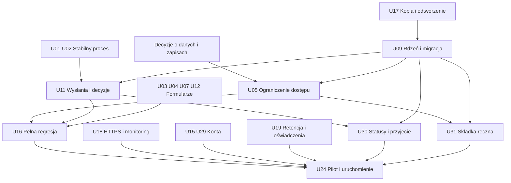

# Ursunalia — plan do publicznych zapisów

Stan: 13.10.2026, audyt HEAD `68737a8`. Termin wydarzenia: **22–24.04.2027**. Data otwarcia zapisów nie została podana. Wersje są proponowanymi milestone, nie istniejącymi wydaniami ani obietnicą daty.

## Cel MVP

Uczestnik rejestruje konto, wypełnia ankiety Ursunaliów, bezpiecznie zapisuje szkic, wraca do niego, wysyła, widzi uwagi i ponownie wysyła poprawki. **Zaakceptowana ankieta postaci oznacza przyjęcie gracza na Ursunalia 2027, bez osobnej decyzji rekrutacyjnej.** Organizator widzi tylko dane zgodne ze swoimi uprawnieniami, obsługuje statusy i ręcznie oznacza wpływ składki przekazanej przelewem na podstawie informacji wysłanych mailem poza systemem. Każda odpowiedź dostępna w podglądzie desktop/mobile. System ma HTTPS, kopię i sprawdzoną procedurę odtworzenia.

MVP nie wymaga kreatora kolejnych wydarzeń, **płatności wbudowanych w aplikację**, grafu relacji, wieloorganizacyjności, osobnej bazy analitycznej ani rozbudowanego panelu profilu postaci. **Ręczna ewidencja składki jest wymagana.** Odrębna encja Character jest w modelu docelowym, ale nie blokuje przyjmowania ankiet.

## Etapy i warunki wyjścia

| Milestone | Zakres | Warunek zakończenia | Zależności |
|---|---|---|---|
| **v27.3 — stabilizacja procesu** | U01/U02/U03/U04/U06/U07/U08/U12/U16/U21; U20 porządek dokumentacji | Świadome, audytowane decyzje organizatora również wobec roboczego szkicu, bez fałszywej informacji o wysłanych odpowiedziach i bez cichej utraty danych; kompletna karta mobile; działający pełny E2E na istniejącym modelu; uzgodniona struktura generatora. | Decyzje D07/D08/D11; testy wykonywane wraz z poprawkami. |
| **v28.0 — minimalny rdzeń, typy kont i prywatność** | U09/U10/U05/U33 | Jedno wydarzenie, typy kont `participant/organizer/administrator`, globalne uprawnienia Administratora i kontrola dostępu do grup danych; zachowana baza, ograniczony odczyt poufnych pól. | C15/C17, D03/D04/D15/D16, kopia i rehearsal migracji; U17 wcześniej. |
| **v28.1 — zgłoszenia i konfigurowalne role** | U11/U14/U19/U23/**U30/U31/U32/U34/U35**; U13 warunkowo; U22 opcjonalnie | Snapshoty, siedem statusów i wznowienie `withdrawn`; lista przyjętych; globalny profil konta, **role per wydarzenie z prawami read/write** (C12/C16), ręczne składki, kontrolowane eksporty i katalog postaci: **publiczna nazwa/opis/zdjęcie dla wszystkich**, opcjonalne kontakty widoczne **dla każdego zalogowanego użytkownika**, wyłącznie jeśli właściciel globalnie je udostępnił (C20/C21/C25/C27/C29), a także **samodzielna edycja opisu i zdjęcia publicznej wizytówki z natychmiastową publikacją** bez resubmit oraz **fizycznym kasowaniem poprzedniego pliku zdjęcia** z aktywnego serwera (C30/C31/C32/U35). | U09/U05/U11/U23/U32/U33, D06/D09/D16/D17/D18. Zakres ról C18/D21 zatwierdzony. Postacie `rejected`/`withdrawn` ukryte (C22); `changes` z ostatniego faktycznego wysłania (C23). Decyzja **C29/D25c zastępuje** dawny wymóg submit C26/D25a i utratę dostępu odbiorcy C28/D25b: uprawnienie kontaktowe to **ważna sesja**, bez zgłoszenia na wydarzenie. Brak dostępu do nieudostępnionych pól. C30/D27a i C31/D27b: edycja opisu i portretu działa bez zmiany statusu i od razu po zapisie, bez moderacji; C32/D27c: każde zastąpione zdjęcie oraz miniatury fizycznie usuwać z aktywnego storage, bez galerii i odzyskiwania starego obrazu ze snapshotu. Wymaga bezpiecznej migracji mediów i cleanup U35, niezależnie od późniejszego U27; kopie zapasowe wg D06/U19/U17. |
| **v29.0 — uruchomienie** | U15/U17/U18/U29/U24 oraz regresja U16 | Staging HTTPS, backup/restore, odzyskanie dostępu, monitoring, pilot i zatwierdzony start zapisów. | Wszystkie P0 i wymagane P1; właściciele operacyjni i D01/D02/D14. |
| **Po Ursunaliach** | U25/U26/U27/U28 i pozostałe P2 zależnie od wyników | Decyzja o kontynuacji platformy po ocenie wydarzenia; **U25: tworzenie wydarzeń wyłącznie przez Administratora albo Organizatora z uprawnieniem `events.create` nadanym przez Administratora, z automatycznym przypisaniem twórcy jako Organizatora nowego wydarzenia (C19/D22)**. | Retrospektywa i realne potrzeby; poza MVP zapisów na Ursunalia 2027. |

Zmiana względem wstępnego planu: prywatność i kontrola poprawności decyzji trafiają przed produkcyjne zapisy; osobna Character oraz pełny kreator wydarzeń nie są obowiązkowym etapem v28.0. HTTPS, backup i E2E przygotowujemy wcześnie, choć ich finalny odbiór następuje w v29.0.

## Krytyczna ścieżka

U17 ma dwa odbiory: projekt i działająca kopia **przed migracją**, następnie automatyzacja i pełny test odtworzenia **przed otwarciem**. Nie powstaje zależność cykliczna od całego v29.0. Analogicznie U16 powstaje w v27.3 i jest rozszerzane o nowy model aż do pilotażu.

## Pierwszych 15 zadań implementacyjnych

Kolejność jest priorytetem pobierania pracy; zadania zależne od decyzji mogą być przesunięte za gotową pracę niezależną.

1. **U01** — odróżnić świadomą zmianę statusu przez organizatora od potwierdzenia treści wysłania; ostrzeżenie i historia zamiast zakazu przejścia.
2. **U02** — stan zapisu per zgłoszenie i ochrona przed starym zapisem z drugiej karty.
3. **U03** — pełne, wspólne podsumowanie odpowiedzi na telefonie i desktopie.
4. **U04** — zaostrzyć walidację definicji i portretów.
5. **U07** — trwałe błędy zapisu, reconciliation po timeout/401/409/422.
6. **U06** — bramka zapisów i reguły aktualnej/starej rewizji.
7. **U12** — jawne kopiowanie formularza i kontrola publikacji ze starego szkicu.
8. **U16** — prawdziwy proces E2E uczestnik/organizator; zacząć szkielet wcześniej równolegle z U01.
9. **U21** — zatwierdzona struktura generatora, następnie spójność katalogów; nie rozpoczynać od przerabiania opisów.
10. **U17** — kopia i próba odtworzenia jako warunek migracji; automatyzacja będzie kontynuowana później.
11. **U09** — minimalny Event/Form i migracja istniejących rewizji.
12. **U10** — rodzaj formularza i ogólny renderer, usunięcie zależności od konkretnego ID.
13. **U33** — trzy bazowe typy kont i globalny Administrator; rozpocząć przed pełnym U14 i U05.
14. **U05** — egzekwowanie na serwerze odczytu/edycji grup danych, globalny Administrator i filtrowanie; projekt polityki od początku, realne dane dopiero po odbiorze.
15. **U11** — snapshoty wysłań i historia decyzji.
16. **U14** — edytor niestandardowych ról i praw read/write, przypisanych tylko do danego wydarzenia (C18/D21), bez możliwości nadania Administratora.
17. **U30** — siedem statusów, uczestnictwo wynikające z zaakceptowanej postaci, dowolne zmiany organizatora oraz wznawianie `withdrawn`.
18. **U31** — ręczne potwierdzanie składki dla użytkownika i wydarzenia; historia zmian i uprawnienia organizatora.
19. **U32** — profil danych kontaktowych globalnie przy koncie, pola rejestracji i edycja profilu oraz kontrola odczytu/edycji grup danych.
20. **U34** — publiczny katalog postaci z nazwą, opisem i zdjęciem, a dla **wszystkich zalogowanych kont** dodatkowo tylko opcjonalne dane globalnie udostępnione przez właściciela. Nie wymagamy wysłania formularza ani statusu wydarzenia **odbiorcy**; wciąż ukrywamy wpisy postaci `rejected`/`withdrawn`.
21. **U35** — samodzielna edycja publicznego opisu i portretu już po wysłaniu, **widoczna natychmiast** bez moderacji/resubmit; po wgraniu nowego obrazu **fizycznie usunąć stary** z aktywnego serwera wraz z miniaturami, z kontrolą wersji, cleanup i audytem, bez utrzymywania starych binariów w snapshotach. Zatwierdzone C30/C31/C32.

Następnie U08/U15/U18/U19/U23/U29/U24 domykają gotowość. **U30, U31, U32, U33 i U14 (typy kont + role niestandardowe) są wymagane przed pierwszymi prawdziwymi zapisami; U34 i U35 muszą być odebrane przed udostępnieniem katalogu z samodzielną edycją wizytówki.** U35 wymaga sprawdzenia fizycznego usuwania starych plików i miniaturek, rozdzielenia binariów od snapshotów oraz procedury odtwarzania backupu bez ponownego ujawnienia usuniętych obrazów. Testy powinny rozróżniać anonimowy podgląd publiczny, zalogowanego bez własnego zgłoszenia (widzi wyłącznie kontakty dobrowolnie udostępnione) oraz wylogowanie (kontakty przestają być widoczne), a także status **samej postaci w katalogu**. Kontakty włączane globalnie przez właściciela nie stają się dostępne anonimowo. U08 i przygotowanie U18 można wykonać niezależnie od migracji. Nie zbierać poufnych danych przed odbiorem U05.

## Praca równoległa i ryzyko

| Strumień | Zadania | Uwagi |
|---|---|---|
| Formularze/UX | U03/U04/U12/U21 | U03 ma uzgodnić kontrakt generic summary z U10. |
| Proces danych | U01/U02/U07/U09/U11 | Wysokie ryzyko regresji, wspólny właściciel API i migracji. |
| Operacje | U17/U18, dostawca email dla U29 | Nie wymaga gotowego kreatora wydarzeń. |
| Polityka i treść | D01/D03/D06/D07, U19 | Wymaga właściciela produktu; część prawna do właściwej weryfikacji. |
| Testy | U16 oraz testy każdego zadania | E2E przyrasta z funkcjami; nie odkładać całej walidacji na koniec. |

Najwyższe ryzyko: migracja rewizji/odpowiedzi (U09/U11), nowy RBAC i typ Administrator (U05/U14/U33), zmiana DTO prywatności (U05), konflikty zapisu i auth (U02/U07/U15/U29). Każdy etap migrujący bazę wymaga kopii i sprawdzenia powrotu. Same poprawki UI mają mniejsze ryzyko danych, ale mogą blokować wysłanie na telefonie.

## Harmonogram względny

**T = zatwierdzona data otwarcia zapisów**, a nie data wydarzenia. Propozycja do planowania, nie uzgodniony harmonogram:

- przed T−4 tygodnie: zamknięte główne funkcje MVP i migracja, staging z HTTPS;
- T−4 do T−2 tygodni: pilot z małą grupą uczestników i co najmniej dwoma organizatorami, test wsparcia oraz odtworzenia;
- T−2 tygodnie do T: poprawki, regresja, zatwierdzone treści i kanał pomocy;
- T: kontrolowane otwarcie, obserwacja błędów i zapisów;
- po T: ograniczyć zmiany schematu do uzasadnionych potrzeb; przed wydarzeniem przygotować minimalny eksport operacyjny z zasadami dostępu.

Jeżeli pilot ujawni P0, przesunąć T lub ograniczyć zbierane dane/funkcje. Nie pomijać ochrony danych, kopii czy testów, aby utrzymać niezatwierdzoną datę. Rozmiary XS/S/M/L w backlogu oznaczają złożoność, nie czas; brak danych o dostępności zespołu uniemożliwia rzetelne zobowiązanie kalendarzowe.

## Warunki otwarcia i ograniczenia pilota

- Wszystkie P0 zamknięte; P1 zweryfikowane dla publicznego zakresu, w tym U30 (przyjęcie/statusy), U31 (ręczne potwierdzenie składki), U32 (globalny profil konta) i U34 (katalog postaci), jeżeli ma być dostępny w MVP. Zakres ewentualnie wyłączonej funkcji i właściciel decyzji zapisani w DECISIONS.
- Pełny E2E na staging oraz testy Firefox/WebKit/Chromium, telefon fizyczny i klawiatura. Nie wymagamy pełnej automatyzacji wszystkich urządzeń, ale wynik kontroli musi być zapisany.
- Backup odtworzony na pustym środowisku, zweryfikowana kompletność odpowiedzi; procedura ma właściciela.
- Brak poufnych danych w listach bez uprawnienia, publicznych zasobach i logach. Pilot początkowo używa fikcyjnych danych.
- Pełna informacja dla uczestników, uzgodniona retencja, kanał odzyskania dostępu i pomocy.
- Osoba odpowiedzialna obserwuje problemy i potrafi zamknąć nowe zapisy bez utraty szkiców/poprawek.
- Test: zaakceptowanie postaci daje udział niezależnie od flagi składki; formularz logistyczny nie daje udziału; Administrator globalny może oznaczyć przelew i cofnąć oznaczenie z audytem, a zwykły Organizator lub rola niestandardowa wymaga uprawnienia `contributions.write`.
- Organizator przygotował instrukcję przelewu do wysłania e-mailem poza systemem. Nie deklarować automatycznych maili lub potwierdzenia bankowego.

## Odłożone po wydarzeniu

Wizualny kreator wydarzeń, dodatkowe reguły warunkowe, biblioteka formularzy, wiele postaci osoby, graf relacji, zarządzanie fabułą, profile i raporty zbiorcze, **automatyczne płatności i integracje bankowe**, osobne magazyny plików, współedycja na żywo, wielojęzyczność. Osobny Character można wdrożyć wcześniej wyłącznie, jeśli konkretna potrzeba pracy fabularnej to uzasadni — nie dlatego, że występuje w docelowym ERD.

Źródła: [FUNCTIONAL_SPEC](../product/FUNCTIONAL_SPEC.md), [DATA_MODEL](../architecture/DATA_MODEL.md), [BACKLOG](BACKLOG.md), [DECISIONS](DECISIONS.md).
