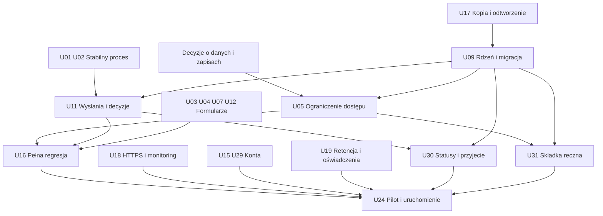

# Ursunalia — plan do publicznych zapisów

Stan: 13.10.2026, audyt HEAD `68737a8`. Termin wydarzenia: **22–24.04.2027**. Data otwarcia zapisów nie została podana. Wersje są proponowanymi milestone, nie istniejącymi wydaniami ani obietnicą daty.

## Cel MVP

Uczestnik rejestruje konto, wypełnia ankiety Ursunaliów, zapisuje szkic i wysyła. **Każda osoba tworzy najwyżej jedną postać na wydarzenie**, niezależnie od liczby ankiet character; formularz logistyczny jest osobny (C41/D04). **Po pierwszym prawdziwym wysłaniu formularza postaci dostaje panel tej samej postaci, który pozwala edytować bieżącą kartę bez ponownego korzystania z formularza** (C35/U36). **C37:** Organizator może jedną flagą zablokować całą kartę, także zbiorczo wszystkie istniejące postacie z listy graczy; **C38:** nie prowadzimy historii kolejnych edycji pól, tylko aktualne wartości. Zachowujemy odrębną historię faktycznych wysłań, statusów, składek i decyzji/blokad. **Zaakceptowana ankieta postaci oznacza przyjęcie na Ursunalia 2027.** Organizator widzi tylko dozwolone informacje, obsługuje statusy i ręcznie oznacza wpływ składki przekazanej przelewem na podstawie informacji spoza systemu. Podglądy desktop/mobile, HTTPS, kopia i sprawdzona procedura odtworzenia pozostają wymagane.

MVP nie wymaga kreatora kolejnych wydarzeń, **płatności wbudowanych w aplikację**, grafu relacji, wieloorganizacyjności, osobnej bazy analitycznej ani osobnej pełnej encji `Character` w bazie. **Podstawowy panel postaci U36 po pierwszym submit jest jednak wymagany w MVP**. Limit jednej postaci na uczestnika w obrębie wydarzenia C41 musi być egzekwowany przez U09 przed publicznymi zapisami. Ręczna ewidencja składki jest wymagana. Odrębna pełna encja `Character` U26 pozostaje późniejszą opcją architektoniczną i nie blokuje panelu.

## Etapy i warunki wyjścia

| Milestone | Zakres | Warunek zakończenia | Zależności |
|---|---|---|---|
| **v27.3 — stabilizacja procesu** | U01/U02/U03/U04/U06/U07/U08/U12/U16/U21; U20 porządek dokumentacji | Świadome, audytowane decyzje organizatora również wobec roboczego szkicu, bez fałszywej informacji o wysłanych odpowiedziach i bez cichej utraty danych; kompletna karta mobile; działający pełny E2E na istniejącym modelu; **C42/D07a:** cechy bez domyślnego min/max, opcjonalne limity w kreatorze, a pozostała struktura generatora/haki – D07b. | Decyzje C42/D07a, D07b, D08/D11; testy wykonywane wraz z poprawkami. |
| **v28.0 — minimalny rdzeń, typy kont i prywatność** | U09/U10/U05/U33 | Jedno wydarzenie, **C41/D04: maksymalnie jedna postać na parę użytkownik–wydarzenie (także szkic/odrzucona/wycofana, ponad wieloma formularzami character)**, typy kont `participant/organizer/administrator`, globalne uprawnienia Administratora i kontrola dostępu do grup danych; zachowana baza, ograniczony odczyt poufnych pól. | C15/C17, D03/C41-D04/D15/D16, kopia i rehearsal migracji; U17 wcześniej. |
| **v28.1 — zgłoszenia i konfigurowalne role** | U11/U14/U19/U23/**U30/U31/U32/U34/U35/U36**; U13 warunkowo; U22 opcjonalnie | Snapshoty realnych wysłań, siedem statusów i wznowienie `withdrawn`, lista przyjętych, globalny profil, role per wydarzenie read/write, ręczne składki, kontrolowane eksporty. Katalog publicznie pokazuje nazwę/opis/zdjęcie; zalogowani widzą tylko kontakty udostępnione globalnie przez właściciela (C20/C21/C25/C27/C29). **Panel postaci powstaje po pierwszym wysłaniu**, pozwala na swobodną edycję bieżących danych fabularnych i publicznych bez resubmit i dodatkowej akceptacji. **Organizator może zablokować całą kartę pojedynczo albo zbiorczo wszystkie zaznaczone postacie z listy (w tym przez „Zaznacz wszystkie”, niezależnie od paginacji).** Nie ma historii kolejnych edycji treści postaci (C38); pozostają historyczne wysłania, statusy i audyt operacji blokowania. Edycja nazwy nie wysyła alertu, stare zdjęcia są fizycznie usuwane z aktywnego serwera (C32/C34). | U09/U05/U11/U23/U32/U33, D06/D09/D16/D17/D18. Wszystkie edytory postaci, w tym U35, muszą serwerowo sprawdzać `character_edit_locked` (C37). Uprawnienie `characters.edit_lock.manage` jest per-event. Bulk działa na wszystkich istniejących postaciach wydarzenia, nie tylko na stronie listy. **D28c i D28e zamknięte:** blokada obejmuje całą kartę, a zbiorcza akcja działa tylko na **istniejących postaciach**. Nowe zgłoszenia pozostają domyślnie odblokowane (C39). Brak per-field historii C38 nie oznacza usunięcia rzeczywistych immutable `submissions` i historii decyzji/statusów. |
| **Archiwum po wydarzeniu i nowe zgłoszenie na podstawie archiwum** | **U37/U39** – archiwizacja przez gracza/Organizatora, ponowne użycie danych | **C43/C47:** archiwalna karta jest **tylko do odczytu**, bez odarchiwizowania i przywrócenia. Właściciel widzi ją w „Moje konto → Archiwum postaci” i może **„Użyć jako podstawy nowego zgłoszenia”**. Powstaje nowy `draft` z nowym `applicationId`, wypełniony zgodnymi danymi dozwolonymi przez nowy schemat, bez statusów, wpłat, zgód i wrażliwych danych z archiwum. | **C41:** źródło nadal zajmuje miejsce na swoim wydarzeniu, a nowe zgłoszenie musi mieć wolny slot i otwarte zapisy; nie reaktywować źródłowej aplikacji. U37/U39 zależą od kontroli dostępu i schematów; **D29d zamknięte**, D29e otwarte co do szczegółów danych i portretu. |
| **Trwałe usuwanie postaci** | **U38**, po D06/U19 i odbiorze kasowania | **C44/C45/C46:** po usunięciu właściciel może utworzyć nową postać na tym samym wydarzeniu. **Usuwamy trwale z aktywnego systemu fabułę, nazwę, publiczny opis, zdjęcie oraz kopie danych postaci w szkicach i historycznych wysłaniach**, aktualnym magazynie, cache, indeksach i kontrolowanych eksportach; nie zachowujemy ich w archiwum postaci. Historyczne metadane organizacyjne i rozliczeniowe pozostają jedynie w niezbędnym zakresie, bez fabuły. | **D29c2 zamknięta (C46). D06/U19 pozostają wymagane** dla zakresu i okresów minimalnej retencji, backupów i obowiązków; kasowanie dopiero po testach cleanup, retry, migracji legacy i restore. Miejsce C41 zwolnić po zweryfikowanym usunięciu. |
| **v29.0 — uruchomienie** | U15/U17/U18/U29/U24 oraz regresja U16 | Staging HTTPS, backup/restore, odzyskanie dostępu, monitoring, pilot i zatwierdzony start zapisów. | Wszystkie P0 i wymagane P1; właściciele operacyjni i D01/D02/D14. |
| **Po Ursunaliach** | U25/U26/U27/U28 i pozostałe P2 zależnie od wyników | Decyzja o kontynuacji platformy po ocenie wydarzenia; **U25: tworzenie wydarzeń wyłącznie przez Administratora albo Organizatora z uprawnieniem `events.create` nadanym przez Administratora, z automatycznym przypisaniem twórcy jako Organizatora nowego wydarzenia (C19/D22)**. | Retrospektywa i realne potrzeby; poza MVP zapisów na Ursunalia 2027. |

Zmiana względem wstępnego planu: prywatność i kontrola poprawności decyzji trafiają przed produkcyjne zapisy; osobna Character oraz pełny kreator wydarzeń nie są obowiązkowym etapem v28.0. HTTPS, backup i E2E przygotowujemy wcześnie, choć ich finalny odbiór następuje w v29.0.

## Krytyczna ścieżka

U17 ma dwa odbiory: projekt i działająca kopia **przed migracją**, następnie automatyzacja i pełny test odtworzenia **przed otwarciem**. Nie powstaje zależność cykliczna od całego v29.0. Analogicznie U16 powstaje w v27.3 i jest rozszerzane o nowy model aż do pilotażu.

## Pierwszych 15 zadań implementacyjnych

Kolejność jest priorytetem pobierania pracy; zadania zależne od decyzji mogą być przesunięte za gotową pracę niezależną.

1. **U01** — odróżnić świadomą zmianę statusu przez organizatora od potwierdzenia treści wysłania; ostrzeżenie i historia zamiast zakazu przejścia.
2. **U02** — stan zapisu per zgłoszenie i ochrona przed starym zapisem z drugiej karty.
3. **U03** — pełne, wspólne podsumowanie odpowiedzi na telefonie i desktopie.
4. **U04** — zaostrzyć walidację definicji i portretów.
5. **U07** — trwałe błędy zapisu, reconciliation po timeout/401/409/422.
6. **U06** — bramka zapisów i reguły aktualnej/starej rewizji.
7. **U12** — jawne kopiowanie formularza i kontrola publikacji ze starego szkicu.
8. **U16** — prawdziwy proces E2E uczestnik/organizator; zacząć szkielet wcześniej równolegle z U01.
9. **U21** — **C42/D07a:** cechy bez domyślnych limitów, kreator opcjonalnie pozwala ustawić min/max, API sprawdza je z definicji; historyczne rewizje zachowują dotychczasowe limity. **D07b** pozostaje dla pozostałej struktury/haków; dopiero potem opisy tagów.
10. **U17** — kopia i próba odtworzenia jako warunek migracji; automatyzacja będzie kontynuowana później.
11. **U09** — minimalny Event/Form, migracja istniejących rewizji i **limit C41 jednej postaci na konto i wydarzenie**, transakcyjny i zabezpieczony w bazie niezależnie od formularza.
12. **U10** — rodzaj formularza i ogólny renderer, usunięcie zależności od konkretnego ID.
13. **U33** — trzy bazowe typy kont i globalny Administrator; rozpocząć przed pełnym U14 i U05.
14. **U05** — egzekwowanie na serwerze odczytu/edycji grup danych, globalny Administrator i filtrowanie; projekt polityki od początku, realne dane dopiero po odbiorze.
15. **U11** — snapshoty wysłań i historia decyzji.
16. **U14** — edytor niestandardowych ról i praw read/write, przypisanych tylko do danego wydarzenia (C18/D21), bez możliwości nadania Administratora.
17. **U30** — siedem statusów, uczestnictwo wynikające z zaakceptowanej postaci, dowolne zmiany organizatora oraz wznawianie `withdrawn`.
18. **U31** — ręczne potwierdzanie składki dla użytkownika i wydarzenia; historia zmian i uprawnienia organizatora.
19. **U32** — profil danych kontaktowych globalnie przy koncie, pola rejestracji i edycja profilu oraz kontrola odczytu/edycji grup danych.
20. **U34** — publiczny katalog postaci z nazwą, opisem i zdjęciem, a dla **wszystkich zalogowanych kont** dodatkowo tylko opcjonalne dane globalnie udostępnione przez właściciela. Nie wymagamy wysłania formularza ani statusu wydarzenia **odbiorcy**; wciąż ukrywamy wpisy postaci `rejected`/`withdrawn`.
21. **U35** — edycja nazwy, publicznego opisu i portretu w panelu postaci, natychmiastowa tylko jeśli **cała karta jest odblokowana**. Po podmianie zdjęcia poprzedni plik i miniatury są fizycznie usuwane z aktywnego magazynu (C32). Zmiana nazwy nie wyzwala powiadomienia ani nie jest zapisywana w osobnej historii edycji (C34/C38).
22. **U36** — panel po pierwszym submit `character`, swobodna edycja wszystkich fabularnych pól i wizytówki (U35) z bieżącymi wartościami, bez dziennika zmian. **C37: jedna blokada całej karty** (publiczne i fabularne pola), blokowanie/odblokowanie jednego lub wielu rekordów z listy; **C40 (skorygowane): uczestnik widzi kartę tylko do odczytu z informacją „Karta zablokowana”, bez obowiązkowego uzasadnienia lub osobnego powiadomienia**, „Zaznacz wszystkie” obejmujące wszystkie istniejące postacie wydarzenia. Operacyjny audyt lock/unlock niezależny od historii edycji. **C39/D28e:** po bulk-locku później zgłoszona postać jest odblokowana; Organizator może ją zablokować późniejszą operacją.
23. **U37** — archiwizacja gracza i zbiorcza archiwizacja Organizatora po zakończeniu LARPa; „Archiwum postaci” w panelu konta. **C47:** archiwalne postacie pozostają **tylko do odczytu**, nie dają się odarchiwizować, edytować ani przywrócić jako aktywne. To odrębny stan cyklu życia, bez zmiany statusu zgłoszenia i bez zwalniania limitu C41.
24. **U38** — **C44/C45/C46:** przy „Usuń postać” trwale kasować jej fabularne treści, opis, nazwę i zdjęcia z aktywnej bazy/storage, dawnych wysłań, indeksu/cache oraz kontrolowanych eksportów. **Nie pozostawiać fabuły w historycznych snapshotach**: zredagować ją przy usuwaniu, zachowując wyłącznie niezbędne metadane/statusy/rozliczenia wg D06/U19. Po skutecznym cleanup zwolnić miejsce na nowe `applicationId`; w trakcie kasowania nie zwalniać. Backupy zgodnie z oddzielną retencją, po restore ponownie stosować rejestr skasowanych danych. D29c2 zatwierdzona; produkcyjne wdrożenie po D06/U19 oraz testach usuwania i odtwarzania.
25. **U39** — **C47/D29d:** z własnej archiwalnej postaci utworzyć **nowy szkic** w aktualnym formularzu i w wydarzeniu z otwartymi zapisami; mapować wyłącznie zgodne dozwolone pola fabularne. Nowe `applicationId`, brak przeniesienia statusu, decyzji, składki, zgód, prywatnych danych, blokady lub historii. Archiwum źródłowe pozostaje read-only, nie jest przywracane. C41 nie pozwala użyć archiwum jako sposobu posiadania dwóch postaci na tym samym wydarzeniu. D29e do ustalenia szczegółów, zwłaszcza portretu.

Następnie U08/U15/U18/U19/U23/U29/U24 domykają gotowość. **U30, U31, U32, U33 i U14 są wymagane przed pierwszymi prawdziwymi zapisami; U34/U35/U36 przed udostępnieniem kompletnego katalogu i panelu postaci.** U35 wymaga fizycznego usuwania zastąpionych zdjęć i testu migracji mediów z historii. Testy U36: swobodna edycja bieżących pól bez per-edit historii, 403 przy blokadzie w obu API oraz **widoczna informacja „Karta zablokowana” w panelu uczestnika (bez powodu i dodatkowego powiadomienia)**, odblokowanie, blokada wszystkich postaci wydarzenia przy wielu stronach listy, **nowa postać zgłoszona po zablokowaniu starszych zachowuje możliwość edycji**, zachowanie immutable wysłań, statusów i audytu lock/unlock. Testy katalogu: anonimowy nie widzi kontaktów; zalogowany widzi tylko globalnie udostępnione; ukryte `rejected/withdrawn`, a `changes` nie ujawnia roboczych zmian formularza. Nie zbierać poufnych danych przed odbiorem U05. Testy C41 przed startem zapisów: jedna postać nawet przy dwóch formularzach `character`, istniejący szkic/wycofane/odrzucone nadal zajmuje miejsce, własne `logistics` nie zajmuje tego limitu, kolejny event umożliwia odrębną postać, dwie równoczesne próby tworzenia nie dublują aplikacji. **U39:** osobno sprawdzać zakaz edycji/reaktywacji archiwum przez API oraz możliwość utworzenia nowego szkicu ze zgodnymi danymi bez kopiowania zgód, statusów i mediów już usuniętych; utrzymać limit jednej postaci na wydarzenie C41.

## Praca równoległa i ryzyko

| Strumień | Zadania | Uwagi |
|---|---|---|
| Formularze/UX | U03/U04/U12/U21 | U03 ma uzgodnić kontrakt generic summary z U10. |
| Proces danych | U01/U02/U07/U09/U11 | Wysokie ryzyko regresji, wspólny właściciel API i migracji. |
| Operacje | U17/U18, dostawca email dla U29 | Nie wymaga gotowego kreatora wydarzeń. |
| Polityka i treść | D01/D03/D06/D07b/D29e, C42–C47, U19 | Wymaga właściciela produktu; część prawna do właściwej weryfikacji. |
| Testy | U16 oraz testy każdego zadania | E2E przyrasta z funkcjami; nie odkładać całej walidacji na koniec. |

Najwyższe ryzyko: migracja rewizji/odpowiedzi (U09/U11), nowy RBAC i typ Administrator (U05/U14/U33), zmiana DTO prywatności (U05), konflikty zapisu i auth (U02/U07/U15/U29). Każdy etap migrujący bazę wymaga kopii i sprawdzenia powrotu. Same poprawki UI mają mniejsze ryzyko danych, ale mogą blokować wysłanie na telefonie. **Archiwizacja nie kasuje treści postaci, lecz trwałe usunięcie musi wymazać fabułę i portret także ze starych `submissions` (C46), przy ewentualnym zachowaniu tylko minimalnych metadanych organizacyjnych i rozliczeniowych. D29c2 zamknięta; retencja D06/U19 oraz testy backup-restore są nadal blockerem produkcyjnego U38.**

## Harmonogram względny

**T = zatwierdzona data otwarcia zapisów**, a nie data wydarzenia. Propozycja do planowania, nie uzgodniony harmonogram:

- przed T−4 tygodnie: zamknięte główne funkcje MVP i migracja, staging z HTTPS;
- T−4 do T−2 tygodni: pilot z małą grupą uczestników i co najmniej dwoma organizatorami, test wsparcia oraz odtworzenia;
- T−2 tygodnie do T: poprawki, regresja, zatwierdzone treści i kanał pomocy;
- T: kontrolowane otwarcie, obserwacja błędów i zapisów;
- po T: ograniczyć zmiany schematu do uzasadnionych potrzeb; przed wydarzeniem przygotować minimalny eksport operacyjny z zasadami dostępu.

Jeżeli pilot ujawni P0, przesunąć T lub ograniczyć zbierane dane/funkcje. Nie pomijać ochrony danych, kopii czy testów, aby utrzymać niezatwierdzoną datę. Rozmiary XS/S/M/L w backlogu oznaczają złożoność, nie czas; brak danych o dostępności zespołu uniemożliwia rzetelne zobowiązanie kalendarzowe.

## Warunki otwarcia i ograniczenia pilota

- Wszystkie P0 zamknięte; P1 zweryfikowane dla publicznego zakresu, w tym U30 (przyjęcie/statusy), U31 (ręczne potwierdzenie składki), U32 (globalny profil konta) i U34 (katalog postaci), jeżeli ma być dostępny w MVP. Zakres ewentualnie wyłączonej funkcji i właściciel decyzji zapisani w DECISIONS.
- Pełny E2E na staging oraz testy Firefox/WebKit/Chromium, telefon fizyczny i klawiatura. Nie wymagamy pełnej automatyzacji wszystkich urządzeń, ale wynik kontroli musi być zapisany.
- Backup odtworzony na pustym środowisku, zweryfikowana kompletność odpowiedzi; procedura ma właściciela.
- Brak poufnych danych w listach bez uprawnienia, publicznych zasobach i logach. Pilot początkowo używa fikcyjnych danych.
- Pełna informacja dla uczestników, uzgodniona retencja, kanał odzyskania dostępu i pomocy.
- Osoba odpowiedzialna obserwuje problemy i potrafi zamknąć nowe zapisy bez utraty szkiców/poprawek.
- Test: zaakceptowanie postaci daje udział niezależnie od flagi składki; formularz logistyczny nie daje udziału; Administrator globalny może oznaczyć przelew i cofnąć oznaczenie z audytem, a zwykły Organizator lub rola niestandardowa wymaga uprawnienia `contributions.write`.
- Organizator przygotował instrukcję przelewu do wysłania e-mailem poza systemem. Nie deklarować automatycznych maili lub potwierdzenia bankowego.

## Odłożone po wydarzeniu

Wizualny kreator wydarzeń, dodatkowe reguły warunkowe, biblioteka formularzy, wiele postaci osoby, graf relacji, zarządzanie fabułą, profile i raporty zbiorcze, **automatyczne płatności i integracje bankowe**, osobne magazyny plików, współedycja na żywo, wielojęzyczność. Osobny Character można wdrożyć wcześniej wyłącznie, jeśli konkretna potrzeba pracy fabularnej to uzasadni — nie dlatego, że występuje w docelowym ERD.

Źródła: [FUNCTIONAL_SPEC](../product/FUNCTIONAL_SPEC.md), [DATA_MODEL](../architecture/DATA_MODEL.md), [BACKLOG](BACKLOG.md), [DECISIONS](DECISIONS.md).
